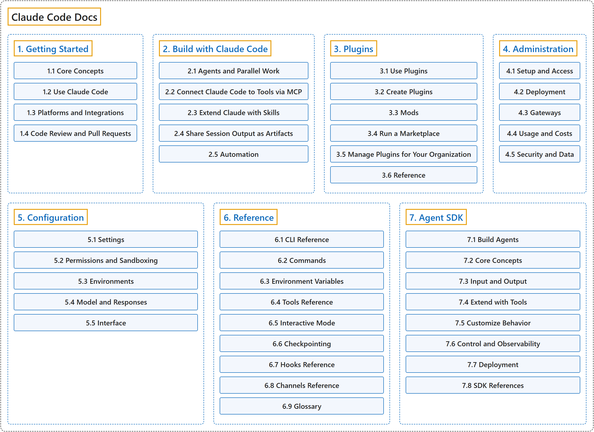

# Claude Code Docs

Official source: [Claude Code Docs](https://code.claude.com/docs/en/overview), Anthropic.

## Classification

## Glossary

| Term | Definition | 中文翻译 | Source |
|---|---|---|---|
| **Claude Code Docs** Claude Code 文档 | (Summary) The **official manual** for **Claude Code, the AI coding assistant**. | （概述）**官方手册**，介绍 **Claude Code 这款 AI 编码助手**。 | [Anthropic, n.d., "Claude Code Docs"](https://code.claude.com/docs/en/overview) |
| **[1. Getting Started](getting-started/index.md)** 入门 | (Summary) The **basic ideas of Claude Code** and **where it can be used**. | （概述）**Claude Code 的基本概念**，以及**可以在哪些地方使用它**。 | [Anthropic, n.d., "Getting Started"](https://code.claude.com/docs/en/overview) |
| **[2. Build with Claude Code](build-with-claude-code/index.md)** 用 Claude Code 构建 | (Summary) Ways to **run several agents at once** and **automate repeated work**. | （概述）**同时运行多个代理**并**自动化重复工作**的方法。 | [Anthropic, n.d., "Build with Claude Code"](https://code.claude.com/docs/en/agents) |
| **[3. Plugins](plugins/index.md)** 插件 | (Summary) **Shareable add-on packages** that **extend Claude Code** with skills, hooks and more. | （概述）**可分享的附加包**，用技能、钩子等**扩展 Claude Code**。 | [Anthropic, n.d., "Plugins"](https://code.claude.com/docs/en/plugins/overview) |
| **[4. Administration](administration/index.md)** 管理 | (Summary) How organizations **roll out Claude Code** and **control its cost and security**. | （概述）组织如何**部署 Claude Code**，并**控制其成本和安全**。 | [Anthropic, n.d., "Administration"](https://code.claude.com/docs/en/admin-setup) |
| **[5. Configuration](configuration/index.md)** 配置 | (Summary) The **settings, permissions and environments** that **decide how Claude Code behaves**. | （概述）**设置、权限和环境**，它们**决定 Claude Code 的行为**。 | [Anthropic, n.d., "Configuration"](https://code.claude.com/docs/en/settings) |
| **[6. Reference](reference/index.md)** 参考 | (Summary) Lookup pages for **commands, variables and tools**, plus the **official glossary**. | （概述）**命令、变量和工具**的查询页，以及**官方术语表**。 | [Anthropic, n.d., "Reference"](https://code.claude.com/docs/en/cli-reference) |
| **[7. Agent SDK](agent-sdk/index.md)** Agent SDK | (Summary) A library that **puts the agent loop of Claude Code** inside **your own programs**. | （概述）把 **Claude Code 的代理循环**放进**你自己的程序**的库。 | [Anthropic, n.d., "Agent SDK"](https://code.claude.com/docs/en/agent-sdk/overview) |

## References

Anthropic. (n.d.). *Claude Code Docs*. Retrieved November 8, 2026, from <https://code.claude.com/docs/en/overview>
