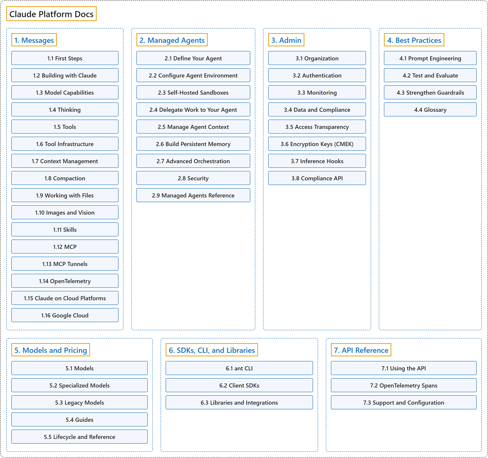

# Claude Platform Docs

Official source: [Claude Platform Docs](https://platform.claude.com/docs/en/home), Anthropic.

## Classification

## Glossary

| Term | Definition | 中文翻译 | Source |
|---|---|---|---|
| **Claude Platform Docs** Claude 平台文档 | (Summary) The **developer documentation** for **building on Claude through its APIs and SDKs**. | （概述）**开发者文档**，介绍如何**通过 API 和 SDK 基于 Claude 构建应用**。 | [Anthropic, n.d., "Claude Platform Docs"](https://platform.claude.com/docs/en/intro) |
| **[1. Messages](messages/index.md)** 消息 | (Summary) The **core API for sending prompts to Claude**, with **tools, context and file features**. | （概述）**向 Claude 发送提示的核心 API**，包含**工具、上下文和文件功能**。 | [Anthropic, n.d., "Messages"](https://platform.claude.com/docs/en/intro) |
| **[2. Managed Agents](managed-agents/index.md)** 托管代理 | (Summary) An **agent runtime hosted by Anthropic**, so you **need not build the loop yourself**. | （概述）**由 Anthropic 托管的代理运行环境**，你**无需自己构建循环**。 | [Anthropic, n.d., "Managed Agents"](https://platform.claude.com/docs/en/managed-agents/overview) |
| **[3. Admin](admin/index.md)** 管理 | (Summary) APIs for **running an organization on the platform**: **members, keys, usage and compliance**. | （概述）**管理平台上组织**的 API：**成员、密钥、用量和合规**。 | [Anthropic, n.d., "Admin"](https://platform.claude.com/docs/en/manage-claude/admin-api) |
| **[4. Best Practices](best-practices/index.md)** 最佳实践 | (Summary) Guidance on **writing better prompts** and **measuring and protecting results**. | （概述）关于**写出更好的提示**，以及**衡量和保护结果**的指南。 | [Anthropic, n.d., "Best Practices"](https://platform.claude.com/docs/en/build-with-claude/prompt-engineering/overview) |
| **[5. Models and Pricing](models-and-pricing/index.md)** 模型与定价 | (Summary) The **current and older Claude models**, with **how to choose among them and what they cost**. | （概述）**现有和旧版 Claude 模型**，以及**如何选择和费用**。 | [Anthropic, n.d., "Models and Pricing"](https://platform.claude.com/docs/en/models/overview) |
| **[6. SDKs, CLI, and Libraries](sdks-cli-and-libraries/index.md)** SDK、CLI 与库 | (Summary) The **official command-line tool and client libraries** for **calling the API from code**. | （概述）**官方命令行工具和客户端库**，用于**从代码调用 API**。 | [Anthropic, n.d., "SDKs, CLI, and Libraries"](https://platform.claude.com/docs/en/cli-sdks-libraries/overview) |
| **[7. API Reference](api-reference/index.md)** API 参考 | (Summary) The **REST interface details**, including **versions, rate limits and regions**. | （概述）**REST 接口的细节**，包括**版本、速率限制和地区**。 | [Anthropic, n.d., "API Reference"](https://platform.claude.com/docs/en/api/overview) |

## References

Anthropic. (n.d.). *Claude Platform Docs*. Retrieved November 8, 2026, from <https://platform.claude.com/docs/en/home>
