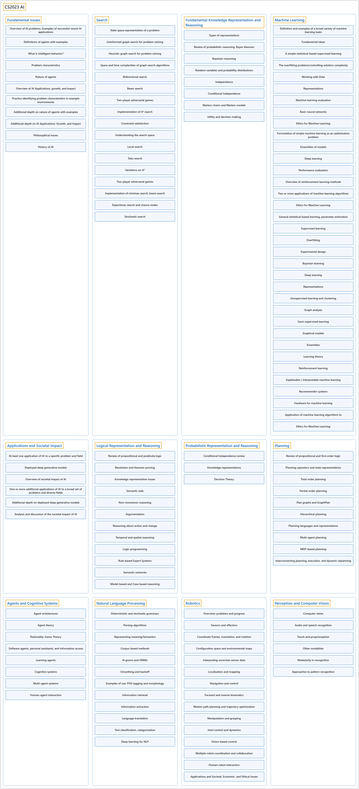

# CS2023 AI

## Classification

## Glossary

| Term | Definition | 中文翻译 | Source |
|---|---|---|---|
| **CS2023 AI** CS2023 AI | "Artificial intelligence (AI) studies **problems that are difficult or impractical to solve with traditional algorithmic approaches**." | 人工智能（AI）研究**用传统算法方法难以解决或无法实际解决的问题**。 | [Joint Task Force on Computing Curricula, 2024, AI "Preamble" section, para. 1](https://csed.acm.org/wp-content/uploads/2024/04/3.1-Body-of-Knowledge-1.pdf#page=3) |
| **[Fundamental Issues](fundamental-issues/index.md)** 基本问题 | (context) "Describe the **Turing test** and the “**Chinese Room**” thought experiment." | （语境）描述**图灵测试**和“**中文屋**”思想实验。 | [Joint Task Force on Computing Curricula, 2024, AI-Introduction "Illustrative Learning Outcomes", 1](https://csed.acm.org/wp-content/uploads/2024/04/3.1-Body-of-Knowledge-1.pdf#page=6) |
| **[Search](search/index.md)** 搜索 | (context) "Design the **state space representation** for a puzzle (e.g., N-queens or 3-jug problem)" | （语境）为一个谜题设计**状态空间表示**（例如 N 皇后问题或三水壶问题） | [Joint Task Force on Computing Curricula, 2024, AI-Search "Illustrative Learning Outcomes", 1](https://csed.acm.org/wp-content/uploads/2024/04/3.1-Body-of-Knowledge-1.pdf#page=7) |
| **[Fundamental Knowledge Representation and Reasoning](fundamental-knowledge-representation-and-reasoning/index.md)** 知识表示与推理基础 | (context) "Given a natural language problem statement, encode it as a **symbolic or logical representation**." | （语境）给定一个用自然语言描述的问题，把它编码成**符号表示或逻辑表示**。 | [Joint Task Force on Computing Curricula, 2024, AI-KRR "Illustrative Learning Outcomes", 1](https://csed.acm.org/wp-content/uploads/2024/04/3.1-Body-of-Knowledge-1.pdf#page=8) |
| **[Machine Learning](machine-learning/index.md)** 机器学习 | (context) "Describe the differences among the **three main styles of learning (supervised, reinforcement, and unsupervised)** and determine which is appropriate to a particular problem domain." | （语境）描述**三种主要学习方式**（监督学习、强化学习和无监督学习）之间的区别，并判断哪一种适合特定的问题领域。 | [Joint Task Force on Computing Curricula, 2024, AI-ML "Illustrative Learning Outcomes", 1](https://csed.acm.org/wp-content/uploads/2024/04/3.1-Body-of-Knowledge-1.pdf#page=12) |
| **[Applications and Societal Impact](applications-and-societal-impact/index.md)** 应用与社会影响 | (context) "Given a real-world application domain and problem, **formulate an AI solution** to it, identifying proper data/input, preprocessing, representations, AI techniques, and evaluation metrics/methodology." | （语境）给定一个现实应用领域和问题，为它**构建 AI 解决方案**，确定合适的数据/输入、预处理、表示、AI 技术以及评估指标/方法。 | [Joint Task Force on Computing Curricula, 2024, AI-SEP "Illustrative Learning Outcomes", 1](https://csed.acm.org/wp-content/uploads/2024/04/3.1-Body-of-Knowledge-1.pdf#page=14) |
| **[Logical Representation and Reasoning](logical-representation-and-reasoning/index.md)** 逻辑表示与推理 | (context) "Translate a natural language (e.g., English) sentence into a **predicate logic statement**." | （语境）把一句自然语言（例如英语）句子翻译成**谓词逻辑语句**。 | [Joint Task Force on Computing Curricula, 2024, AI-LRR "Illustrative Learning Outcomes", 1](https://csed.acm.org/wp-content/uploads/2024/04/3.1-Body-of-Knowledge-1.pdf#page=15) |
| **[Probabilistic Representation and Reasoning](probabilistic-representation-and-reasoning/index.md)** 概率表示与推理 | (context) "Compute the **probability of a hypothesis given the evidence** in a **Bayesian network**." | （语境）在**贝叶斯网络**中计算**给定证据下某个假设的概率**。 | [Joint Task Force on Computing Curricula, 2024, AI-Probability "Illustrative Learning Outcomes", 1](https://csed.acm.org/wp-content/uploads/2024/04/3.1-Body-of-Knowledge-1.pdf#page=16) |
| **[Planning](planning/index.md)** 规划 | (context) "Construct the **state representation, goal, and operators** for a given planning problem." | （语境）为给定的规划问题构建**状态表示、目标和操作符**。 | [Joint Task Force on Computing Curricula, 2024, AI-Planning "Illustrative Learning Outcomes", 1](https://csed.acm.org/wp-content/uploads/2024/04/3.1-Body-of-Knowledge-1.pdf#page=16) |
| **[Agents and Cognitive Systems](agents-and-cognitive-systems/index.md)** 智能体与认知系统 | (context) "Characterize and contrast the **standard agent architectures**." | （语境）刻画并对比**标准的智能体架构**。 | [Joint Task Force on Computing Curricula, 2024, AI-Agents "Illustrative Learning Outcomes", 1](https://csed.acm.org/wp-content/uploads/2024/04/3.1-Body-of-Knowledge-1.pdf#page=17) |
| **[Natural Language Processing](natural-language-processing/index.md)** 自然语言处理 | (context) "Define and contrast **deterministic and stochastic grammars**, providing examples to show the adequacy of each." | （语境）定义并对比**确定性文法和随机文法**，并举例说明各自的适用性。 | [Joint Task Force on Computing Curricula, 2024, AI-NLP "Illustrative Learning Outcomes", 1](https://csed.acm.org/wp-content/uploads/2024/04/3.1-Body-of-Knowledge-1.pdf#page=18) |
| **[Robotics](robotics/index.md)** 机器人 | (context) "List **capabilities and limitations of today's state-of-the-art robot systems**, including their sensors and the crucial sensor processing that informs those systems." | （语境）列出**当今最先进机器人系统的能力和局限**，包括它们的传感器以及为这些系统提供信息的关键传感器处理。 | [Joint Task Force on Computing Curricula, 2024, AI-Robotics "Illustrative Learning Outcomes", 1](https://csed.acm.org/wp-content/uploads/2024/04/3.1-Body-of-Knowledge-1.pdf#page=19) |
| **[Perception and Computer Vision](perception-and-computer-vision/index.md)** 感知与计算机视觉 | (context) "Summarize the **importance of image and object recognition in AI** and indicate several significant applications of this technology." | （语境）概述**图像和物体识别在 AI 中的重要性**，并指出这项技术的几个重要应用。 | [Joint Task Force on Computing Curricula, 2024, AI-Vision "Illustrative Learning Outcomes", 1](https://csed.acm.org/wp-content/uploads/2024/04/3.1-Body-of-Knowledge-1.pdf#page=20) |

## References

Joint Task Force on Computing Curricula. (2024). *Computer science curricula 2023*. Association for Computing Machinery. <https://doi.org/10.1145/3664191>
