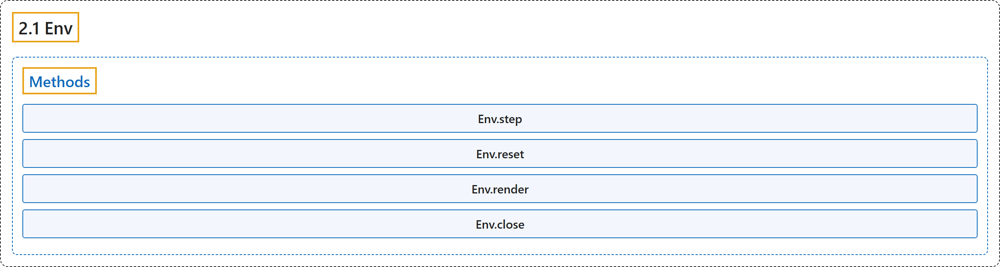

# 2.1 Env

## Classification

## Glossary

| Term | Definition | 中文翻译 | Source |
|---|---|---|---|
| **2.1 Env** 环境 | "**The main Gymnasium class for implementing Reinforcement Learning Agents environments.**" | **Gymnasium 中用于实现强化学习智能体环境的主类。** | [Farama Foundation, n.d., "gymnasium.Env", para. 1](https://gymnasium.farama.org/api/env/#gymnasium.Env) |
| **Methods** 方法 | (No definition) | （无定义） | [Farama Foundation, n.d., "Methods"](https://gymnasium.farama.org/api/env/#methods) |
| **Env.step** step 方法 | "**Run one timestep of the environment’s dynamics using the agent actions.**" | **用智能体的动作让环境的动力学运行一个时间步。** | [Farama Foundation, n.d., "gymnasium.Env.step", para. 1](https://gymnasium.farama.org/api/env/#gymnasium.Env.step) |
| **Env.reset** reset 方法 | "**Resets the environment to an initial internal state, returning an initial observation and info.**" | **把环境重置到初始内部状态，返回初始观测和信息。** | [Farama Foundation, n.d., "gymnasium.Env.reset", para. 1](https://gymnasium.farama.org/api/env/#gymnasium.Env.reset) |
| **Env.render** render 方法 | "**Compute the render frames** as specified by render_mode during the initialization of the environment." | **计算渲染帧**，按环境初始化时 render_mode 的指定进行。 | [Farama Foundation, n.d., "gymnasium.Env.render", para. 1](https://gymnasium.farama.org/api/env/#gymnasium.Env.render) |
| **Env.close** close 方法 | "After the user has finished using the environment, close **contains the code necessary to “clean up” the environment**." | 用户用完环境后，close **包含“清理”环境所需的代码**。 | [Farama Foundation, n.d., "gymnasium.Env.close", para. 1](https://gymnasium.farama.org/api/env/#gymnasium.Env.close) |

## References

Farama Foundation. (n.d.). *Env*. Gymnasium Documentation (Version 1.4.0). Retrieved October 31, 2026, from <https://gymnasium.farama.org/api/env/>
