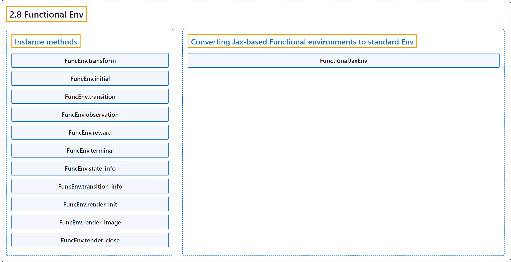

# 2.8 Functional Env

## Classification

## Glossary

| Term | Definition | 中文翻译 | Source |
|---|---|---|---|
| **2.8 Functional Env** 函数式环境 | (context) "**Base class (template) for functional envs.**" | （语境）**函数式环境的基类（模板）。** | [Farama Foundation, n.d., "gymnasium.experimental.functional.FuncEnv", para. 1](https://gymnasium.farama.org/api/functional/#gymnasium.experimental.functional.FuncEnv) |
| **Instance methods** 实例方法 | (context) "A functional env consists of **the following functions (in this case, instance methods)**:" | （语境）函数式环境的组成是**以下函数（这里是实例方法）**： | [Farama Foundation, n.d., "gymnasium.experimental.functional.FuncEnv", para. 2](https://gymnasium.farama.org/api/functional/#gymnasium.experimental.functional.FuncEnv) |
| **FuncEnv.transform** transform 方法 | "**Functional transformations.**" | **函数式变换。** | [Farama Foundation, n.d., "gymnasium.experimental.functional.FuncEnv.transform", para. 1](https://gymnasium.farama.org/api/functional/#gymnasium.experimental.functional.FuncEnv.transform) |
| **FuncEnv.initial** initial 方法 | "**Generates the initial state of the environment with a random number generator.**" | **用随机数生成器生成环境的初始状态。** | [Farama Foundation, n.d., "gymnasium.experimental.functional.FuncEnv.initial", para. 1](https://gymnasium.farama.org/api/functional/#gymnasium.experimental.functional.FuncEnv.initial) |
| **FuncEnv.transition** transition 方法 | "**Updates (transitions) the state with an action and random number generator.**" | **用动作和随机数生成器更新（转移）状态。** | [Farama Foundation, n.d., "gymnasium.experimental.functional.FuncEnv.transition", para. 1](https://gymnasium.farama.org/api/functional/#gymnasium.experimental.functional.FuncEnv.transition) |
| **FuncEnv.observation** observation 方法 | "**Generates an observation for a given state of an environment.**" | **为环境的给定状态生成观测。** | [Farama Foundation, n.d., "gymnasium.experimental.functional.FuncEnv.observation", para. 1](https://gymnasium.farama.org/api/functional/#gymnasium.experimental.functional.FuncEnv.observation) |
| **FuncEnv.reward** reward 方法 | "**Computes the reward for a given transition between state, action to next_state.**" | **计算从 state 经 action 到 next_state 这一给定转移的奖励。** | [Farama Foundation, n.d., "gymnasium.experimental.functional.FuncEnv.reward", para. 1](https://gymnasium.farama.org/api/functional/#gymnasium.experimental.functional.FuncEnv.reward) |
| **FuncEnv.terminal** terminal 方法 | "**Returns if the state is a final terminal state.**" | **返回该状态是否为最终的终止状态。** | [Farama Foundation, n.d., "gymnasium.experimental.functional.FuncEnv.terminal", para. 1](https://gymnasium.farama.org/api/functional/#gymnasium.experimental.functional.FuncEnv.terminal) |
| **FuncEnv.state_info** state_info 方法 | "**Info dict about a single state.**" | **关于单个状态的信息字典。** | [Farama Foundation, n.d., "gymnasium.experimental.functional.FuncEnv.state_info", para. 1](https://gymnasium.farama.org/api/functional/#gymnasium.experimental.functional.FuncEnv.state_info) |
| **FuncEnv.transition_info** transition_info 方法 | "**Info dict about a full transition.**" | **关于一次完整转移的信息字典。** | [Farama Foundation, n.d., "gymnasium.experimental.functional.FuncEnv.transition_info", para. 1](https://gymnasium.farama.org/api/functional/#gymnasium.experimental.functional.FuncEnv.transition_info) |
| **FuncEnv.render_init** render_init 方法 | "**Initialize the render state.**" | **初始化渲染状态。** | [Farama Foundation, n.d., "gymnasium.experimental.functional.FuncEnv.render_init", para. 1](https://gymnasium.farama.org/api/functional/#gymnasium.experimental.functional.FuncEnv.render_init) |
| **FuncEnv.render_image** render_image 方法 | "**Show the state.**" | **显示状态。** | [Farama Foundation, n.d., "gymnasium.experimental.functional.FuncEnv.render_image", para. 1](https://gymnasium.farama.org/api/functional/#gymnasium.experimental.functional.FuncEnv.render_image) |
| **FuncEnv.render_close** render_close 方法 | "**Close the render state.**" | **关闭渲染状态。** | [Farama Foundation, n.d., "gymnasium.experimental.functional.FuncEnv.render_close", para. 1](https://gymnasium.farama.org/api/functional/#gymnasium.experimental.functional.FuncEnv.render_close) |
| **Converting Jax-based Functional environments to standard Env** 把基于 Jax 的函数式环境转换为标准 Env | (No definition) | （无定义） | [Farama Foundation, n.d., "Converting Jax-based Functional environments to standard Env"](https://gymnasium.farama.org/api/functional/#converting-jax-based-functional-environments-to-standard-env) |
| **FunctionalJaxEnv** FunctionalJaxEnv（Jax 函数式环境） | "**A conversion layer for jax-based environments.**" | **面向基于 jax 的环境的转换层。** | [Farama Foundation, n.d., "gymnasium.envs.functional_jax_env.FunctionalJaxEnv", para. 1](https://gymnasium.farama.org/api/functional/#gymnasium.envs.functional_jax_env.FunctionalJaxEnv) |
| **FunctionalJaxEnv.reset** reset 方法 | "**Resets the environment using the seed.**" | **用 seed 重置环境。** | [Farama Foundation, n.d., "gymnasium.envs.functional_jax_env.FunctionalJaxEnv.reset", para. 1](https://gymnasium.farama.org/api/functional/#gymnasium.envs.functional_jax_env.FunctionalJaxEnv.reset) |
| **FunctionalJaxEnv.step** step 方法 | "**Steps through the environment using the action.**" | **用该动作让环境走一步。** | [Farama Foundation, n.d., "gymnasium.envs.functional_jax_env.FunctionalJaxEnv.step", para. 1](https://gymnasium.farama.org/api/functional/#gymnasium.envs.functional_jax_env.FunctionalJaxEnv.step) |
| **FunctionalJaxEnv.render** render 方法 | "**Returns the render state** if render_mode is “rgb_array”." | **返回渲染状态**，在 render_mode 为“rgb_array”时。 | [Farama Foundation, n.d., "gymnasium.envs.functional_jax_env.FunctionalJaxEnv.render", para. 1](https://gymnasium.farama.org/api/functional/#gymnasium.envs.functional_jax_env.FunctionalJaxEnv.render) |

## References

Farama Foundation. (n.d.). *Functional Env*. Gymnasium Documentation (Version 1.4.0). Retrieved October 31, 2026, from <https://gymnasium.farama.org/api/functional/>
