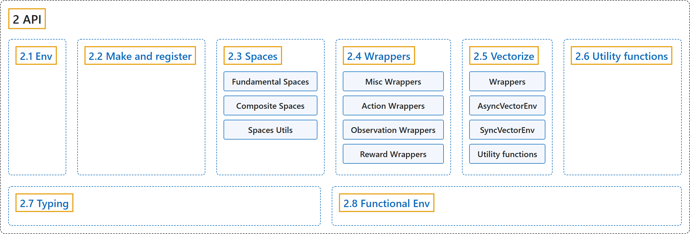

# 2. API

## Classification

## Glossary

| Term | Definition | 中文翻译 | Source |
|---|---|---|---|
| **2 API** API | (context) "**The main Gymnasium class for implementing Reinforcement Learning Agents environments.**" | （语境）**Gymnasium 中用于实现强化学习智能体环境的主类。** | [Farama Foundation, n.d.-a, "gymnasium.Env", para. 1](https://gymnasium.farama.org/api/env/#gymnasium.Env) |
| **[2.1 Env](env.md)** 环境 | "**The main Gymnasium class for implementing Reinforcement Learning Agents environments.**" | **Gymnasium 中用于实现强化学习智能体环境的主类。** | [Farama Foundation, n.d.-a, "gymnasium.Env", para. 1](https://gymnasium.farama.org/api/env/#gymnasium.Env) |
| **[2.2 Make and register](make-and-register.md)** 创建与注册 | (context) "Gymnasium allows users to **automatically load environments, pre-wrapped with several important wrappers** through the gymnasium.make() function." | （语境）Gymnasium 让用户通过 gymnasium.make() 函数**自动加载环境，并预先套上几个重要的包装器**。 | [Farama Foundation, n.d.-c, "Make and register", para. 1](https://gymnasium.farama.org/api/registry/) |
| **[2.3 Spaces](spaces.md)** 空间 | "Spaces **describe mathematical sets and are used in Gym to specify valid actions and observations**." | 空间**描述数学上的集合，在 Gym 中用来规定合法的动作和观测**。 | [Farama Foundation, n.d.-d, "Spaces", para. 1](https://gymnasium.farama.org/api/spaces/) |
| **[2.4 Wrappers](wrappers.md)** 包装器 | "Wrappers are **a convenient way to modify an existing environment without having to alter the underlying code directly**." | 包装器是**一种无需直接修改底层代码就能修改现有环境的便捷方式**。 | [Farama Foundation, n.d.-h, "Wrappers", para. 1](https://gymnasium.farama.org/api/wrappers/) |
| **[2.5 Vectorize](vectorize.md)** 向量化 | (context) "**Base class for vectorized environments to run multiple independent copies of the same environment in parallel.**" | （语境）**向量化环境的基类，用于并行运行同一环境的多个独立副本。** | [Farama Foundation, n.d.-g, "gymnasium.vector.VectorEnv", para. 1](https://gymnasium.farama.org/api/vector/#gymnasium.vector.VectorEnv) |
| **[2.6 Utility functions](utility-functions.md)** 工具函数 | (No definition) | （无定义） | [Farama Foundation, n.d.-f, "Utility functions"](https://gymnasium.farama.org/api/utils/) |
| **[2.7 Typing](typing.md)** 类型标注 | (No definition) | （无定义） | [Farama Foundation, n.d.-e, "Typing"](https://gymnasium.farama.org/api/typing/) |
| **[2.8 Functional Env](functional-env.md)** 函数式环境 | (context) "**Base class (template) for functional envs.**" | （语境）**函数式环境的基类（模板）。** | [Farama Foundation, n.d.-b, "gymnasium.experimental.functional.FuncEnv", para. 1](https://gymnasium.farama.org/api/functional/#gymnasium.experimental.functional.FuncEnv) |

## References

Farama Foundation. (n.d.-a). *Env*. Gymnasium Documentation (Version 1.4.0). Retrieved October 31, 2026, from <https://gymnasium.farama.org/api/env/>

Farama Foundation. (n.d.-b). *Functional Env*. Gymnasium Documentation (Version 1.4.0). Retrieved October 31, 2026, from <https://gymnasium.farama.org/api/functional/>

Farama Foundation. (n.d.-c). *Make and register*. Gymnasium Documentation (Version 1.4.0). Retrieved October 31, 2026, from <https://gymnasium.farama.org/api/registry/>

Farama Foundation. (n.d.-d). *Spaces*. Gymnasium Documentation (Version 1.4.0). Retrieved October 31, 2026, from <https://gymnasium.farama.org/api/spaces/>

Farama Foundation. (n.d.-e). *Typing*. Gymnasium Documentation (Version 1.4.0). Retrieved October 31, 2026, from <https://gymnasium.farama.org/api/typing/>

Farama Foundation. (n.d.-f). *Utility functions*. Gymnasium Documentation (Version 1.4.0). Retrieved October 31, 2026, from <https://gymnasium.farama.org/api/utils/>

Farama Foundation. (n.d.-g). *Vectorize*. Gymnasium Documentation (Version 1.4.0). Retrieved October 31, 2026, from <https://gymnasium.farama.org/api/vector/>

Farama Foundation. (n.d.-h). *Wrappers*. Gymnasium Documentation (Version 1.4.0). Retrieved October 31, 2026, from <https://gymnasium.farama.org/api/wrappers/>
