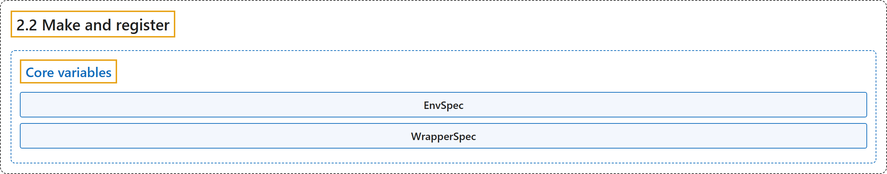

# 2.2 Make and register

## Classification

## Glossary

| Term | Definition | 中文翻译 | Source |
|---|---|---|---|
| **2.2 Make and register** 创建与注册 | (context) "Gymnasium allows users to **automatically load environments, pre-wrapped with several important wrappers** through the gymnasium.make() function." | （语境）Gymnasium 让用户通过 gymnasium.make() 函数**自动加载环境，并预先套上几个重要的包装器**。 | [Farama Foundation, n.d., "Make and register", para. 1](https://gymnasium.farama.org/api/registry/) |
| **Core variables** 核心变量 | (No definition) | （无定义） | [Farama Foundation, n.d., "Core variables"](https://gymnasium.farama.org/api/registry/#core-variables) |
| **EnvSpec** EnvSpec（环境规格） | "**A specification for creating environments with gymnasium.make().**" | **用 gymnasium.make() 创建环境的规格。** | [Farama Foundation, n.d., "gymnasium.envs.registration.EnvSpec", para. 1](https://gymnasium.farama.org/api/registry/#gymnasium.envs.registration.EnvSpec) |
| **WrapperSpec** WrapperSpec（包装器规格） | "**A specification for recording wrapper configs.**" | **用于记录包装器配置的规格。** | [Farama Foundation, n.d., "gymnasium.envs.registration.WrapperSpec", para. 1](https://gymnasium.farama.org/api/registry/#gymnasium.envs.registration.WrapperSpec) |

## References

Farama Foundation. (n.d.). *Make and register*. Gymnasium Documentation (Version 1.4.0). Retrieved October 31, 2026, from <https://gymnasium.farama.org/api/registry/>
