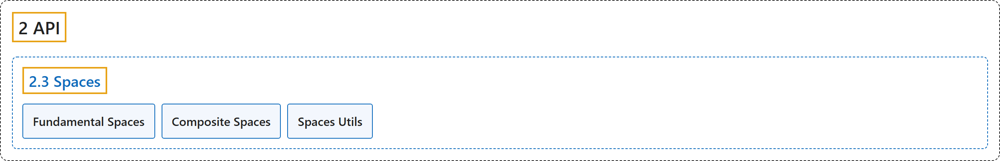

# 2.3 Spaces

## Classification

## Glossary

| Term | Definition | 中文翻译 | Source |
|---|---|---|---|
| **2.3 Spaces** 空间 | "Spaces **describe mathematical sets and are used in Gym to specify valid actions and observations**." | 空间**描述数学上的集合，在 Gym 中用来规定合法的动作和观测**。 | [Farama Foundation, n.d.-c, "Spaces", para. 1](https://gymnasium.farama.org/api/spaces/) |
| **Fundamental Spaces** 基本空间 | (No definition) | （无定义） | [Farama Foundation, n.d.-b, "Fundamental Spaces"](https://gymnasium.farama.org/api/spaces/fundamental/) |
| **Composite Spaces** 复合空间 | (No definition) | （无定义） | [Farama Foundation, n.d.-a, "Composite Spaces"](https://gymnasium.farama.org/api/spaces/composite/) |
| **Spaces Utils** 空间工具函数 | (No definition) | （无定义） | [Farama Foundation, n.d.-d, "Spaces Utils"](https://gymnasium.farama.org/api/spaces/utils/) |

## References

Farama Foundation. (n.d.-a). *Composite Spaces*. Gymnasium Documentation (Version 1.4.0). Retrieved October 31, 2026, from <https://gymnasium.farama.org/api/spaces/composite/>

Farama Foundation. (n.d.-b). *Fundamental Spaces*. Gymnasium Documentation (Version 1.4.0). Retrieved October 31, 2026, from <https://gymnasium.farama.org/api/spaces/fundamental/>

Farama Foundation. (n.d.-c). *Spaces*. Gymnasium Documentation (Version 1.4.0). Retrieved October 31, 2026, from <https://gymnasium.farama.org/api/spaces/>

Farama Foundation. (n.d.-d). *Spaces Utils*. Gymnasium Documentation (Version 1.4.0). Retrieved October 31, 2026, from <https://gymnasium.farama.org/api/spaces/utils/>
