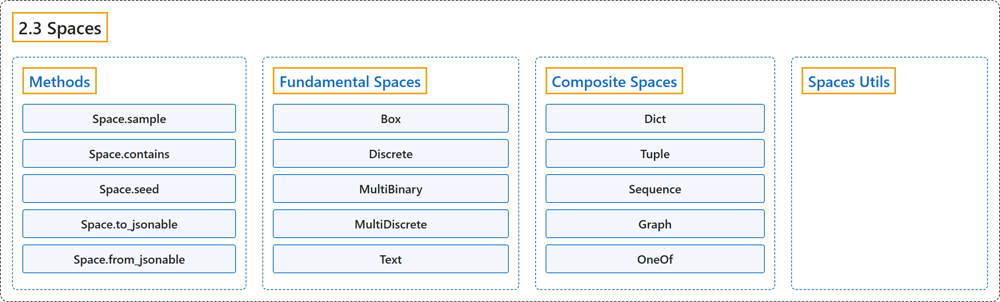

# 2.3 Spaces

## Classification

## Glossary

| Term | Definition | 中文翻译 | Source |
|---|---|---|---|
| **2.3 Spaces** 空间 | "Spaces **describe mathematical sets and are used in Gym to specify valid actions and observations**." | 空间**描述数学上的集合，在 Gym 中用来规定合法的动作和观测**。 | [Farama Foundation, n.d.-c, "Spaces", para. 1](https://gymnasium.farama.org/api/spaces/) |
| **Methods** 方法 | (No definition) | （无定义） | [Farama Foundation, n.d.-c, "Methods"](https://gymnasium.farama.org/api/spaces/#methods) |
| **Space.sample** sample 方法 | "**Randomly sample an element of this space.**" | **从这个空间中随机采样一个元素。** | [Farama Foundation, n.d.-c, "gymnasium.spaces.Space.sample", para. 1](https://gymnasium.farama.org/api/spaces/#gymnasium.spaces.Space.sample) |
| **Space.contains** contains 方法 | "**Return boolean specifying if x is a valid member of this space**, equivalent to sample in space." | **返回布尔值，指明 x 是否为这个空间的合法成员**，等价于 sample in space。 | [Farama Foundation, n.d.-c, "gymnasium.spaces.Space.contains", para. 1](https://gymnasium.farama.org/api/spaces/#gymnasium.spaces.Space.contains) |
| **Space.seed** seed 方法 | "**Seed the pseudorandom number generator (PRNG) of this space and, if applicable, the PRNGs of subspaces.**" | **为这个空间的伪随机数生成器（PRNG）设置种子，如适用，也为各子空间的 PRNG 设置种子。** | [Farama Foundation, n.d.-c, "gymnasium.spaces.Space.seed", para. 1](https://gymnasium.farama.org/api/spaces/#gymnasium.spaces.Space.seed) |
| **Space.to_jsonable** to_jsonable 方法 | "**Convert a batch of samples from this space to a JSONable data type.**" | **把这个空间的一批样本转换为可 JSON 序列化的数据类型。** | [Farama Foundation, n.d.-c, "gymnasium.spaces.Space.to_jsonable", para. 1](https://gymnasium.farama.org/api/spaces/#gymnasium.spaces.Space.to_jsonable) |
| **Space.from_jsonable** from_jsonable 方法 | "**Convert a JSONable data type to a batch of samples from this space.**" | **把可 JSON 序列化的数据类型转换为这个空间的一批样本。** | [Farama Foundation, n.d.-c, "gymnasium.spaces.Space.from_jsonable", para. 1](https://gymnasium.farama.org/api/spaces/#gymnasium.spaces.Space.from_jsonable) |
| **Fundamental Spaces** 基本空间 | (No definition) | （无定义） | [Farama Foundation, n.d.-b, "Fundamental Spaces"](https://gymnasium.farama.org/api/spaces/fundamental/) |
| **Box** Box（盒空间） | "**A (possibly unbounded) box in Rn.**" | **Rn 中的一个（可能无界的）盒子。** | [Farama Foundation, n.d.-b, "gymnasium.spaces.Box", para. 1](https://gymnasium.farama.org/api/spaces/fundamental/#gymnasium.spaces.Box) |
| **Box.sample** sample 方法 | "**Generates a single random sample inside the Box.**" | **在 Box 内部生成一个随机样本。** | [Farama Foundation, n.d.-b, "gymnasium.spaces.Box.sample", para. 1](https://gymnasium.farama.org/api/spaces/fundamental/#gymnasium.spaces.Box.sample) |
| **Box.is_bounded** is_bounded 方法 | "**Checks whether the box is bounded in some sense.**" | **检查盒子在某种意义上是否有界。** | [Farama Foundation, n.d.-b, "gymnasium.spaces.Box.is_bounded", para. 1](https://gymnasium.farama.org/api/spaces/fundamental/#gymnasium.spaces.Box.is_bounded) |
| **Discrete** Discrete（离散空间） | "**A space consisting of finitely many elements.**" | **由有限个元素组成的空间。** | [Farama Foundation, n.d.-b, "gymnasium.spaces.Discrete", para. 1](https://gymnasium.farama.org/api/spaces/fundamental/#gymnasium.spaces.Discrete) |
| **Discrete.sample** sample 方法 | "**Generates a single random sample from this space.**" | **从这个空间生成一个随机样本。** | [Farama Foundation, n.d.-b, "gymnasium.spaces.Discrete.sample", para. 1](https://gymnasium.farama.org/api/spaces/fundamental/#gymnasium.spaces.Discrete.sample) |
| **MultiBinary** MultiBinary（多二值空间） | "**An n-shape binary space.**" | **一个 n 形状的二值空间。** | [Farama Foundation, n.d.-b, "gymnasium.spaces.MultiBinary", para. 1](https://gymnasium.farama.org/api/spaces/fundamental/#gymnasium.spaces.MultiBinary) |
| **MultiBinary.sample** sample 方法 | "**Generates a single random sample from this space.**" | **从这个空间生成一个随机样本。** | [Farama Foundation, n.d.-b, "gymnasium.spaces.MultiBinary.sample", para. 1](https://gymnasium.farama.org/api/spaces/fundamental/#gymnasium.spaces.MultiBinary.sample) |
| **MultiDiscrete** MultiDiscrete（多离散空间） | "This represents **the cartesian product of arbitrary Discrete spaces**." | 它表示**任意多个 Discrete 空间的笛卡尔积**。 | [Farama Foundation, n.d.-b, "gymnasium.spaces.MultiDiscrete", para. 1](https://gymnasium.farama.org/api/spaces/fundamental/#gymnasium.spaces.MultiDiscrete) |
| **MultiDiscrete.sample** sample 方法 | "**Generates a single random sample from this space.**" | **从这个空间生成一个随机样本。** | [Farama Foundation, n.d.-b, "gymnasium.spaces.MultiDiscrete.sample", para. 1](https://gymnasium.farama.org/api/spaces/fundamental/#gymnasium.spaces.MultiDiscrete.sample) |
| **Text** Text（文本空间） | "**A space representing a string comprised of characters from a given charset.**" | **表示由给定字符集中的字符组成的字符串的空间。** | [Farama Foundation, n.d.-b, "gymnasium.spaces.Text", para. 1](https://gymnasium.farama.org/api/spaces/fundamental/#gymnasium.spaces.Text) |
| **Text.sample** sample 方法 | "**Generates a single random sample from this space** with by default a random length between min_length and max_length and sampled from the charset." | **从这个空间生成一个随机样本**，默认长度在 min_length 与 max_length 之间随机，字符从 charset 中采样。 | [Farama Foundation, n.d.-b, "gymnasium.spaces.Text.sample", para. 1](https://gymnasium.farama.org/api/spaces/fundamental/#gymnasium.spaces.Text.sample) |
| **Composite Spaces** 复合空间 | (No definition) | （无定义） | [Farama Foundation, n.d.-a, "Composite Spaces"](https://gymnasium.farama.org/api/spaces/composite/) |
| **Dict** Dict（字典空间） | "**A dictionary of Space instances.**" | **由 Space 实例组成的字典。** | [Farama Foundation, n.d.-a, "gymnasium.spaces.Dict", para. 1](https://gymnasium.farama.org/api/spaces/composite/#gymnasium.spaces.Dict) |
| **Dict.sample** sample 方法 | "**Generates a single random sample from this space.**" | **从这个空间生成一个随机样本。** | [Farama Foundation, n.d.-a, "gymnasium.spaces.Dict.sample", para. 1](https://gymnasium.farama.org/api/spaces/composite/#gymnasium.spaces.Dict.sample) |
| **Dict.seed** seed 方法 | "**Seed the PRNG of this space and all subspaces.**" | **为这个空间及其所有子空间的 PRNG 设置种子。** | [Farama Foundation, n.d.-a, "gymnasium.spaces.Dict.seed", para. 1](https://gymnasium.farama.org/api/spaces/composite/#gymnasium.spaces.Dict.seed) |
| **Tuple** Tuple（元组空间） | "**A tuple (more precisely: the cartesian product) of Space instances.**" | **由 Space 实例组成的元组（更准确地说，是它们的笛卡尔积）。** | [Farama Foundation, n.d.-a, "gymnasium.spaces.Tuple", para. 1](https://gymnasium.farama.org/api/spaces/composite/#gymnasium.spaces.Tuple) |
| **Tuple.sample** sample 方法 | "**Generates a single random sample inside this space.**" | **在这个空间内部生成一个随机样本。** | [Farama Foundation, n.d.-a, "gymnasium.spaces.Tuple.sample", para. 1](https://gymnasium.farama.org/api/spaces/composite/#gymnasium.spaces.Tuple.sample) |
| **Tuple.seed** seed 方法 | "**Seed the PRNG of this space and all subspaces.**" | **为这个空间及其所有子空间的 PRNG 设置种子。** | [Farama Foundation, n.d.-a, "gymnasium.spaces.Tuple.seed", para. 1](https://gymnasium.farama.org/api/spaces/composite/#gymnasium.spaces.Tuple.seed) |
| **Sequence** Sequence（序列空间） | "This space represent **sets of finite-length sequences**." | 这个空间表示**有限长度序列的集合**。 | [Farama Foundation, n.d.-a, "gymnasium.spaces.Sequence", para. 1](https://gymnasium.farama.org/api/spaces/composite/#gymnasium.spaces.Sequence) |
| **Sequence.sample** sample 方法 | "**Generates a single random sample from this space.**" | **从这个空间生成一个随机样本。** | [Farama Foundation, n.d.-a, "gymnasium.spaces.Sequence.sample", para. 1](https://gymnasium.farama.org/api/spaces/composite/#gymnasium.spaces.Sequence.sample) |
| **Sequence.seed** seed 方法 | "**Seed the PRNG of the Sequence space and the feature space.**" | **为 Sequence 空间及其特征空间的 PRNG 设置种子。** | [Farama Foundation, n.d.-a, "gymnasium.spaces.Sequence.seed", para. 1](https://gymnasium.farama.org/api/spaces/composite/#gymnasium.spaces.Sequence.seed) |
| **Graph** Graph（图空间） | "**A space representing graph information as a series of nodes connected with edges according to an adjacency matrix represented as a series of edge_links.**" | **把图信息表示为一系列节点的空间，节点之间按邻接矩阵用边相连，邻接矩阵表示为一系列 edge_links。** | [Farama Foundation, n.d.-a, "gymnasium.spaces.Graph", para. 1](https://gymnasium.farama.org/api/spaces/composite/#gymnasium.spaces.Graph) |
| **Graph.sample** sample 方法 | "**Generates a single sample graph** with num_nodes between 1 and 10 sampled from the Graph." | **生成一个样本图**，从该 Graph 中采样，num_nodes 在 1 到 10 之间。 | [Farama Foundation, n.d.-a, "gymnasium.spaces.Graph.sample", para. 1](https://gymnasium.farama.org/api/spaces/composite/#gymnasium.spaces.Graph.sample) |
| **Graph.seed** seed 方法 | "**Seeds the PRNG of this space and node / edge subspace.**" | **为这个空间及其节点、边子空间的 PRNG 设置种子。** | [Farama Foundation, n.d.-a, "gymnasium.spaces.Graph.seed", para. 1](https://gymnasium.farama.org/api/spaces/composite/#gymnasium.spaces.Graph.seed) |
| **OneOf** OneOf（多选一空间） | "**An exclusive tuple (more precisely: the direct sum) of Space instances.**" | **由 Space 实例组成的互斥元组（更准确地说，是它们的直和）。** | [Farama Foundation, n.d.-a, "gymnasium.spaces.OneOf", para. 1](https://gymnasium.farama.org/api/spaces/composite/#gymnasium.spaces.OneOf) |
| **OneOf.sample** sample 方法 | "**Generates a single random sample inside this space.**" | **在这个空间内部生成一个随机样本。** | [Farama Foundation, n.d.-a, "gymnasium.spaces.OneOf.sample", para. 1](https://gymnasium.farama.org/api/spaces/composite/#gymnasium.spaces.OneOf.sample) |
| **OneOf.seed** seed 方法 | "**Seed the PRNG of this space and all subspaces.**" | **为这个空间及其所有子空间的 PRNG 设置种子。** | [Farama Foundation, n.d.-a, "gymnasium.spaces.OneOf.seed", para. 1](https://gymnasium.farama.org/api/spaces/composite/#gymnasium.spaces.OneOf.seed) |
| **Spaces Utils** 空间工具函数 | (No definition) | （无定义） | [Farama Foundation, n.d.-d, "Spaces Utils"](https://gymnasium.farama.org/api/spaces/utils/) |

## References

Farama Foundation. (n.d.-a). *Composite Spaces*. Gymnasium Documentation (Version 1.4.0). Retrieved October 31, 2026, from <https://gymnasium.farama.org/api/spaces/composite/>

Farama Foundation. (n.d.-b). *Fundamental Spaces*. Gymnasium Documentation (Version 1.4.0). Retrieved October 31, 2026, from <https://gymnasium.farama.org/api/spaces/fundamental/>

Farama Foundation. (n.d.-c). *Spaces*. Gymnasium Documentation (Version 1.4.0). Retrieved October 31, 2026, from <https://gymnasium.farama.org/api/spaces/>

Farama Foundation. (n.d.-d). *Spaces Utils*. Gymnasium Documentation (Version 1.4.0). Retrieved October 31, 2026, from <https://gymnasium.farama.org/api/spaces/utils/>
