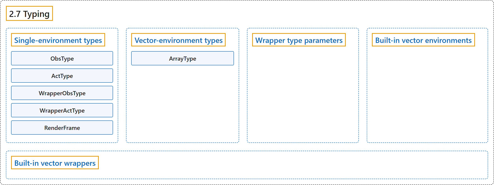

# 2.7 Typing

## Classification

## Glossary

| Term | Definition | 中文翻译 | Source |
|---|---|---|---|
| **2.7 Typing** 类型标注 | (No definition) | （无定义） | [Farama Foundation, n.d., "Typing"](https://gymnasium.farama.org/api/typing/) |
| **Single-environment types** 单环境类型 | (No definition) | （无定义） | [Farama Foundation, n.d., "Single-environment types"](https://gymnasium.farama.org/api/typing/#single-environment-types) |
| **ObsType** ObsType（观测类型） | "**Type variable.**" | **类型变量。** | [Farama Foundation, n.d., "gymnasium.core.ObsType", para. 1](https://gymnasium.farama.org/api/typing/#gymnasium.core.ObsType) |
| **ActType** ActType（动作类型） | "**Type variable.**" | **类型变量。** | [Farama Foundation, n.d., "gymnasium.core.ActType", para. 1](https://gymnasium.farama.org/api/typing/#gymnasium.core.ActType) |
| **WrapperObsType** WrapperObsType（包装器观测类型） | "**Type variable.**" | **类型变量。** | [Farama Foundation, n.d., "gymnasium.core.WrapperObsType", para. 1](https://gymnasium.farama.org/api/typing/#gymnasium.core.WrapperObsType) |
| **WrapperActType** WrapperActType（包装器动作类型） | "**Type variable.**" | **类型变量。** | [Farama Foundation, n.d., "gymnasium.core.WrapperActType", para. 1](https://gymnasium.farama.org/api/typing/#gymnasium.core.WrapperActType) |
| **RenderFrame** RenderFrame（渲染帧类型） | "**Represent a PEP 604 union type**" | **表示一个 PEP 604 联合类型** | [Farama Foundation, n.d., "gymnasium.core.RenderFrame", para. 1](https://gymnasium.farama.org/api/typing/#gymnasium.core.RenderFrame) |
| **Vector-environment types** 向量环境类型 | "Vector environments and wrappers **reuse the single-environment TypeVars for their batched observations and actions, with one additional parameter for the rewards, terminations and truncations arrays returned by step**." | 向量环境和包装器**为其批量观测和动作复用单环境的 TypeVar，并为 step 返回的奖励、终止和截断数组多加一个参数**。 | [Farama Foundation, n.d., "Vector-environment types", para. 1](https://gymnasium.farama.org/api/typing/#vector-environment-types) |
| **ArrayType** ArrayType（数组类型） | "**Type variable.**" | **类型变量。** | [Farama Foundation, n.d., "gymnasium.vector.vector_env.ArrayType", para. 1](https://gymnasium.farama.org/api/typing/#gymnasium.vector.vector_env.ArrayType) |
| **Wrapper type parameters** 包装器类型参数 | "Each vector wrapper has **the same type parameters as its single-environment equivalent, followed by ArrayType**." | 每个向量包装器具有**与其单环境对应物相同的类型参数，后面再加 ArrayType**。 | [Farama Foundation, n.d., "Wrapper type parameters", para. 1](https://gymnasium.farama.org/api/typing/#wrapper-type-parameters) |
| **Built-in vector environments** 内置向量环境 | (context) "SyncVectorEnv and AsyncVectorEnv are **generic in their observation and action types, [ObsType, ActType], and return np.ndarray rewards, terminations and truncations**, so they compose with the np.ndarray wrappers below." | （语境）SyncVectorEnv 和 AsyncVectorEnv **在观测和动作类型 [ObsType, ActType] 上是泛型的，并返回 np.ndarray 类型的奖励、终止和截断**，因此能与下文的 np.ndarray 包装器组合使用。 | [Farama Foundation, n.d., "Built-in vector environments", para. 1](https://gymnasium.farama.org/api/typing/#built-in-vector-environments) |
| **Built-in vector wrappers** 内置向量包装器 | (context) "The vector wrappers that transform the observations, actions or rewards **mirror their single-environment equivalents, so they have the same type parameters, followed by ArrayType**:" | （语境）变换观测、动作或奖励的向量包装器**与其单环境对应物一一对应，因此具有相同的类型参数，后面再加 ArrayType**： | [Farama Foundation, n.d., "Built-in vector wrappers", para. 1](https://gymnasium.farama.org/api/typing/#built-in-vector-wrappers) |

## References

Farama Foundation. (n.d.). *Typing*. Gymnasium Documentation (Version 1.4.0). Retrieved October 31, 2026, from <https://gymnasium.farama.org/api/typing/>
