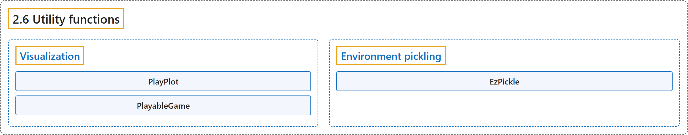

# 2.6 Utility functions

## Classification

## Glossary

| Term | Definition | 中文翻译 | Source |
|---|---|---|---|
| **2.6 Utility functions** 工具函数 | (No definition) | （无定义） | [Farama Foundation, n.d., "Utility functions"](https://gymnasium.farama.org/api/utils/) |
| **Visualization** 可视化 | (No definition) | （无定义） | [Farama Foundation, n.d., "Visualization"](https://gymnasium.farama.org/api/utils/#visualization) |
| **PlayPlot** PlayPlot（游玩绘图类） | "**Provides a callback to create live plots of arbitrary metrics** when using play()." | **提供一个回调，用于实时绘制任意指标的曲线**，在使用 play() 时使用。 | [Farama Foundation, n.d., "gymnasium.utils.play.PlayPlot", para. 1](https://gymnasium.farama.org/api/utils/#gymnasium.utils.play.PlayPlot) |
| **PlayPlot.callback** callback 方法 | "**The callback that calls the provided data callback and adds the data to the plots.**" | **调用所提供的数据回调并把数据加入图中的回调。** | [Farama Foundation, n.d., "gymnasium.utils.play.PlayPlot.callback", para. 1](https://gymnasium.farama.org/api/utils/#gymnasium.utils.play.PlayPlot.callback) |
| **PlayableGame** PlayableGame（可游玩游戏类） | "**Wraps an environment allowing keyboard inputs to interact with the environment.**" | **包装一个环境，允许用键盘输入与环境交互。** | [Farama Foundation, n.d., "gymnasium.utils.play.PlayableGame", para. 1](https://gymnasium.farama.org/api/utils/#gymnasium.utils.play.PlayableGame) |
| **PlayableGame.process_event** process_event 方法 | "**Processes a PyGame event.**" | **处理一个 PyGame 事件。** | [Farama Foundation, n.d., "gymnasium.utils.play.PlayableGame.process_event", para. 1](https://gymnasium.farama.org/api/utils/#gymnasium.utils.play.PlayableGame.process_event) |
| **Environment pickling** 环境序列化 | (No definition) | （无定义） | [Farama Foundation, n.d., "Environment pickling"](https://gymnasium.farama.org/api/utils/#environment-pickling) |
| **EzPickle** EzPickle（简易序列化类） | "**Objects that are pickled and unpickled via their constructor arguments.**" | **通过其构造参数进行序列化（pickle）和反序列化的对象。** | [Farama Foundation, n.d., "gymnasium.utils.ezpickle.EzPickle", para. 1](https://gymnasium.farama.org/api/utils/#gymnasium.utils.ezpickle.EzPickle) |

## References

Farama Foundation. (n.d.). *Utility functions*. Gymnasium Documentation (Version 1.4.0). Retrieved October 31, 2026, from <https://gymnasium.farama.org/api/utils/>
