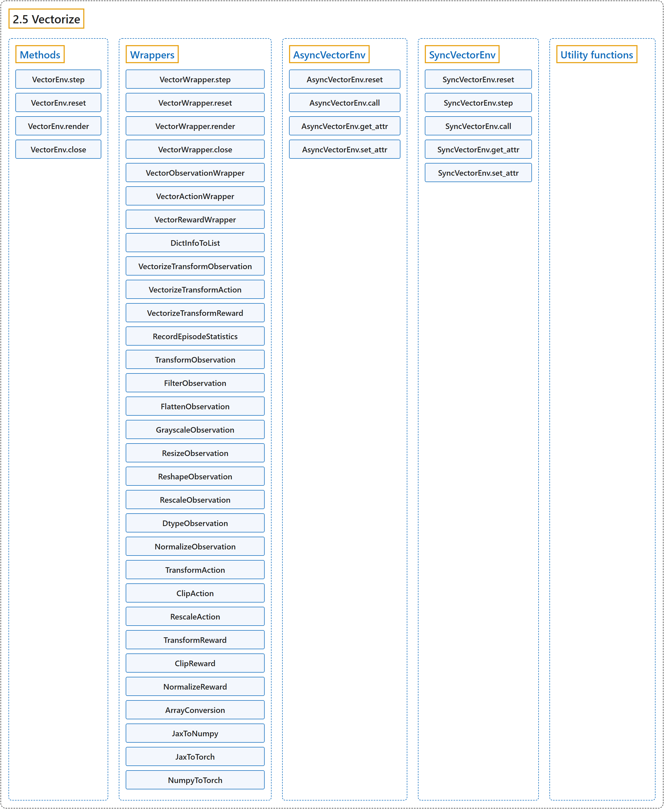

# 2.5 Vectorize

## Classification

## Glossary

| Term | Definition | 中文翻译 | Source |
|---|---|---|---|
| **2.5 Vectorize** 向量化 | (context) "**Base class for vectorized environments to run multiple independent copies of the same environment in parallel.**" | （语境）**向量化环境的基类，用于并行运行同一环境的多个独立副本。** | [Farama Foundation, n.d.-d, "gymnasium.vector.VectorEnv", para. 1](https://gymnasium.farama.org/api/vector/#gymnasium.vector.VectorEnv) |
| **Methods** 方法 | (No definition) | （无定义） | [Farama Foundation, n.d.-d, "Methods"](https://gymnasium.farama.org/api/vector/#methods) |
| **VectorEnv.step** step 方法 | "**Take an action for each parallel environment.**" | **为每个并行环境执行一个动作。** | [Farama Foundation, n.d.-d, "gymnasium.vector.VectorEnv.step", para. 1](https://gymnasium.farama.org/api/vector/#gymnasium.vector.VectorEnv.step) |
| **VectorEnv.reset** reset 方法 | "**Reset all parallel environments and return a batch of initial observations and info.**" | **重置所有并行环境，并返回一批初始观测和信息。** | [Farama Foundation, n.d.-d, "gymnasium.vector.VectorEnv.reset", para. 1](https://gymnasium.farama.org/api/vector/#gymnasium.vector.VectorEnv.reset) |
| **VectorEnv.render** render 方法 | "**Returns the rendered frames from the parallel environments.**" | **返回各并行环境渲染出的帧。** | [Farama Foundation, n.d.-d, "gymnasium.vector.VectorEnv.render", para. 1](https://gymnasium.farama.org/api/vector/#gymnasium.vector.VectorEnv.render) |
| **VectorEnv.close** close 方法 | "**Close all parallel environments and release resources.**" | **关闭所有并行环境并释放资源。** | [Farama Foundation, n.d.-d, "gymnasium.vector.VectorEnv.close", para. 1](https://gymnasium.farama.org/api/vector/#gymnasium.vector.VectorEnv.close) |
| **Wrappers** 包装器 | "**Wraps the vectorized environment to allow a modular transformation.**" | **包装向量化环境，以便进行模块化的变换。** | [Farama Foundation, n.d.-e, "gymnasium.vector.VectorWrapper", para. 1](https://gymnasium.farama.org/api/vector/wrappers/#gymnasium.vector.VectorWrapper) |
| **VectorWrapper.step** step 方法 | "**Step through all environments using the actions returning the batched data.**" | **用这些动作让所有环境走一步，返回批量数据。** | [Farama Foundation, n.d.-e, "gymnasium.vector.VectorWrapper.step", para. 1](https://gymnasium.farama.org/api/vector/wrappers/#gymnasium.vector.VectorWrapper.step) |
| **VectorWrapper.reset** reset 方法 | "**Reset all environment using seed and options.**" | **用 seed 和 options 重置所有环境。** | [Farama Foundation, n.d.-e, "gymnasium.vector.VectorWrapper.reset", para. 1](https://gymnasium.farama.org/api/vector/wrappers/#gymnasium.vector.VectorWrapper.reset) |
| **VectorWrapper.render** render 方法 | "**Returns the render mode from the base vector environment.**" | **返回底层向量环境的渲染模式。** | [Farama Foundation, n.d.-e, "gymnasium.vector.VectorWrapper.render", para. 1](https://gymnasium.farama.org/api/vector/wrappers/#gymnasium.vector.VectorWrapper.render) |
| **VectorWrapper.close** close 方法 | "**Close all environments.**" | **关闭所有环境。** | [Farama Foundation, n.d.-e, "gymnasium.vector.VectorWrapper.close", para. 1](https://gymnasium.farama.org/api/vector/wrappers/#gymnasium.vector.VectorWrapper.close) |
| **VectorObservationWrapper** VectorObservationWrapper（向量观测包装器） | "**Wraps the vectorized environment to allow a modular transformation of the observation.**" | **包装向量化环境，以便对观测进行模块化的变换。** | [Farama Foundation, n.d.-e, "gymnasium.vector.VectorObservationWrapper", para. 1](https://gymnasium.farama.org/api/vector/wrappers/#gymnasium.vector.VectorObservationWrapper) |
| **VectorObservationWrapper.observations** observations 方法 | "**Defines the vector observation transformation.**" | **定义向量观测的变换。** | [Farama Foundation, n.d.-e, "gymnasium.vector.VectorObservationWrapper.observations", para. 1](https://gymnasium.farama.org/api/vector/wrappers/#gymnasium.vector.VectorObservationWrapper.observations) |
| **VectorActionWrapper** VectorActionWrapper（向量动作包装器） | "**Wraps the vectorized environment to allow a modular transformation of the actions.**" | **包装向量化环境，以便对动作进行模块化的变换。** | [Farama Foundation, n.d.-e, "gymnasium.vector.VectorActionWrapper", para. 1](https://gymnasium.farama.org/api/vector/wrappers/#gymnasium.vector.VectorActionWrapper) |
| **VectorActionWrapper.actions** actions 方法 | "**Transform the actions before sending them to the environment.**" | **在把动作发给环境之前对其进行变换。** | [Farama Foundation, n.d.-e, "gymnasium.vector.VectorActionWrapper.actions", para. 1](https://gymnasium.farama.org/api/vector/wrappers/#gymnasium.vector.VectorActionWrapper.actions) |
| **VectorRewardWrapper** VectorRewardWrapper（向量奖励包装器） | "**Wraps the vectorized environment to allow a modular transformation of the reward.**" | **包装向量化环境，以便对奖励进行模块化的变换。** | [Farama Foundation, n.d.-e, "gymnasium.vector.VectorRewardWrapper", para. 1](https://gymnasium.farama.org/api/vector/wrappers/#gymnasium.vector.VectorRewardWrapper) |
| **VectorRewardWrapper.rewards** rewards 方法 | "**Transform the reward before returning it.**" | **在返回奖励之前对其进行变换。** | [Farama Foundation, n.d.-e, "gymnasium.vector.VectorRewardWrapper.rewards", para. 1](https://gymnasium.farama.org/api/vector/wrappers/#gymnasium.vector.VectorRewardWrapper.rewards) |
| **DictInfoToList** DictInfoToList（信息字典转列表包装器） | "**Converts infos of vectorized environments from dict to List[dict].**" | **把向量化环境的 infos 从 dict 转换为 List[dict]。** | [Farama Foundation, n.d.-e, "gymnasium.wrappers.vector.DictInfoToList", para. 1](https://gymnasium.farama.org/api/vector/wrappers/#gymnasium.wrappers.vector.DictInfoToList) |
| **VectorizeTransformObservation** VectorizeTransformObservation（向量化观测变换包装器） | "**Vectorizes a single-agent transform observation wrapper for vector environments.**" | **为向量环境向量化一个单智能体的观测变换包装器。** | [Farama Foundation, n.d.-e, "gymnasium.wrappers.vector.VectorizeTransformObservation", para. 1](https://gymnasium.farama.org/api/vector/wrappers/#gymnasium.wrappers.vector.VectorizeTransformObservation) |
| **VectorizeTransformAction** VectorizeTransformAction（向量化动作变换包装器） | "**Vectorizes a single-agent transform action wrapper for vector environments.**" | **为向量环境向量化一个单智能体的动作变换包装器。** | [Farama Foundation, n.d.-e, "gymnasium.wrappers.vector.VectorizeTransformAction", para. 1](https://gymnasium.farama.org/api/vector/wrappers/#gymnasium.wrappers.vector.VectorizeTransformAction) |
| **VectorizeTransformReward** VectorizeTransformReward（向量化奖励变换包装器） | "**Vectorizes a single-agent transform reward wrapper for vector environments.**" | **为向量环境向量化一个单智能体的奖励变换包装器。** | [Farama Foundation, n.d.-e, "gymnasium.wrappers.vector.VectorizeTransformReward", para. 1](https://gymnasium.farama.org/api/vector/wrappers/#gymnasium.wrappers.vector.VectorizeTransformReward) |
| **RecordEpisodeStatistics** RecordEpisodeStatistics（记录回合统计包装器） | "This wrapper will **keep track of cumulative rewards and episode lengths**." | 这个包装器会**跟踪累计奖励和回合长度**。 | [Farama Foundation, n.d.-e, "gymnasium.wrappers.vector.RecordEpisodeStatistics", para. 1](https://gymnasium.farama.org/api/vector/wrappers/#gymnasium.wrappers.vector.RecordEpisodeStatistics) |
| **TransformObservation** TransformObservation（观测变换包装器） | "**Transforms an observation via a function provided to the wrapper.**" | **通过提供给包装器的函数变换观测。** | [Farama Foundation, n.d.-e, "gymnasium.wrappers.vector.TransformObservation", para. 1](https://gymnasium.farama.org/api/vector/wrappers/#gymnasium.wrappers.vector.TransformObservation) |
| **FilterObservation** FilterObservation（观测过滤包装器） | "**Vector wrapper for filtering dict or tuple observation spaces.**" | **用于过滤 dict 或 tuple 观测空间的向量包装器。** | [Farama Foundation, n.d.-e, "gymnasium.wrappers.vector.FilterObservation", para. 1](https://gymnasium.farama.org/api/vector/wrappers/#gymnasium.wrappers.vector.FilterObservation) |
| **FlattenObservation** FlattenObservation（观测展平包装器） | "**Observation wrapper that flattens the observation.**" | **展平观测的观测包装器。** | [Farama Foundation, n.d.-e, "gymnasium.wrappers.vector.FlattenObservation", para. 1](https://gymnasium.farama.org/api/vector/wrappers/#gymnasium.wrappers.vector.FlattenObservation) |
| **GrayscaleObservation** GrayscaleObservation（灰度观测包装器） | "**Observation wrapper that converts an RGB image to grayscale.**" | **把 RGB 图像转换为灰度图的观测包装器。** | [Farama Foundation, n.d.-e, "gymnasium.wrappers.vector.GrayscaleObservation", para. 1](https://gymnasium.farama.org/api/vector/wrappers/#gymnasium.wrappers.vector.GrayscaleObservation) |
| **ResizeObservation** ResizeObservation（观测尺寸调整包装器） | "**Resizes image observations using OpenCV to shape.**" | **用 OpenCV 把图像观测调整为 shape。** | [Farama Foundation, n.d.-e, "gymnasium.wrappers.vector.ResizeObservation", para. 1](https://gymnasium.farama.org/api/vector/wrappers/#gymnasium.wrappers.vector.ResizeObservation) |
| **ReshapeObservation** ReshapeObservation（观测变形包装器） | "**Reshapes array based observations to shapes.**" | **把基于数组的观测变形为指定形状。** | [Farama Foundation, n.d.-e, "gymnasium.wrappers.vector.ReshapeObservation", para. 1](https://gymnasium.farama.org/api/vector/wrappers/#gymnasium.wrappers.vector.ReshapeObservation) |
| **RescaleObservation** RescaleObservation（观测缩放包装器） | "**Linearly rescales observation to between a minimum and maximum value.**" | **把观测线性缩放到最小值与最大值之间。** | [Farama Foundation, n.d.-e, "gymnasium.wrappers.vector.RescaleObservation", para. 1](https://gymnasium.farama.org/api/vector/wrappers/#gymnasium.wrappers.vector.RescaleObservation) |
| **DtypeObservation** DtypeObservation（观测类型转换包装器） | "**Observation wrapper for transforming the dtype of an observation.**" | **用于转换观测 dtype 的观测包装器。** | [Farama Foundation, n.d.-e, "gymnasium.wrappers.vector.DtypeObservation", para. 1](https://gymnasium.farama.org/api/vector/wrappers/#gymnasium.wrappers.vector.DtypeObservation) |
| **NormalizeObservation** NormalizeObservation（观测归一化包装器） | "This wrapper will **normalize observations s.t. each coordinate is centered with unit variance**." | 这个包装器会**归一化观测，使每个坐标居中且方差为 1**。 | [Farama Foundation, n.d.-e, "gymnasium.wrappers.vector.NormalizeObservation", para. 1](https://gymnasium.farama.org/api/vector/wrappers/#gymnasium.wrappers.vector.NormalizeObservation) |
| **TransformAction** TransformAction（动作变换包装器） | "**Transforms an action via a function provided to the wrapper.**" | **通过提供给包装器的函数变换动作。** | [Farama Foundation, n.d.-e, "gymnasium.wrappers.vector.TransformAction", para. 1](https://gymnasium.farama.org/api/vector/wrappers/#gymnasium.wrappers.vector.TransformAction) |
| **ClipAction** ClipAction（动作裁剪包装器） | "**Clip the continuous action within the valid Box observation space bound.**" | **把连续动作裁剪到合法的 Box 观测空间边界之内。** | [Farama Foundation, n.d.-e, "gymnasium.wrappers.vector.ClipAction", para. 1](https://gymnasium.farama.org/api/vector/wrappers/#gymnasium.wrappers.vector.ClipAction) |
| **RescaleAction** RescaleAction（动作缩放包装器） | "**Affinely rescales the continuous action space of the environment to the range [min_action, max_action].**" | **把环境的连续动作空间仿射缩放到 [min_action, max_action] 范围。** | [Farama Foundation, n.d.-e, "gymnasium.wrappers.vector.RescaleAction", para. 1](https://gymnasium.farama.org/api/vector/wrappers/#gymnasium.wrappers.vector.RescaleAction) |
| **TransformReward** TransformReward（奖励变换包装器） | "**A reward wrapper that allows a custom function to modify the step reward.**" | **一种奖励包装器，允许用自定义函数修改 step 的奖励。** | [Farama Foundation, n.d.-e, "gymnasium.wrappers.vector.TransformReward", para. 1](https://gymnasium.farama.org/api/vector/wrappers/#gymnasium.wrappers.vector.TransformReward) |
| **ClipReward** ClipReward（奖励裁剪包装器） | "**A wrapper that clips the rewards for an environment between an upper and lower bound.**" | **一种包装器，把环境的奖励裁剪到上下界之间。** | [Farama Foundation, n.d.-e, "gymnasium.wrappers.vector.ClipReward", para. 1](https://gymnasium.farama.org/api/vector/wrappers/#gymnasium.wrappers.vector.ClipReward) |
| **NormalizeReward** NormalizeReward（奖励归一化包装器） | "This wrapper will **scale rewards s.t. their exponential moving average has an approximately fixed variance**." | 这个包装器会**缩放奖励，使其指数移动平均的方差近似固定**。 | [Farama Foundation, n.d.-e, "gymnasium.wrappers.vector.NormalizeReward", para. 1](https://gymnasium.farama.org/api/vector/wrappers/#gymnasium.wrappers.vector.NormalizeReward) |
| **ArrayConversion** ArrayConversion（数组转换包装器） | "**Wraps a vector environment returning Array API compatible arrays so that it can be interacted with through a specific framework.**" | **包装一个返回兼容 Array API 数组的向量环境，使其能通过特定框架交互。** | [Farama Foundation, n.d.-e, "gymnasium.wrappers.vector.ArrayConversion", para. 1](https://gymnasium.farama.org/api/vector/wrappers/#gymnasium.wrappers.vector.ArrayConversion) |
| **JaxToNumpy** JaxToNumpy（Jax 转 NumPy 包装器） | "**Wraps a jax vector environment so that it can be interacted with through numpy arrays.**" | **包装一个 jax 向量环境，使其能通过 numpy 数组交互。** | [Farama Foundation, n.d.-e, "gymnasium.wrappers.vector.JaxToNumpy", para. 1](https://gymnasium.farama.org/api/vector/wrappers/#gymnasium.wrappers.vector.JaxToNumpy) |
| **JaxToTorch** JaxToTorch（Jax 转 PyTorch 包装器） | "**Wraps a Jax-based vector environment so that it can be interacted with through PyTorch Tensors.**" | **包装一个基于 Jax 的向量环境，使其能通过 PyTorch 张量交互。** | [Farama Foundation, n.d.-e, "gymnasium.wrappers.vector.JaxToTorch", para. 1](https://gymnasium.farama.org/api/vector/wrappers/#gymnasium.wrappers.vector.JaxToTorch) |
| **NumpyToTorch** NumpyToTorch（NumPy 转 PyTorch 包装器） | "**Wraps a numpy-based environment so that it can be interacted with through PyTorch Tensors.**" | **包装一个基于 numpy 的环境，使其能通过 PyTorch 张量交互。** | [Farama Foundation, n.d.-e, "gymnasium.wrappers.vector.NumpyToTorch", para. 1](https://gymnasium.farama.org/api/vector/wrappers/#gymnasium.wrappers.vector.NumpyToTorch) |
| **AsyncVectorEnv** 异步向量环境 | "**Vectorized environment that runs multiple environments in parallel.**" | **并行运行多个环境的向量化环境。** | [Farama Foundation, n.d.-a, "gymnasium.vector.AsyncVectorEnv", para. 1](https://gymnasium.farama.org/api/vector/async_vector_env/#gymnasium.vector.AsyncVectorEnv) |
| **AsyncVectorEnv.reset** reset 方法 | "**Resets all sub-environments in parallel and return a batch of concatenated observations and info.**" | **并行重置所有子环境，并返回一批拼接后的观测和信息。** | [Farama Foundation, n.d.-a, "gymnasium.vector.AsyncVectorEnv.reset", para. 1](https://gymnasium.farama.org/api/vector/async_vector_env/#gymnasium.vector.AsyncVectorEnv.reset) |
| **AsyncVectorEnv.call** call 方法 | "**Call a method from each parallel environment with args and kwargs.**" | **用 args 和 kwargs 调用每个并行环境的一个方法。** | [Farama Foundation, n.d.-a, "gymnasium.vector.AsyncVectorEnv.call", para. 1](https://gymnasium.farama.org/api/vector/async_vector_env/#gymnasium.vector.AsyncVectorEnv.call) |
| **AsyncVectorEnv.get_attr** get_attr 方法 | "**Get a property from each parallel environment.**" | **从每个并行环境获取一个属性。** | [Farama Foundation, n.d.-a, "gymnasium.vector.AsyncVectorEnv.get_attr", para. 1](https://gymnasium.farama.org/api/vector/async_vector_env/#gymnasium.vector.AsyncVectorEnv.get_attr) |
| **AsyncVectorEnv.set_attr** set_attr 方法 | "**Sets an attribute of the sub-environments.**" | **设置各子环境的一个属性。** | [Farama Foundation, n.d.-a, "gymnasium.vector.AsyncVectorEnv.set_attr", para. 1](https://gymnasium.farama.org/api/vector/async_vector_env/#gymnasium.vector.AsyncVectorEnv.set_attr) |
| **SyncVectorEnv** 同步向量环境 | "**Vectorized environment that serially runs multiple environments.**" | **依次串行运行多个环境的向量化环境。** | [Farama Foundation, n.d.-b, "gymnasium.vector.SyncVectorEnv", para. 1](https://gymnasium.farama.org/api/vector/sync_vector_env/#gymnasium.vector.SyncVectorEnv) |
| **SyncVectorEnv.reset** reset 方法 | "**Resets each of the sub-environments and concatenate the results together.**" | **逐个重置子环境，并把结果拼接在一起。** | [Farama Foundation, n.d.-b, "gymnasium.vector.SyncVectorEnv.reset", para. 1](https://gymnasium.farama.org/api/vector/sync_vector_env/#gymnasium.vector.SyncVectorEnv.reset) |
| **SyncVectorEnv.step** step 方法 | "**Steps through each of the environments returning the batched results.**" | **让每个环境逐个走一步，返回批量结果。** | [Farama Foundation, n.d.-b, "gymnasium.vector.SyncVectorEnv.step", para. 1](https://gymnasium.farama.org/api/vector/sync_vector_env/#gymnasium.vector.SyncVectorEnv.step) |
| **SyncVectorEnv.call** call 方法 | "**Calls a sub-environment method with name and applies args and kwargs.**" | **按名称调用子环境的方法，并传入 args 和 kwargs。** | [Farama Foundation, n.d.-b, "gymnasium.vector.SyncVectorEnv.call", para. 1](https://gymnasium.farama.org/api/vector/sync_vector_env/#gymnasium.vector.SyncVectorEnv.call) |
| **SyncVectorEnv.get_attr** get_attr 方法 | "**Get a property from each parallel environment.**" | **从每个并行环境获取一个属性。** | [Farama Foundation, n.d.-b, "gymnasium.vector.SyncVectorEnv.get_attr", para. 1](https://gymnasium.farama.org/api/vector/sync_vector_env/#gymnasium.vector.SyncVectorEnv.get_attr) |
| **SyncVectorEnv.set_attr** set_attr 方法 | "**Sets an attribute of the sub-environments.**" | **设置各子环境的一个属性。** | [Farama Foundation, n.d.-b, "gymnasium.vector.SyncVectorEnv.set_attr", para. 1](https://gymnasium.farama.org/api/vector/sync_vector_env/#gymnasium.vector.SyncVectorEnv.set_attr) |
| **Utility functions** 工具函数 | (No definition) | （无定义） | [Farama Foundation, n.d.-c, "Utility functions"](https://gymnasium.farama.org/api/vector/utils/) |

## References

Farama Foundation. (n.d.-a). *AsyncVectorEnv*. Gymnasium Documentation (Version 1.4.0). Retrieved October 31, 2026, from <https://gymnasium.farama.org/api/vector/async_vector_env/>

Farama Foundation. (n.d.-b). *SyncVectorEnv*. Gymnasium Documentation (Version 1.4.0). Retrieved October 31, 2026, from <https://gymnasium.farama.org/api/vector/sync_vector_env/>

Farama Foundation. (n.d.-c). *Utility functions (Vectorize)*. Gymnasium Documentation (Version 1.4.0). Retrieved October 31, 2026, from <https://gymnasium.farama.org/api/vector/utils/>

Farama Foundation. (n.d.-d). *Vectorize*. Gymnasium Documentation (Version 1.4.0). Retrieved October 31, 2026, from <https://gymnasium.farama.org/api/vector/>

Farama Foundation. (n.d.-e). *Wrappers (Vectorize)*. Gymnasium Documentation (Version 1.4.0). Retrieved October 31, 2026, from <https://gymnasium.farama.org/api/vector/wrappers/>
