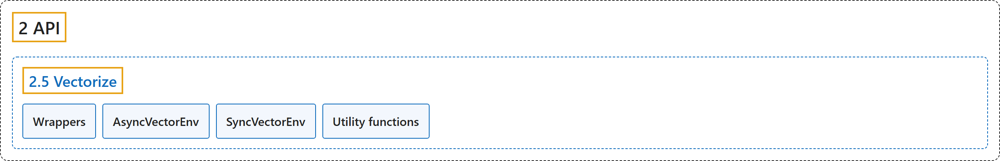

# 2.5 Vectorize

## Classification

## Glossary

| Term | Definition | 中文翻译 | Source |
|---|---|---|---|
| **2.5 Vectorize** 向量化 | (context) "**Base class for vectorized environments to run multiple independent copies of the same environment in parallel.**" | （语境）**向量化环境的基类，用于并行运行同一环境的多个独立副本。** | [Farama Foundation, n.d.-d, "gymnasium.vector.VectorEnv", para. 1](https://gymnasium.farama.org/api/vector/#gymnasium.vector.VectorEnv) |
| **Wrappers** 包装器 | "**Wraps the vectorized environment to allow a modular transformation.**" | **包装向量化环境，以便进行模块化的变换。** | [Farama Foundation, n.d.-e, "gymnasium.vector.VectorWrapper", para. 1](https://gymnasium.farama.org/api/vector/wrappers/#gymnasium.vector.VectorWrapper) |
| **AsyncVectorEnv** 异步向量环境 | "**Vectorized environment that runs multiple environments in parallel.**" | **并行运行多个环境的向量化环境。** | [Farama Foundation, n.d.-a, "gymnasium.vector.AsyncVectorEnv", para. 1](https://gymnasium.farama.org/api/vector/async_vector_env/#gymnasium.vector.AsyncVectorEnv) |
| **SyncVectorEnv** 同步向量环境 | "**Vectorized environment that serially runs multiple environments.**" | **依次串行运行多个环境的向量化环境。** | [Farama Foundation, n.d.-b, "gymnasium.vector.SyncVectorEnv", para. 1](https://gymnasium.farama.org/api/vector/sync_vector_env/#gymnasium.vector.SyncVectorEnv) |
| **Utility functions** 工具函数 | (No definition) | （无定义） | [Farama Foundation, n.d.-c, "Utility functions"](https://gymnasium.farama.org/api/vector/utils/) |

## References

Farama Foundation. (n.d.-a). *AsyncVectorEnv*. Gymnasium Documentation (Version 1.4.0). Retrieved October 31, 2026, from <https://gymnasium.farama.org/api/vector/async_vector_env/>

Farama Foundation. (n.d.-b). *SyncVectorEnv*. Gymnasium Documentation (Version 1.4.0). Retrieved October 31, 2026, from <https://gymnasium.farama.org/api/vector/sync_vector_env/>

Farama Foundation. (n.d.-c). *Utility functions (Vectorize)*. Gymnasium Documentation (Version 1.4.0). Retrieved October 31, 2026, from <https://gymnasium.farama.org/api/vector/utils/>

Farama Foundation. (n.d.-d). *Vectorize*. Gymnasium Documentation (Version 1.4.0). Retrieved October 31, 2026, from <https://gymnasium.farama.org/api/vector/>

Farama Foundation. (n.d.-e). *Wrappers (Vectorize)*. Gymnasium Documentation (Version 1.4.0). Retrieved October 31, 2026, from <https://gymnasium.farama.org/api/vector/wrappers/>
