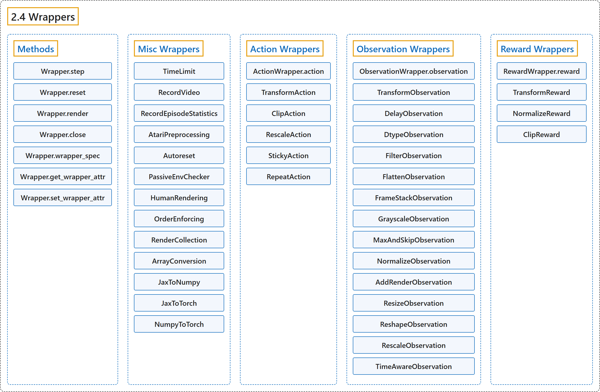

# 2.4 Wrappers

## Classification

## Glossary

| Term | Definition | 中文翻译 | Source |
|---|---|---|---|
| **2.4 Wrappers** 包装器 | "Wrappers are **a convenient way to modify an existing environment without having to alter the underlying code directly**." | 包装器是**一种无需直接修改底层代码就能修改现有环境的便捷方式**。 | [Farama Foundation, n.d.-e, "Wrappers", para. 1](https://gymnasium.farama.org/api/wrappers/) |
| **Methods** 方法 | (No definition) | （无定义） | [Farama Foundation, n.d.-e, "Methods"](https://gymnasium.farama.org/api/wrappers/#methods) |
| **Wrapper.step** step 方法 | "**Uses the step() of the env that can be overwritten to change the returned data.**" | **调用 env 的 step()，可被重写以改变返回的数据。** | [Farama Foundation, n.d.-e, "gymnasium.Wrapper.step", para. 1](https://gymnasium.farama.org/api/wrappers/#gymnasium.Wrapper.step) |
| **Wrapper.reset** reset 方法 | "**Uses the reset() of the env that can be overwritten to change the returned data.**" | **调用 env 的 reset()，可被重写以改变返回的数据。** | [Farama Foundation, n.d.-e, "gymnasium.Wrapper.reset", para. 1](https://gymnasium.farama.org/api/wrappers/#gymnasium.Wrapper.reset) |
| **Wrapper.render** render 方法 | "**Uses the render() of the env that can be overwritten to change the returned data.**" | **调用 env 的 render()，可被重写以改变返回的数据。** | [Farama Foundation, n.d.-e, "gymnasium.Wrapper.render", para. 1](https://gymnasium.farama.org/api/wrappers/#gymnasium.Wrapper.render) |
| **Wrapper.close** close 方法 | "**Closes the wrapper and env.**" | **关闭包装器和 env。** | [Farama Foundation, n.d.-e, "gymnasium.Wrapper.close", para. 1](https://gymnasium.farama.org/api/wrappers/#gymnasium.Wrapper.close) |
| **Wrapper.wrapper_spec** wrapper_spec 方法 | "**Generates a WrapperSpec for the wrappers.**" | **为包装器生成一个 WrapperSpec。** | [Farama Foundation, n.d.-e, "gymnasium.Wrapper.wrapper_spec", para. 1](https://gymnasium.farama.org/api/wrappers/#gymnasium.Wrapper.wrapper_spec) |
| **Wrapper.get_wrapper_attr** get_wrapper_attr 方法 | "**Gets an attribute from the wrapper and lower environments** if name doesn’t exist in this object." | **从包装器及其下层环境获取属性**，在该名称不存在于本对象时使用。 | [Farama Foundation, n.d.-e, "gymnasium.Wrapper.get_wrapper_attr", para. 1](https://gymnasium.farama.org/api/wrappers/#gymnasium.Wrapper.get_wrapper_attr) |
| **Wrapper.set_wrapper_attr** set_wrapper_attr 方法 | "**Sets an attribute on this wrapper or lower environment** if name is already defined." | **在本包装器或下层环境上设置属性**，在该名称已定义时使用。 | [Farama Foundation, n.d.-e, "gymnasium.Wrapper.set_wrapper_attr", para. 1](https://gymnasium.farama.org/api/wrappers/#gymnasium.Wrapper.set_wrapper_attr) |
| **Misc Wrappers** 其他包装器 | (No definition) | （无定义） | [Farama Foundation, n.d.-b, "Misc Wrappers"](https://gymnasium.farama.org/api/wrappers/misc_wrappers/) |
| **TimeLimit** TimeLimit（时间限制包装器） | "**Limits the number of steps for an environment through truncating the environment if a maximum number of timesteps is exceeded.**" | **在超过最大时间步数时截断环境，从而限制环境的步数。** | [Farama Foundation, n.d.-b, "gymnasium.wrappers.TimeLimit", para. 1](https://gymnasium.farama.org/api/wrappers/misc_wrappers/#gymnasium.wrappers.TimeLimit) |
| **RecordVideo** RecordVideo（录制视频包装器） | "**Records videos of environment episodes using the environment’s render function.**" | **用环境的 render 函数录制环境回合的视频。** | [Farama Foundation, n.d.-b, "gymnasium.wrappers.RecordVideo", para. 1](https://gymnasium.farama.org/api/wrappers/misc_wrappers/#gymnasium.wrappers.RecordVideo) |
| **RecordEpisodeStatistics** RecordEpisodeStatistics（记录回合统计包装器） | "This wrapper will **keep track of cumulative rewards and episode lengths**." | 这个包装器会**跟踪累计奖励和回合长度**。 | [Farama Foundation, n.d.-b, "gymnasium.wrappers.RecordEpisodeStatistics", para. 1](https://gymnasium.farama.org/api/wrappers/misc_wrappers/#gymnasium.wrappers.RecordEpisodeStatistics) |
| **AtariPreprocessing** AtariPreprocessing（Atari 预处理包装器） | "**Implements the common preprocessing techniques for Atari environments (excluding frame stacking).**" | **实现 Atari 环境常用的预处理技术（不含帧堆叠）。** | [Farama Foundation, n.d.-b, "gymnasium.wrappers.AtariPreprocessing", para. 1](https://gymnasium.farama.org/api/wrappers/misc_wrappers/#gymnasium.wrappers.AtariPreprocessing) |
| **Autoreset** Autoreset（自动重置包装器） | "The wrapped environment is **automatically reset when a terminated or truncated state is reached**." | 被包装的环境**在到达终止或截断状态时自动重置**。 | [Farama Foundation, n.d.-b, "gymnasium.wrappers.Autoreset", para. 1](https://gymnasium.farama.org/api/wrappers/misc_wrappers/#gymnasium.wrappers.Autoreset) |
| **PassiveEnvChecker** PassiveEnvChecker（被动环境检查包装器） | "**A passive wrapper that surrounds the step, reset and render functions to check they follow Gymnasium’s API.**" | **一个被动包装器，包住 step、reset 和 render 函数，检查它们是否遵循 Gymnasium 的 API。** | [Farama Foundation, n.d.-b, "gymnasium.wrappers.PassiveEnvChecker", para. 1](https://gymnasium.farama.org/api/wrappers/misc_wrappers/#gymnasium.wrappers.PassiveEnvChecker) |
| **HumanRendering** HumanRendering（人类渲染包装器） | "**Allows human like rendering for environments that support “rgb_array” rendering.**" | **让支持“rgb_array”渲染的环境能进行 human 式渲染。** | [Farama Foundation, n.d.-b, "gymnasium.wrappers.HumanRendering", para. 1](https://gymnasium.farama.org/api/wrappers/misc_wrappers/#gymnasium.wrappers.HumanRendering) |
| **OrderEnforcing** OrderEnforcing（顺序强制包装器） | "**Will produce an error if step or render is called before reset.**" | **若在 reset 之前调用 step 或 render，就报错。** | [Farama Foundation, n.d.-b, "gymnasium.wrappers.OrderEnforcing", para. 1](https://gymnasium.farama.org/api/wrappers/misc_wrappers/#gymnasium.wrappers.OrderEnforcing) |
| **RenderCollection** RenderCollection（渲染收集包装器） | "**Collect rendered frames of an environment** such render returns a list[RenderedFrame]." | **收集环境的渲染帧**，使 render 返回 list[RenderedFrame]。 | [Farama Foundation, n.d.-b, "gymnasium.wrappers.RenderCollection", para. 1](https://gymnasium.farama.org/api/wrappers/misc_wrappers/#gymnasium.wrappers.RenderCollection) |
| **ArrayConversion** ArrayConversion（数组转换包装器） | "**Wraps an Array API compatible environment so that it can be interacted with with another Array API framework.**" | **包装一个兼容 Array API 的环境，使其能用另一个 Array API 框架来交互。** | [Farama Foundation, n.d.-b, "gymnasium.wrappers.ArrayConversion", para. 1](https://gymnasium.farama.org/api/wrappers/misc_wrappers/#gymnasium.wrappers.ArrayConversion) |
| **JaxToNumpy** JaxToNumpy（Jax 转 NumPy 包装器） | "**Wraps a Jax-based environment such that it can be interacted with NumPy arrays.**" | **包装一个基于 Jax 的环境，使其能用 NumPy 数组交互。** | [Farama Foundation, n.d.-b, "gymnasium.wrappers.JaxToNumpy", para. 1](https://gymnasium.farama.org/api/wrappers/misc_wrappers/#gymnasium.wrappers.JaxToNumpy) |
| **JaxToTorch** JaxToTorch（Jax 转 PyTorch 包装器） | "**Wraps a Jax-based environment so that it can be interacted with PyTorch Tensors.**" | **包装一个基于 Jax 的环境，使其能用 PyTorch 张量交互。** | [Farama Foundation, n.d.-b, "gymnasium.wrappers.JaxToTorch", para. 1](https://gymnasium.farama.org/api/wrappers/misc_wrappers/#gymnasium.wrappers.JaxToTorch) |
| **NumpyToTorch** NumpyToTorch（NumPy 转 PyTorch 包装器） | "**Wraps a NumPy-based environment such that it can be interacted with PyTorch Tensors.**" | **包装一个基于 NumPy 的环境，使其能用 PyTorch 张量交互。** | [Farama Foundation, n.d.-b, "gymnasium.wrappers.NumpyToTorch", para. 1](https://gymnasium.farama.org/api/wrappers/misc_wrappers/#gymnasium.wrappers.NumpyToTorch) |
| **Action Wrappers** 动作包装器 | "**Superclass of wrappers that can modify the action before step().**" | **能在 step() 之前修改动作的包装器的超类。** | [Farama Foundation, n.d.-a, "gymnasium.ActionWrapper", para. 1](https://gymnasium.farama.org/api/wrappers/action_wrappers/#gymnasium.ActionWrapper) |
| **ActionWrapper.action** action 方法 | "**Returns a modified action before step() is called.**" | **在调用 step() 之前返回修改后的动作。** | [Farama Foundation, n.d.-a, "gymnasium.ActionWrapper.action", para. 1](https://gymnasium.farama.org/api/wrappers/action_wrappers/#gymnasium.ActionWrapper.action) |
| **TransformAction** TransformAction（动作变换包装器） | "**Applies a function to the action before passing the modified value to the environment step function.**" | **先对动作应用一个函数，再把修改后的值传给环境的 step 函数。** | [Farama Foundation, n.d.-a, "gymnasium.wrappers.TransformAction", para. 1](https://gymnasium.farama.org/api/wrappers/action_wrappers/#gymnasium.wrappers.TransformAction) |
| **ClipAction** ClipAction（动作裁剪包装器） | "**Clips the action pass to step to be within the environment’s action_space.**" | **裁剪传给 step 的动作，使其落在环境的 action_space 之内。** | [Farama Foundation, n.d.-a, "gymnasium.wrappers.ClipAction", para. 1](https://gymnasium.farama.org/api/wrappers/action_wrappers/#gymnasium.wrappers.ClipAction) |
| **RescaleAction** RescaleAction（动作缩放包装器） | "**Affinely (linearly) rescales a Box action space of the environment to within the range of [min_action, max_action].**" | **把环境的 Box 动作空间仿射（线性）缩放到 [min_action, max_action] 范围内。** | [Farama Foundation, n.d.-a, "gymnasium.wrappers.RescaleAction", para. 1](https://gymnasium.farama.org/api/wrappers/action_wrappers/#gymnasium.wrappers.RescaleAction) |
| **StickyAction** StickyAction（粘滞动作包装器） | "**Adds a probability that the action is repeated for the same step function.**" | **增加一个概率，使动作在同一 step 函数中被重复。** | [Farama Foundation, n.d.-a, "gymnasium.wrappers.StickyAction", para. 1](https://gymnasium.farama.org/api/wrappers/action_wrappers/#gymnasium.wrappers.StickyAction) |
| **RepeatAction** RepeatAction（重复动作包装器） | "**Repeats the given action for num_repeats steps, accumulating the reward.**" | **把给定动作重复 num_repeats 步，并累加奖励。** | [Farama Foundation, n.d.-a, "gymnasium.wrappers.RepeatAction", para. 1](https://gymnasium.farama.org/api/wrappers/action_wrappers/#gymnasium.wrappers.RepeatAction) |
| **Observation Wrappers** 观测包装器 | "**Modify observations from Env.reset() and Env.step() using observation() function.**" | **用 observation() 函数修改 Env.reset() 和 Env.step() 返回的观测。** | [Farama Foundation, n.d.-c, "gymnasium.ObservationWrapper", para. 1](https://gymnasium.farama.org/api/wrappers/observation_wrappers/#gymnasium.ObservationWrapper) |
| **ObservationWrapper.observation** observation 方法 | "**Returns a modified observation.**" | **返回修改后的观测。** | [Farama Foundation, n.d.-c, "gymnasium.ObservationWrapper.observation", para. 1](https://gymnasium.farama.org/api/wrappers/observation_wrappers/#gymnasium.ObservationWrapper.observation) |
| **TransformObservation** TransformObservation（观测变换包装器） | "**Applies a function to the observation received from the environment’s Env.reset() and Env.step() that is passed back to the user.**" | **对从环境的 Env.reset() 和 Env.step() 收到、要返回给用户的观测应用一个函数。** | [Farama Foundation, n.d.-c, "gymnasium.wrappers.TransformObservation", para. 1](https://gymnasium.farama.org/api/wrappers/observation_wrappers/#gymnasium.wrappers.TransformObservation) |
| **DelayObservation** DelayObservation（观测延迟包装器） | "**Adds a delay to the returned observation from the environment.**" | **给环境返回的观测加上延迟。** | [Farama Foundation, n.d.-c, "gymnasium.wrappers.DelayObservation", para. 1](https://gymnasium.farama.org/api/wrappers/observation_wrappers/#gymnasium.wrappers.DelayObservation) |
| **DtypeObservation** DtypeObservation（观测类型转换包装器） | "**Modifies the dtype of an observation array to a specified dtype.**" | **把观测数组的 dtype 改为指定的 dtype。** | [Farama Foundation, n.d.-c, "gymnasium.wrappers.DtypeObservation", para. 1](https://gymnasium.farama.org/api/wrappers/observation_wrappers/#gymnasium.wrappers.DtypeObservation) |
| **FilterObservation** FilterObservation（观测过滤包装器） | "**Filters a Dict or Tuple observation spaces by a set of keys or indexes.**" | **按一组键或索引过滤 Dict 或 Tuple 观测空间。** | [Farama Foundation, n.d.-c, "gymnasium.wrappers.FilterObservation", para. 1](https://gymnasium.farama.org/api/wrappers/observation_wrappers/#gymnasium.wrappers.FilterObservation) |
| **FlattenObservation** FlattenObservation（观测展平包装器） | "**Flattens the environment’s observation space and each observation from reset and step functions.**" | **展平环境的观测空间以及 reset 和 step 函数返回的每个观测。** | [Farama Foundation, n.d.-c, "gymnasium.wrappers.FlattenObservation", para. 1](https://gymnasium.farama.org/api/wrappers/observation_wrappers/#gymnasium.wrappers.FlattenObservation) |
| **FrameStackObservation** FrameStackObservation（帧堆叠观测包装器） | "**Stacks the observations from the last N time steps in a rolling manner.**" | **以滚动方式堆叠最近 N 个时间步的观测。** | [Farama Foundation, n.d.-c, "gymnasium.wrappers.FrameStackObservation", para. 1](https://gymnasium.farama.org/api/wrappers/observation_wrappers/#gymnasium.wrappers.FrameStackObservation) |
| **GrayscaleObservation** GrayscaleObservation（灰度观测包装器） | "**Converts an image observation computed by reset and step from RGB to Grayscale.**" | **把 reset 和 step 计算出的图像观测从 RGB 转换为灰度。** | [Farama Foundation, n.d.-c, "gymnasium.wrappers.GrayscaleObservation", para. 1](https://gymnasium.farama.org/api/wrappers/observation_wrappers/#gymnasium.wrappers.GrayscaleObservation) |
| **MaxAndSkipObservation** MaxAndSkipObservation（取最大并跳帧观测包装器） | "**Skips the N-th frame (observation) and return the max values between the two last observations.**" | **跳过第 N 帧（观测），并返回最后两个观测之间的最大值。** | [Farama Foundation, n.d.-c, "gymnasium.wrappers.MaxAndSkipObservation", para. 1](https://gymnasium.farama.org/api/wrappers/observation_wrappers/#gymnasium.wrappers.MaxAndSkipObservation) |
| **NormalizeObservation** NormalizeObservation（观测归一化包装器） | "**Normalizes observations to be centered at the mean with unit variance.**" | **把观测归一化为以均值为中心、方差为 1。** | [Farama Foundation, n.d.-c, "gymnasium.wrappers.NormalizeObservation", para. 1](https://gymnasium.farama.org/api/wrappers/observation_wrappers/#gymnasium.wrappers.NormalizeObservation) |
| **AddRenderObservation** AddRenderObservation（加入渲染观测包装器） | "**Includes the rendered observations in the environment’s observations.**" | **把渲染出的观测加入环境的观测中。** | [Farama Foundation, n.d.-c, "gymnasium.wrappers.AddRenderObservation", para. 1](https://gymnasium.farama.org/api/wrappers/observation_wrappers/#gymnasium.wrappers.AddRenderObservation) |
| **ResizeObservation** ResizeObservation（观测尺寸调整包装器） | "**Resizes image observations using OpenCV to a specified shape.**" | **用 OpenCV 把图像观测调整为指定形状。** | [Farama Foundation, n.d.-c, "gymnasium.wrappers.ResizeObservation", para. 1](https://gymnasium.farama.org/api/wrappers/observation_wrappers/#gymnasium.wrappers.ResizeObservation) |
| **ReshapeObservation** ReshapeObservation（观测变形包装器） | "**Reshapes Array based observations to a specified shape.**" | **把基于数组的观测变形为指定形状。** | [Farama Foundation, n.d.-c, "gymnasium.wrappers.ReshapeObservation", para. 1](https://gymnasium.farama.org/api/wrappers/observation_wrappers/#gymnasium.wrappers.ReshapeObservation) |
| **RescaleObservation** RescaleObservation（观测缩放包装器） | "**Affinely (linearly) rescales a Box observation space of the environment to within the range of [min_obs, max_obs].**" | **把环境的 Box 观测空间仿射（线性）缩放到 [min_obs, max_obs] 范围内。** | [Farama Foundation, n.d.-c, "gymnasium.wrappers.RescaleObservation", para. 1](https://gymnasium.farama.org/api/wrappers/observation_wrappers/#gymnasium.wrappers.RescaleObservation) |
| **TimeAwareObservation** TimeAwareObservation（时间感知观测包装器） | "**Augment the observation with the number of time steps taken within an episode.**" | **用回合内已走的时间步数来扩充观测。** | [Farama Foundation, n.d.-c, "gymnasium.wrappers.TimeAwareObservation", para. 1](https://gymnasium.farama.org/api/wrappers/observation_wrappers/#gymnasium.wrappers.TimeAwareObservation) |
| **Reward Wrappers** 奖励包装器 | "**Superclass of wrappers that can modify the returning reward from a step.**" | **能修改 step 返回的奖励的包装器的超类。** | [Farama Foundation, n.d.-d, "gymnasium.RewardWrapper", para. 1](https://gymnasium.farama.org/api/wrappers/reward_wrappers/#gymnasium.RewardWrapper) |
| **RewardWrapper.reward** reward 方法 | "**Returns a modified environment reward.**" | **返回修改后的环境奖励。** | [Farama Foundation, n.d.-d, "gymnasium.RewardWrapper.reward", para. 1](https://gymnasium.farama.org/api/wrappers/reward_wrappers/#gymnasium.RewardWrapper.reward) |
| **TransformReward** TransformReward（奖励变换包装器） | "**Applies a function to the reward received from the environment’s step.**" | **对从环境的 step 收到的奖励应用一个函数。** | [Farama Foundation, n.d.-d, "gymnasium.wrappers.TransformReward", para. 1](https://gymnasium.farama.org/api/wrappers/reward_wrappers/#gymnasium.wrappers.TransformReward) |
| **NormalizeReward** NormalizeReward（奖励归一化包装器） | "**Normalizes immediate rewards such that their exponential moving average has an approximately fixed variance.**" | **归一化即时奖励，使其指数移动平均的方差近似固定。** | [Farama Foundation, n.d.-d, "gymnasium.wrappers.NormalizeReward", para. 1](https://gymnasium.farama.org/api/wrappers/reward_wrappers/#gymnasium.wrappers.NormalizeReward) |
| **ClipReward** ClipReward（奖励裁剪包装器） | "**Clips the rewards for an environment between an upper and lower bound.**" | **把环境的奖励裁剪到上下界之间。** | [Farama Foundation, n.d.-d, "gymnasium.wrappers.ClipReward", para. 1](https://gymnasium.farama.org/api/wrappers/reward_wrappers/#gymnasium.wrappers.ClipReward) |

## References

Farama Foundation. (n.d.-a). *Action Wrappers*. Gymnasium Documentation (Version 1.4.0). Retrieved October 31, 2026, from <https://gymnasium.farama.org/api/wrappers/action_wrappers/>

Farama Foundation. (n.d.-b). *Misc Wrappers*. Gymnasium Documentation (Version 1.4.0). Retrieved October 31, 2026, from <https://gymnasium.farama.org/api/wrappers/misc_wrappers/>

Farama Foundation. (n.d.-c). *Observation Wrappers*. Gymnasium Documentation (Version 1.4.0). Retrieved October 31, 2026, from <https://gymnasium.farama.org/api/wrappers/observation_wrappers/>

Farama Foundation. (n.d.-d). *Reward Wrappers*. Gymnasium Documentation (Version 1.4.0). Retrieved October 31, 2026, from <https://gymnasium.farama.org/api/wrappers/reward_wrappers/>

Farama Foundation. (n.d.-e). *Wrappers*. Gymnasium Documentation (Version 1.4.0). Retrieved October 31, 2026, from <https://gymnasium.farama.org/api/wrappers/>
