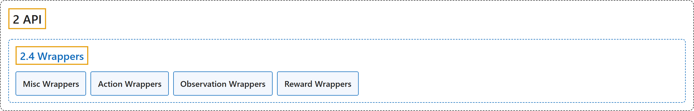

# 2.4 Wrappers

## Classification

## Glossary

| Term | Definition | 中文翻译 | Source |
|---|---|---|---|
| **2.4 Wrappers** 包装器 | "Wrappers are **a convenient way to modify an existing environment without having to alter the underlying code directly**." | 包装器是**一种无需直接修改底层代码就能修改现有环境的便捷方式**。 | [Farama Foundation, n.d.-e, "Wrappers", para. 1](https://gymnasium.farama.org/api/wrappers/) |
| **Misc Wrappers** 其他包装器 | (No definition) | （无定义） | [Farama Foundation, n.d.-b, "Misc Wrappers"](https://gymnasium.farama.org/api/wrappers/misc_wrappers/) |
| **Action Wrappers** 动作包装器 | "**Superclass of wrappers that can modify the action before step().**" | **能在 step() 之前修改动作的包装器的超类。** | [Farama Foundation, n.d.-a, "gymnasium.ActionWrapper", para. 1](https://gymnasium.farama.org/api/wrappers/action_wrappers/#gymnasium.ActionWrapper) |
| **Observation Wrappers** 观测包装器 | "**Modify observations from Env.reset() and Env.step() using observation() function.**" | **用 observation() 函数修改 Env.reset() 和 Env.step() 返回的观测。** | [Farama Foundation, n.d.-c, "gymnasium.ObservationWrapper", para. 1](https://gymnasium.farama.org/api/wrappers/observation_wrappers/#gymnasium.ObservationWrapper) |
| **Reward Wrappers** 奖励包装器 | "**Superclass of wrappers that can modify the returning reward from a step.**" | **能修改 step 返回的奖励的包装器的超类。** | [Farama Foundation, n.d.-d, "gymnasium.RewardWrapper", para. 1](https://gymnasium.farama.org/api/wrappers/reward_wrappers/#gymnasium.RewardWrapper) |

## References

Farama Foundation. (n.d.-a). *Action Wrappers*. Gymnasium Documentation (Version 1.4.0). Retrieved October 31, 2026, from <https://gymnasium.farama.org/api/wrappers/action_wrappers/>

Farama Foundation. (n.d.-b). *Misc Wrappers*. Gymnasium Documentation (Version 1.4.0). Retrieved October 31, 2026, from <https://gymnasium.farama.org/api/wrappers/misc_wrappers/>

Farama Foundation. (n.d.-c). *Observation Wrappers*. Gymnasium Documentation (Version 1.4.0). Retrieved October 31, 2026, from <https://gymnasium.farama.org/api/wrappers/observation_wrappers/>

Farama Foundation. (n.d.-d). *Reward Wrappers*. Gymnasium Documentation (Version 1.4.0). Retrieved October 31, 2026, from <https://gymnasium.farama.org/api/wrappers/reward_wrappers/>

Farama Foundation. (n.d.-e). *Wrappers*. Gymnasium Documentation (Version 1.4.0). Retrieved October 31, 2026, from <https://gymnasium.farama.org/api/wrappers/>
