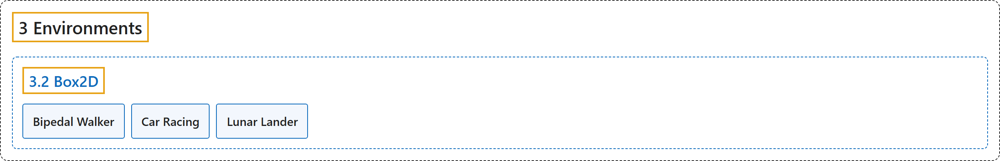

# 3.2 Box2D

## Classification

## Glossary

| Term | Definition | 中文翻译 | Source |
|---|---|---|---|
| **3.2 Box2D** Box2D | "These environments all involve **toy games based around physics control, using box2d based physics and PyGame-based rendering**." | 这些环境都是**围绕物理控制的玩具游戏，使用基于 box2d 的物理引擎和基于 PyGame 的渲染**。 | [Farama Foundation, n.d.-b, "Box2D", para. 2](https://gymnasium.farama.org/environments/box2d/) |
| **Bipedal Walker** 双足行走者 | "This is **a simple 4-joint walker robot environment**." | 这是**一个简单的四关节行走机器人环境**。 | [Farama Foundation, n.d.-a, "Bipedal Walker", para. 2](https://gymnasium.farama.org/environments/box2d/bipedal_walker/) |
| **Car Racing** 赛车 | "**The easiest control task to learn from pixels - a top-down racing environment.**" | **最容易从像素学习的控制任务：一个俯视视角的赛车环境。** | [Farama Foundation, n.d.-c, "Car Racing", para. 2](https://gymnasium.farama.org/environments/box2d/car_racing/) |
| **Lunar Lander** 月球着陆器 | "This environment is **a classic rocket trajectory optimization problem**." | 这个环境是**一个经典的火箭轨迹优化问题**。 | [Farama Foundation, n.d.-d, "Lunar Lander", para. 2](https://gymnasium.farama.org/environments/box2d/lunar_lander/) |

## References

Farama Foundation. (n.d.-a). *Bipedal Walker*. Gymnasium Documentation (Version 1.4.0). Retrieved October 31, 2026, from <https://gymnasium.farama.org/environments/box2d/bipedal_walker/>

Farama Foundation. (n.d.-b). *Box2D*. Gymnasium Documentation (Version 1.4.0). Retrieved October 31, 2026, from <https://gymnasium.farama.org/environments/box2d/>

Farama Foundation. (n.d.-c). *Car Racing*. Gymnasium Documentation (Version 1.4.0). Retrieved October 31, 2026, from <https://gymnasium.farama.org/environments/box2d/car_racing/>

Farama Foundation. (n.d.-d). *Lunar Lander*. Gymnasium Documentation (Version 1.4.0). Retrieved October 31, 2026, from <https://gymnasium.farama.org/environments/box2d/lunar_lander/>
