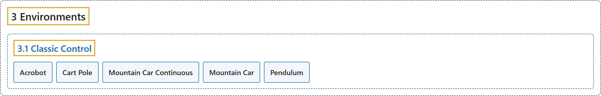

# 3.1 Classic Control

## Classification

## Glossary

| Term | Definition | 中文翻译 | Source |
|---|---|---|---|
| **3.1 Classic Control** 经典控制 | "There are **five classic control environments: Acrobot, CartPole, Mountain Car, Continuous Mountain Car, and Pendulum**." | 共有**五个经典控制环境：Acrobot、CartPole、Mountain Car、Continuous Mountain Car 和 Pendulum**。 | [Farama Foundation, n.d.-c, "Classic Control", para. 2](https://gymnasium.farama.org/environments/classic_control/) |
| **Acrobot** 双连杆摆 | "The system **consists of two links connected linearly to form a chain, with one end of the chain fixed**." | 该系统**由两根线性连接成链的连杆组成，链的一端固定**。 | [Farama Foundation, n.d.-a, "Acrobot", para. 2](https://gymnasium.farama.org/environments/classic_control/acrobot/) |
| **Cart Pole** 倒立摆小车 | "**A pole is attached by an un-actuated joint to a cart, which moves along a frictionless track.**" | **一根杆通过无驱动的关节连在小车上，小车沿无摩擦的轨道移动。** | [Farama Foundation, n.d.-b, "Cart Pole", para. 2](https://gymnasium.farama.org/environments/classic_control/cart_pole/) |
| **Mountain Car Continuous** 连续动作山地车 | "The Mountain Car MDP is **a deterministic MDP that consists of a car placed stochastically at the bottom of a sinusoidal valley, with the only possible actions being the accelerations that can be applied to the car in either direction**." | 山地车 MDP 是**一个确定性的 MDP：一辆车被随机放在正弦形山谷的谷底，唯一可做的动作是向任一方向给车施加加速度**。 | [Farama Foundation, n.d.-e, "Mountain Car Continuous", para. 2](https://gymnasium.farama.org/environments/classic_control/mountain_car_continuous/) |
| **Mountain Car** 山地车 | "The Mountain Car MDP is **a deterministic MDP that consists of a car placed stochastically at the bottom of a sinusoidal valley, with the only possible actions being the accelerations that can be applied to the car in either direction**." | 山地车 MDP 是**一个确定性的 MDP：一辆车被随机放在正弦形山谷的谷底，唯一可做的动作是向任一方向给车施加加速度**。 | [Farama Foundation, n.d.-d, "Mountain Car", para. 2](https://gymnasium.farama.org/environments/classic_control/mountain_car/) |
| **Pendulum** 摆 | "The system **consists of a pendulum attached at one end to a fixed point, and the other end being free**." | 该系统**由一个摆组成，一端连在固定点上，另一端自由**。 | [Farama Foundation, n.d.-f, "Pendulum", para. 2](https://gymnasium.farama.org/environments/classic_control/pendulum/) |

## References

Farama Foundation. (n.d.-a). *Acrobot*. Gymnasium Documentation (Version 1.4.0). Retrieved October 31, 2026, from <https://gymnasium.farama.org/environments/classic_control/acrobot/>

Farama Foundation. (n.d.-b). *Cart Pole*. Gymnasium Documentation (Version 1.4.0). Retrieved October 31, 2026, from <https://gymnasium.farama.org/environments/classic_control/cart_pole/>

Farama Foundation. (n.d.-c). *Classic Control*. Gymnasium Documentation (Version 1.4.0). Retrieved October 31, 2026, from <https://gymnasium.farama.org/environments/classic_control/>

Farama Foundation. (n.d.-d). *Mountain Car*. Gymnasium Documentation (Version 1.4.0). Retrieved October 31, 2026, from <https://gymnasium.farama.org/environments/classic_control/mountain_car/>

Farama Foundation. (n.d.-e). *Mountain Car Continuous*. Gymnasium Documentation (Version 1.4.0). Retrieved October 31, 2026, from <https://gymnasium.farama.org/environments/classic_control/mountain_car_continuous/>

Farama Foundation. (n.d.-f). *Pendulum*. Gymnasium Documentation (Version 1.4.0). Retrieved October 31, 2026, from <https://gymnasium.farama.org/environments/classic_control/pendulum/>
