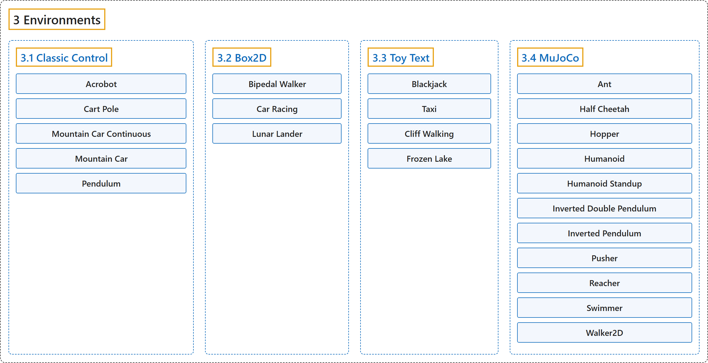

# 3. Environments

## Classification

## Glossary

| Term | Definition | 中文翻译 | Source |
|---|---|---|---|
| **3 Environments** 环境 | (context) "There are **five classic control environments: Acrobot, CartPole, Mountain Car, Continuous Mountain Car, and Pendulum**." | （语境）共有**五个经典控制环境：Acrobot、CartPole、Mountain Car、Continuous Mountain Car 和 Pendulum**。 | [Farama Foundation, n.d.-b, "Classic Control", para. 2](https://gymnasium.farama.org/environments/classic_control/) |
| **[3.1 Classic Control](classic-control.md)** 经典控制 | "There are **five classic control environments: Acrobot, CartPole, Mountain Car, Continuous Mountain Car, and Pendulum**." | 共有**五个经典控制环境：Acrobot、CartPole、Mountain Car、Continuous Mountain Car 和 Pendulum**。 | [Farama Foundation, n.d.-b, "Classic Control", para. 2](https://gymnasium.farama.org/environments/classic_control/) |
| **[3.2 Box2D](box2d.md)** Box2D | "These environments all involve **toy games based around physics control, using box2d based physics and PyGame-based rendering**." | 这些环境都是**围绕物理控制的玩具游戏，使用基于 box2d 的物理引擎和基于 PyGame 的渲染**。 | [Farama Foundation, n.d.-a, "Box2D", para. 2](https://gymnasium.farama.org/environments/box2d/) |
| **[3.3 Toy Text](toy-text.md)** 玩具文本 | "Toy text environments are **designed to be extremely simple, with small discrete state and action spaces, and hence easy to learn**." | 玩具文本环境**设计得极其简单，状态空间和动作空间都很小且离散，因此容易学习**。 | [Farama Foundation, n.d.-d, "Toy Text", para. 2](https://gymnasium.farama.org/environments/toy_text/) |
| **[3.4 MuJoCo](mujoco.md)** MuJoCo | (context) "MuJoCo stands for Multi-Joint dynamics with Contact. It is **a physics engine for facilitating research and development in robotics, biomechanics, graphics and animation, and other areas where fast and accurate simulation is needed**." | （语境）MuJoCo 是 Multi-Joint dynamics with Contact 的缩写。它是**一个物理引擎，用于推动机器人、生物力学、图形与动画以及其他需要快速准确仿真的领域的研究和开发**。 | [Farama Foundation, n.d.-c, "MuJoCo", para. 2](https://gymnasium.farama.org/environments/mujoco/) |

## References

Farama Foundation. (n.d.-a). *Box2D*. Gymnasium Documentation (Version 1.4.0). Retrieved October 31, 2026, from <https://gymnasium.farama.org/environments/box2d/>

Farama Foundation. (n.d.-b). *Classic Control*. Gymnasium Documentation (Version 1.4.0). Retrieved October 31, 2026, from <https://gymnasium.farama.org/environments/classic_control/>

Farama Foundation. (n.d.-c). *MuJoCo*. Gymnasium Documentation (Version 1.4.0). Retrieved October 31, 2026, from <https://gymnasium.farama.org/environments/mujoco/>

Farama Foundation. (n.d.-d). *Toy Text*. Gymnasium Documentation (Version 1.4.0). Retrieved October 31, 2026, from <https://gymnasium.farama.org/environments/toy_text/>
