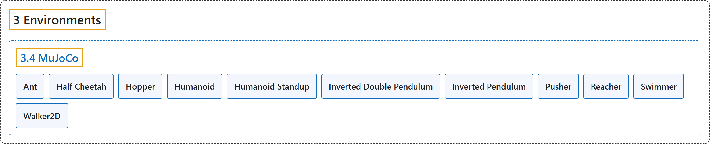

# 3.4 MuJoCo

## Classification

## Glossary

| Term | Definition | 中文翻译 | Source |
|---|---|---|---|
| **3.4 MuJoCo** MuJoCo | (context) "MuJoCo stands for Multi-Joint dynamics with Contact. It is **a physics engine for facilitating research and development in robotics, biomechanics, graphics and animation, and other areas where fast and accurate simulation is needed**." | （语境）MuJoCo 是 Multi-Joint dynamics with Contact 的缩写。它是**一个物理引擎，用于推动机器人、生物力学、图形与动画以及其他需要快速准确仿真的领域的研究和开发**。 | [Farama Foundation, n.d.-h, "MuJoCo", para. 2](https://gymnasium.farama.org/environments/mujoco/) |
| **Ant** 蚂蚁 | "The ant is **a 3D quadruped robot consisting of a torso (free rotational body) with four legs attached to it, where each leg has two body parts**." | 蚂蚁是**一个三维四足机器人，由一个躯干（可自由转动的刚体）和连在上面的四条腿组成，每条腿有两节**。 | [Farama Foundation, n.d.-a, "Ant", para. 2](https://gymnasium.farama.org/environments/mujoco/ant/) |
| **Half Cheetah** 半猎豹 | "The HalfCheetah is **a 2-dimensional robot consisting of 9 body parts and 8 joints connecting them (including two paws)**." | 半猎豹是**一个二维机器人，由 9 个身体部件和连接它们的 8 个关节组成（包括两只爪子）**。 | [Farama Foundation, n.d.-b, "Half Cheetah", para. 2](https://gymnasium.farama.org/environments/mujoco/half_cheetah/) |
| **Hopper** 单腿跳跃者 | "The hopper is **a two-dimensional one-legged figure consisting of four main body parts - the torso at the top, the thigh in the middle, the leg at the bottom, and a single foot on which the entire body rests**." | 单腿跳跃者是**一个二维的单腿形体，由四个主要部件组成：顶部的躯干、中间的大腿、底部的小腿，以及支撑整个身体的一只脚**。 | [Farama Foundation, n.d.-c, "Hopper", para. 2](https://gymnasium.farama.org/environments/mujoco/hopper/) |
| **Humanoid** 人形 | "The 3D bipedal robot is **designed to simulate a human**." | 这个三维双足机器人**用来模拟人**。 | [Farama Foundation, n.d.-d, "Humanoid", para. 2](https://gymnasium.farama.org/environments/mujoco/humanoid/) |
| **Humanoid Standup** 人形起立 | "The 3D bipedal robot is **designed to simulate a human**." | 这个三维双足机器人**用来模拟人**。 | [Farama Foundation, n.d.-e, "Humanoid Standup", para. 2](https://gymnasium.farama.org/environments/mujoco/humanoid_standup/) |
| **Inverted Double Pendulum** 二级倒立摆 | "The cart can be pushed left or right, and the goal is **to balance the second pole on top of the first pole, which is in turn on top of the cart, by applying continuous forces to the cart**." | 小车可以向左或向右推，目标是**通过对小车施加连续的力，让第二根杆平衡在第一根杆之上，而第一根杆又立在小车上**。 | [Farama Foundation, n.d.-f, "Inverted Double Pendulum", para. 2](https://gymnasium.farama.org/environments/mujoco/inverted_double_pendulum/) |
| **Inverted Pendulum** 倒立摆 | "The cart can be pushed left or right, and the goal is **to balance the pole on top of the cart by applying forces to the cart**." | 小车可以向左或向右推，目标是**通过对小车施力，让杆在小车上保持平衡**。 | [Farama Foundation, n.d.-g, "Inverted Pendulum", para. 2](https://gymnasium.farama.org/environments/mujoco/inverted_pendulum/) |
| **Pusher** 推动臂 | "“Pusher” is **a multi-jointed robot arm that is very similar to a human arm**." | “Pusher”是**一个与人类手臂非常相似的多关节机械臂**。 | [Farama Foundation, n.d.-i, "Pusher", para. 2](https://gymnasium.farama.org/environments/mujoco/pusher/) |
| **Reacher** 伸展臂 | "“Reacher” is **a two-jointed robot arm**." | “Reacher”是**一个两关节机械臂**。 | [Farama Foundation, n.d.-j, "Reacher", para. 2](https://gymnasium.farama.org/environments/mujoco/reacher/) |
| **Swimmer** 游泳者 | "The swimmers **consist of three or more segments (’links’) and one less articulation joints (’rotors’)** - one rotor joint connects exactly two links to form a linear chain." | 游泳者**由三个或更多的节段（“连杆”）和比节段少一个的关节（“转子”）组成**：每个转子关节恰好连接两根连杆，形成一条线性链。 | [Farama Foundation, n.d.-k, "Swimmer", para. 2](https://gymnasium.farama.org/environments/mujoco/swimmer/) |
| **Walker2D** 二维行走者 | "This environment **builds on the hopper environment by adding another set of legs that allow the robot to walk forward instead of hop**." | 这个环境**在单腿跳跃者环境的基础上增加了一组腿，使机器人能向前行走，而不是跳跃**。 | [Farama Foundation, n.d.-l, "Walker2D", para. 2](https://gymnasium.farama.org/environments/mujoco/walker2d/) |

## References

Farama Foundation. (n.d.-a). *Ant*. Gymnasium Documentation (Version 1.4.0). Retrieved October 31, 2026, from <https://gymnasium.farama.org/environments/mujoco/ant/>

Farama Foundation. (n.d.-b). *Half Cheetah*. Gymnasium Documentation (Version 1.4.0). Retrieved October 31, 2026, from <https://gymnasium.farama.org/environments/mujoco/half_cheetah/>

Farama Foundation. (n.d.-c). *Hopper*. Gymnasium Documentation (Version 1.4.0). Retrieved October 31, 2026, from <https://gymnasium.farama.org/environments/mujoco/hopper/>

Farama Foundation. (n.d.-d). *Humanoid*. Gymnasium Documentation (Version 1.4.0). Retrieved October 31, 2026, from <https://gymnasium.farama.org/environments/mujoco/humanoid/>

Farama Foundation. (n.d.-e). *Humanoid Standup*. Gymnasium Documentation (Version 1.4.0). Retrieved October 31, 2026, from <https://gymnasium.farama.org/environments/mujoco/humanoid_standup/>

Farama Foundation. (n.d.-f). *Inverted Double Pendulum*. Gymnasium Documentation (Version 1.4.0). Retrieved October 31, 2026, from <https://gymnasium.farama.org/environments/mujoco/inverted_double_pendulum/>

Farama Foundation. (n.d.-g). *Inverted Pendulum*. Gymnasium Documentation (Version 1.4.0). Retrieved October 31, 2026, from <https://gymnasium.farama.org/environments/mujoco/inverted_pendulum/>

Farama Foundation. (n.d.-h). *MuJoCo*. Gymnasium Documentation (Version 1.4.0). Retrieved October 31, 2026, from <https://gymnasium.farama.org/environments/mujoco/>

Farama Foundation. (n.d.-i). *Pusher*. Gymnasium Documentation (Version 1.4.0). Retrieved October 31, 2026, from <https://gymnasium.farama.org/environments/mujoco/pusher/>

Farama Foundation. (n.d.-j). *Reacher*. Gymnasium Documentation (Version 1.4.0). Retrieved October 31, 2026, from <https://gymnasium.farama.org/environments/mujoco/reacher/>

Farama Foundation. (n.d.-k). *Swimmer*. Gymnasium Documentation (Version 1.4.0). Retrieved October 31, 2026, from <https://gymnasium.farama.org/environments/mujoco/swimmer/>

Farama Foundation. (n.d.-l). *Walker2D*. Gymnasium Documentation (Version 1.4.0). Retrieved October 31, 2026, from <https://gymnasium.farama.org/environments/mujoco/walker2d/>
