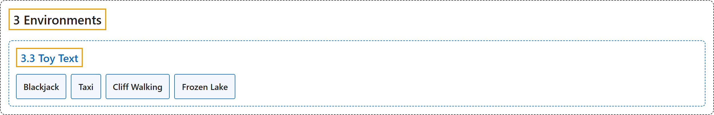

# 3.3 Toy Text

## Classification

## Glossary

| Term | Definition | 中文翻译 | Source |
|---|---|---|---|
| **3.3 Toy Text** 玩具文本 | "Toy text environments are **designed to be extremely simple, with small discrete state and action spaces, and hence easy to learn**." | 玩具文本环境**设计得极其简单，状态空间和动作空间都很小且离散，因此容易学习**。 | [Farama Foundation, n.d.-e, "Toy Text", para. 2](https://gymnasium.farama.org/environments/toy_text/) |
| **Blackjack** 二十一点 | "Blackjack is **a card game where the goal is to beat the dealer by obtaining cards that sum to closer to 21 (without going over 21) than the dealers cards**." | 二十一点是**一种纸牌游戏，目标是让手中牌的点数总和比庄家更接近 21（不超过 21），从而赢过庄家**。 | [Farama Foundation, n.d.-a, "Blackjack", para. 2](https://gymnasium.farama.org/environments/toy_text/blackjack/) |
| **Taxi** 出租车 | "The Taxi Problem involves **navigating to passengers in a grid world, picking them up and dropping them off at one of four locations**." | 出租车问题是**在网格世界中开到乘客处，接上乘客，再把他们送到四个地点之一**。 | [Farama Foundation, n.d.-d, "Taxi", para. 2](https://gymnasium.farama.org/environments/toy_text/taxi/) |
| **Cliff Walking** 悬崖行走 | "Cliff walking involves **crossing a gridworld from start to goal while avoiding falling off a cliff**." | 悬崖行走是**从起点穿过网格世界到达终点，同时避免掉下悬崖**。 | [Farama Foundation, n.d.-b, "Cliff Walking", para. 2](https://gymnasium.farama.org/environments/toy_text/cliff_walking/) |
| **Frozen Lake** 冰湖 | "Frozen lake involves **crossing a frozen lake from start to goal without falling into any holes by walking over the frozen lake**." | 冰湖是**在冰冻的湖面上行走，从起点到达终点，途中不掉进任何冰洞**。 | [Farama Foundation, n.d.-c, "Frozen Lake", para. 2](https://gymnasium.farama.org/environments/toy_text/frozen_lake/) |

## References

Farama Foundation. (n.d.-a). *Blackjack*. Gymnasium Documentation (Version 1.4.0). Retrieved October 31, 2026, from <https://gymnasium.farama.org/environments/toy_text/blackjack/>

Farama Foundation. (n.d.-b). *Cliff Walking*. Gymnasium Documentation (Version 1.4.0). Retrieved October 31, 2026, from <https://gymnasium.farama.org/environments/toy_text/cliff_walking/>

Farama Foundation. (n.d.-c). *Frozen Lake*. Gymnasium Documentation (Version 1.4.0). Retrieved October 31, 2026, from <https://gymnasium.farama.org/environments/toy_text/frozen_lake/>

Farama Foundation. (n.d.-d). *Taxi*. Gymnasium Documentation (Version 1.4.0). Retrieved October 31, 2026, from <https://gymnasium.farama.org/environments/toy_text/taxi/>

Farama Foundation. (n.d.-e). *Toy Text*. Gymnasium Documentation (Version 1.4.0). Retrieved October 31, 2026, from <https://gymnasium.farama.org/environments/toy_text/>
