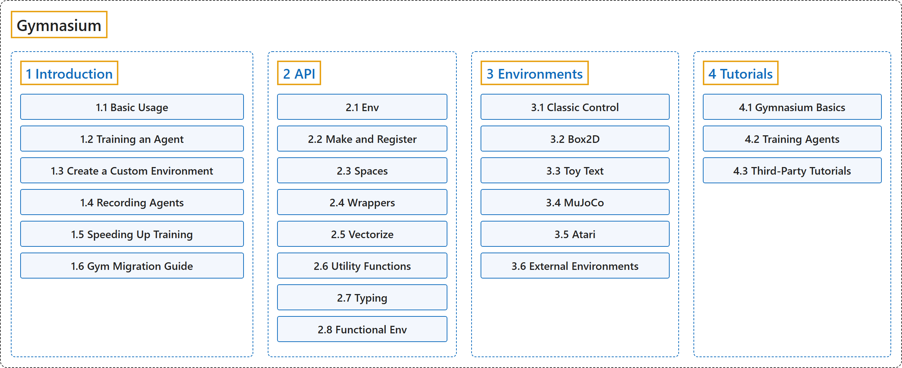

# Gymnasium

## Classification

## Glossary

| Term | Definition | 中文翻译 | Source |
|---|---|---|---|
| **Gymnasium** Gymnasium | "Gymnasium is **a maintained fork of OpenAI’s Gym library**. The Gymnasium interface is **simple, pythonic, and capable of representing general RL problems**, and has a migration guide for old Gym environments:" | Gymnasium 是 **OpenAI Gym 库的一个持续维护的分支**。Gymnasium 的接口**简单、符合 Python 习惯，能够表示一般的强化学习问题**，并为旧的 Gym 环境提供了迁移指南： | [Farama Foundation, n.d., "Gymnasium Documentation", para. 1](https://gymnasium.farama.org/) |
| **[1 Introduction](introduction/index.md)** 入门 | (context) "At its heart, Gymnasium provides **an API (application programming interface) for all single agent reinforcement learning environments, with implementations of common environments**: cartpole, pendulum, mountain-car, mujoco, atari, and more." | （语境）Gymnasium 的核心是提供**一个面向所有单智能体强化学习环境的 API（应用程序编程接口），并实现了常见的环境**：cartpole、pendulum、mountain-car、mujoco、atari 等。 | [Farama Foundation, n.d., "Why Gymnasium?", para. 1](https://gymnasium.farama.org/introduction/basic_usage/#why-gymnasium) |
| **[2 API](api/index.md)** API | (context) "**The main Gymnasium class for implementing Reinforcement Learning Agents environments.**" | （语境）**Gymnasium 中用于实现强化学习智能体环境的主类。** | [Farama Foundation, n.d., "Env", gymnasium.Env, para. 1](https://gymnasium.farama.org/api/env/#gymnasium.Env) |
| **[3 Environments](environments/index.md)** 环境 | (context) "There are **five classic control environments: Acrobot, CartPole, Mountain Car, Continuous Mountain Car, and Pendulum**." | （语境）共有**五个经典控制环境：Acrobot、CartPole、Mountain Car、Continuous Mountain Car 和 Pendulum**。 | [Farama Foundation, n.d., "Classic Control", para. 2](https://gymnasium.farama.org/environments/classic_control/) |
| **[4 Tutorials](tutorials/index.md)** 教程 | (context) "The aim of these tutorials is to **showcase the fundamental API of Gymnasium to help users implement it**" | （语境）这些教程的目的是**展示 Gymnasium 的基本 API，帮助用户实现它** | [Farama Foundation, n.d., "Gymnasium Basics", para. 1](https://gymnasium.farama.org/tutorials/gymnasium_basics/#gymnasium-basics) |

## References

Farama Foundation. (n.d.). *Gymnasium Documentation* (Version 1.4.0). Retrieved October 30, 2026, from <https://gymnasium.farama.org/>
