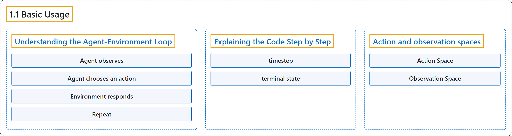

# 1.1 Basic Usage

## Classification

## Glossary

| Term | Definition | 中文翻译 | Source |
|---|---|---|---|
| **1.1 Basic Usage** 基本用法 | (context) "Reinforcement learning is like **teaching through trial and error - an agent learns by trying actions, receiving feedback (rewards), and gradually improving its behavior**." | （语境）强化学习就像**通过试错来教学：智能体尝试动作、获得反馈（奖励），逐步改进自己的行为**。 | [Farama Foundation, n.d., "What is Reinforcement Learning?", para. 1](https://gymnasium.farama.org/introduction/basic_usage/#what-is-reinforcement-learning) |
| **Understanding the Agent-Environment Loop** 理解智能体与环境的循环 | "In reinforcement learning, the classic “agent-environment loop” pictured below **represents how learning happens in RL**." | 在强化学习中，下图所示的经典“智能体与环境的循环”**表示了强化学习中学习是如何发生的**。 | [Farama Foundation, n.d., "Understanding the Agent-Environment Loop", para. 1](https://gymnasium.farama.org/introduction/basic_usage/#understanding-the-agent-environment-loop) |
| **Agent observes** 智能体观察 | "Agent observes **the current situation** (like looking at a game screen)" | 智能体观察**当前情况**（就像看着游戏画面） | [Farama Foundation, n.d., "Understanding the Agent-Environment Loop", item 1](https://gymnasium.farama.org/introduction/basic_usage/#understanding-the-agent-environment-loop) |
| **Agent chooses an action** 智能体选择动作 | "Agent chooses an action **based on what it sees** (like pressing a button)" | 智能体选择动作**依据它看到的内容**（就像按下一个按钮） | [Farama Foundation, n.d., "Understanding the Agent-Environment Loop", item 2](https://gymnasium.farama.org/introduction/basic_usage/#understanding-the-agent-environment-loop) |
| **Environment responds** 环境响应 | "Environment responds **with a new situation and a reward** (game state changes, score updates)" | 环境响应**给出新的情况和一个奖励**（游戏状态变化、分数更新） | [Farama Foundation, n.d., "Understanding the Agent-Environment Loop", item 3](https://gymnasium.farama.org/introduction/basic_usage/#understanding-the-agent-environment-loop) |
| **Repeat** 重复 | "Repeat **until the episode ends**" | 重复**直到回合结束** | [Farama Foundation, n.d., "Understanding the Agent-Environment Loop", item 4](https://gymnasium.farama.org/introduction/basic_usage/#understanding-the-agent-environment-loop) |
| **Explaining the Code Step by Step** 逐步讲解代码 | (No definition) | （无定义） | [Farama Foundation, n.d., "Explaining the Code Step by Step"](https://gymnasium.farama.org/introduction/basic_usage/#explaining-the-code-step-by-step) |
| **timestep** 时间步 | "One such action-observation exchange is called a **timestep**." | 一次这样的动作与观测交换称为一个**时间步**。 | [Farama Foundation, n.d., "Explaining the Code Step by Step", para. 4](https://gymnasium.farama.org/introduction/basic_usage/#explaining-the-code-step-by-step) |
| **terminal state** 终止状态 | "However, after some timesteps, the environment may end - this is called **the terminal state**." | 然而，经过若干时间步后，环境可能会结束，这称为**终止状态**。 | [Farama Foundation, n.d., "Explaining the Code Step by Step", para. 5](https://gymnasium.farama.org/introduction/basic_usage/#explaining-the-code-step-by-step) |
| **Action and observation spaces** 动作空间与观测空间 | "Every environment **specifies the format of valid actions and observations with the action_space and observation_space attributes**." | 每个环境都**用 action_space 和 observation_space 属性规定合法动作和观测的格式**。 | [Farama Foundation, n.d., "Action and observation spaces", para. 1](https://gymnasium.farama.org/introduction/basic_usage/#action-and-observation-spaces) |
| **Action Space** 动作空间 | "Action Space: **What can your agent do?** (discrete choices, continuous values, etc.)" | 动作空间：**你的智能体能做什么**？（离散选择、连续值等） | [Farama Foundation, n.d., "Action and observation spaces", para. 2, item 1](https://gymnasium.farama.org/introduction/basic_usage/#action-and-observation-spaces) |
| **Observation Space** 观测空间 | "Observation Space: **What can your agent see?** (images, numbers, structured data, etc.)" | 观测空间：**你的智能体能看到什么**？（图像、数字、结构化数据等） | [Farama Foundation, n.d., "Action and observation spaces", para. 2, item 2](https://gymnasium.farama.org/introduction/basic_usage/#action-and-observation-spaces) |

## References

Farama Foundation. (n.d.). *Basic Usage*. Gymnasium Documentation (Version 1.4.0). Retrieved October 31, 2026, from <https://gymnasium.farama.org/introduction/basic_usage/>
