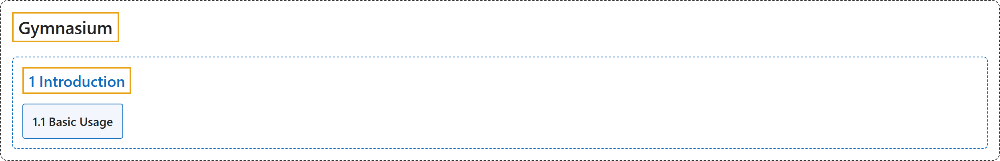

# 1. Introduction

## Classification

## Glossary

| Term | Definition | 中文翻译 | Source |
|---|---|---|---|
| **1 Introduction** 入门 | (context) "At its heart, Gymnasium provides **an API (application programming interface) for all single agent reinforcement learning environments, with implementations of common environments**: cartpole, pendulum, mountain-car, mujoco, atari, and more." | （语境）Gymnasium 的核心是提供**一个面向所有单智能体强化学习环境的 API（应用程序编程接口），并实现了常见的环境**：cartpole、pendulum、mountain-car、mujoco、atari 等。 | [Farama Foundation, n.d., "Why Gymnasium?", para. 1](https://gymnasium.farama.org/introduction/basic_usage/#why-gymnasium) |
| **[1.1 Basic Usage](basic-usage.md)** 基本用法 | (context) "Reinforcement learning is like **teaching through trial and error - an agent learns by trying actions, receiving feedback (rewards), and gradually improving its behavior**." | （语境）强化学习就像**通过试错来教学：智能体尝试动作、获得反馈（奖励），逐步改进自己的行为**。 | [Farama Foundation, n.d., "What is Reinforcement Learning?", para. 1](https://gymnasium.farama.org/introduction/basic_usage/#what-is-reinforcement-learning) |

## References

Farama Foundation. (n.d.). *Basic Usage*. Gymnasium Documentation (Version 1.4.0). Retrieved October 31, 2026, from <https://gymnasium.farama.org/introduction/basic_usage/>
