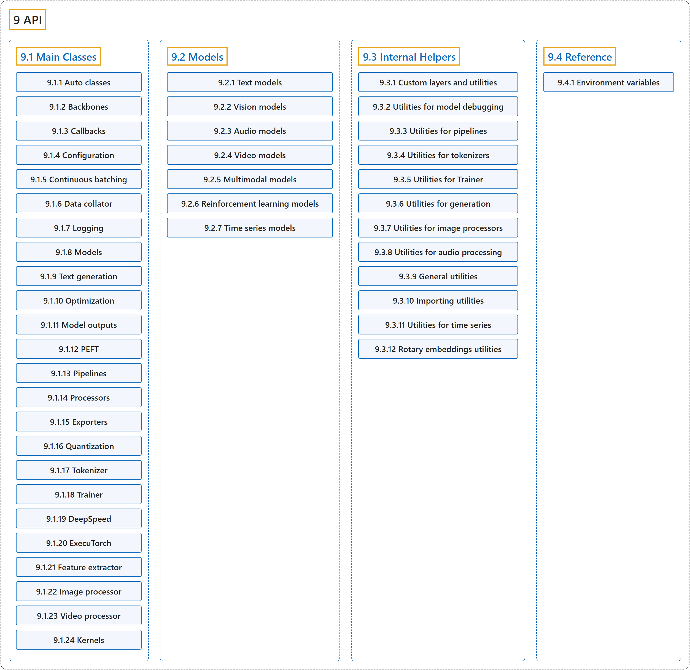

# 9. API

## Classification

## Glossary

| Term | Definition | 中文翻译 | Source |
|---|---|---|---|
| **9 API** API | (context) "In many cases, the architecture you want to use can be guessed from the name or the path of the pretrained model you are supplying to the `from_pretrained()` method. AutoClasses are here to do this job for you so that you **automatically retrieve the relevant model given the name/path to the pretrained weights/config/vocabulary**." | （语境）很多情况下，你要用的架构可以从你传给 `from_pretrained()` 方法的预训练模型的名称或路径猜出来。AutoClasses 替你完成这件事，让你**根据预训练权重、配置或词表的名称或路径自动取得相应的模型**。 | [Hugging Face, n.d., "Auto classes", para. 1](https://huggingface.co/docs/transformers/v5.20.2/en/model_doc/auto) |
| **[9.1 Main Classes](main-classes.md)** 主要类 | (context) "Fast and easy to use: Every model is implemented from **only three main classes (configuration, model, and preprocessor)** and can be quickly used for inference or training with Pipeline or Trainer." | （语境）快速易用：每个模型的实现都只用到**三个主要类（配置、模型和预处理器）**，并能借助 Pipeline 或 Trainer 快速用于推理或训练。 | [Hugging Face, n.d., "Design", item 1](https://huggingface.co/docs/transformers/v5.20.2/en/index#design) |
| **[9.2 Models](models.md)** 模型 | (context) "Explore the Models Timeline to discover **the latest text, vision, audio and multimodal model architectures in Transformers**." | （语境）浏览 Models Timeline，了解 **Transformers 中最新的文本、视觉、音频和多模态模型架构**。 | [Hugging Face, n.d., "Transformers", para. 6](https://huggingface.co/docs/transformers/v5.20.2/en/index) |
| **[9.3 Internal Helpers](internal-helpers.md)** 内部辅助工具 | (context) "This page lists **all the custom layers used by the library, as well as the utility functions and classes it provides for modeling**. Most of those are only useful if you are studying the code of the models in the library." | （语境）本页列出**库中使用的所有自定义层，以及它为建模提供的工具函数和类**。其中大多数只在你研究库中模型的代码时才有用。 | [Hugging Face, n.d., "Custom layers and utilities", para. 1](https://huggingface.co/docs/transformers/v5.20.2/en/internal/modeling_utils#custom-layers-and-utilities) |
| **[9.4 Reference](reference.md)** 参考 | (context) "Most of these variables are **read once, when Transformers is imported**." | （语境）这些变量大多**只在导入 Transformers 时读取一次**。 | [Hugging Face, n.d., "Environment variables", para. 2](https://huggingface.co/docs/transformers/v5.20.2/en/reference/environment_variables#environment-variables) |

## References

Hugging Face. (n.d.). *Transformers documentation* (Version 5.20.2). Retrieved October 30, 2026, from <https://huggingface.co/docs/transformers/v5.20.2/en/index>
