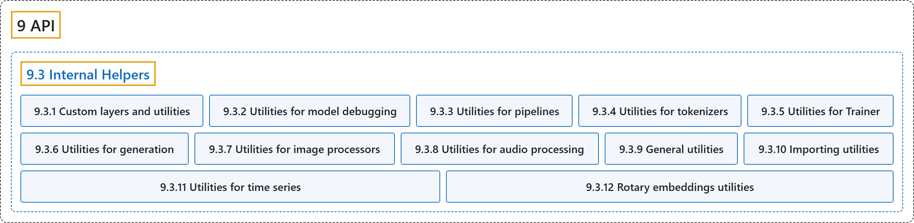

# 9.3 Internal Helpers

## Classification

## Glossary

| Term | Definition | 中文翻译 | Source |
|---|---|---|---|
| **9.3 Internal Helpers** 内部辅助工具 | (context) "This page lists **all the custom layers used by the library, as well as the utility functions and classes it provides for modeling**. Most of those are only useful if you are studying the code of the models in the library." | （语境）本页列出**库中使用的所有自定义层，以及它为建模提供的工具函数和类**。其中大多数只在你研究库中模型的代码时才有用。 | [Hugging Face, n.d., "Custom layers and utilities", para. 1](https://huggingface.co/docs/transformers/v5.20.2/en/internal/modeling_utils#custom-layers-and-utilities) |
| **9.3.1 Custom layers and utilities** 自定义层与工具 | (context) "This page lists **all the custom layers used by the library, as well as the utility functions and classes it provides for modeling**." | （语境）本页列出**库中使用的所有自定义层，以及它为建模提供的工具函数和类**。 | [Hugging Face, n.d., "Custom layers and utilities", para. 1](https://huggingface.co/docs/transformers/v5.20.2/en/internal/modeling_utils#custom-layers-and-utilities) |
| **9.3.2 Utilities for model debugging** 模型调试工具 | (context) "This page lists **all the debugging and model adding tools used by the library, as well as the utility functions it provides for it**." | （语境）本页列出**库中使用的所有调试工具和添加模型的工具，以及它为此提供的工具函数**。 | [Hugging Face, n.d., "Model debugging toolboxes", para. 1](https://huggingface.co/docs/transformers/v5.20.2/en/internal/model_debugging_utils#model-debugging-toolboxes) |
| **9.3.3 Utilities for pipelines** 管道工具 | (context) "This page lists **all the utility functions the library provides for pipelines**." | （语境）本页列出**库为管道提供的所有工具函数**。 | [Hugging Face, n.d., "Utilities for pipelines", para. 1](https://huggingface.co/docs/transformers/v5.20.2/en/internal/pipelines_utils#utilities-for-pipelines) |
| **9.3.4 Utilities for tokenizers** 分词器工具 | (context) "This page lists **all the utility functions used by the tokenizers**, mainly the class PreTrainedTokenizerBase that implements the common methods between PreTrainedTokenizer and PreTrainedTokenizerFast." | （语境）本页列出**分词器使用的所有工具函数**，主要是 PreTrainedTokenizerBase 类，它实现了 PreTrainedTokenizer 和 PreTrainedTokenizerFast 共有的方法。 | [Hugging Face, n.d., "Utilities for tokenizers", para. 1](https://huggingface.co/docs/transformers/v5.20.2/en/internal/tokenization_utils#utilities-for-tokenizers) |
| **9.3.5 Utilities for Trainer** Trainer 工具 | (context) "This page lists **all the utility functions used by Trainer**." | （语境）本页列出 **Trainer 使用的所有工具函数**。 | [Hugging Face, n.d., "Utilities for Trainer", para. 1](https://huggingface.co/docs/transformers/v5.20.2/en/internal/trainer_utils#utilities-for-trainer) |
| **9.3.6 Utilities for generation** 生成工具 | (context) "This page lists **all the utility functions used by generate()**." | （语境）本页列出 **generate() 使用的所有工具函数**。 | [Hugging Face, n.d., "Utilities for generation", para. 1](https://huggingface.co/docs/transformers/v5.20.2/en/internal/generation_utils#utilities-for-generation) |
| **9.3.7 Utilities for image processors** 图像处理器工具 | (context) "This page lists **all the utility functions used by the image processors, mainly the functional transformations used to process the images**." | （语境）本页列出**图像处理器使用的所有工具函数，主要是处理图像所用的函数式变换**。 | [Hugging Face, n.d., "Utilities for image processors", para. 1](https://huggingface.co/docs/transformers/v5.20.2/en/internal/image_processing_utils#utilities-for-image-processors) |
| **9.3.8 Utilities for audio processing** 音频处理工具 | (context) "This page lists **all the utility functions that can be used by the audio FeatureExtractor in order to compute special features from a raw audio** using common algorithms such as *Short Time Fourier Transform* or *log mel spectrogram*." | （语境）本页列出**音频 FeatureExtractor 可用来从原始音频计算特殊特征的所有工具函数**，用的是*短时傅里叶变换*或*对数梅尔频谱图*等常见算法。 | [Hugging Face, n.d., "Utilities for FeatureExtractors", para. 1](https://huggingface.co/docs/transformers/v5.20.2/en/internal/audio_utils#utilities-for-featureextractors) |
| **9.3.9 General utilities** 通用工具 | (context) "This page lists **all of Transformers general utility functions that are found in the file `utils.py`**." | （语境）本页列出 **Transformers 中位于 `utils.py` 文件里的所有通用工具函数**。 | [Hugging Face, n.d., "General utilities", para. 1](https://huggingface.co/docs/transformers/v5.20.2/en/internal/file_utils#general-utilities) |
| **9.3.10 Importing utilities** 导入工具 | (context) "This page goes through **the transformers utilities to enable lazy and fast object import**." | （语境）本页介绍 **transformers 中用于实现对象延迟导入和快速导入的工具**。 | [Hugging Face, n.d., "Importing utilities", para. 1](https://huggingface.co/docs/transformers/v5.20.2/en/internal/import_utils#importing-utilities) |
| **9.3.11 Utilities for time series** 时间序列工具 | (context) "This page lists **all the utility functions and classes that can be used for Time Series based models**." | （语境）本页列出**可用于时间序列模型的所有工具函数和类**。 | [Hugging Face, n.d., "Utilities for time series", para. 1](https://huggingface.co/docs/transformers/v5.20.2/en/internal/time_series_utils#utilities-for-time-series) |
| **9.3.12 Rotary embeddings utilities** 旋转位置嵌入工具 | (context) "This page explains **how the Rotary Embedding is computed and applied in Transformers and what types of RoPE are supported**." | （语境）本页说明 **Transformers 中旋转位置嵌入如何计算和应用，以及支持哪些类型的 RoPE**。 | [Hugging Face, n.d., "Rotary embeddings utilities", para. 1](https://huggingface.co/docs/transformers/v5.20.2/en/internal/rope_utils#rotary-embeddings-utilities) |

## References

Hugging Face. (n.d.). *Transformers documentation* (Version 5.20.2). Retrieved October 30, 2026, from <https://huggingface.co/docs/transformers/v5.20.2/en/index>
