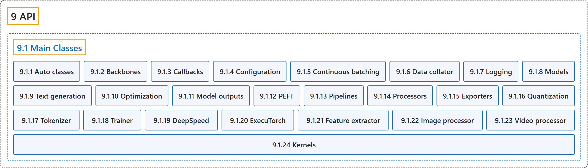

# 9.1 Main Classes

## Classification

## Glossary

| Term | Definition | 中文翻译 | Source |
|---|---|---|---|
| **9.1 Main Classes** 主要类 | (context) "Fast and easy to use: Every model is implemented from **only three main classes (configuration, model, and preprocessor)** and can be quickly used for inference or training with Pipeline or Trainer." | （语境）快速易用：每个模型的实现都只用到**三个主要类（配置、模型和预处理器）**，并能借助 Pipeline 或 Trainer 快速用于推理或训练。 | [Hugging Face, n.d., "Design", item 1](https://huggingface.co/docs/transformers/v5.20.2/en/index#design) |
| **9.1.1 Auto classes** 自动类 | (context) "In many cases, the architecture you want to use can be guessed from the name or the path of the pretrained model you are supplying to the `from_pretrained()` method. AutoClasses are here to do this job for you so that you **automatically retrieve the relevant model given the name/path to the pretrained weights/config/vocabulary**." | （语境）很多情况下，你要用的架构可以从你传给 `from_pretrained()` 方法的预训练模型的名称或路径猜出来。AutoClasses 替你完成这件事，让你**根据预训练权重、配置或词表的名称或路径自动取得相应的模型**。 | [Hugging Face, n.d., "Auto classes", para. 1](https://huggingface.co/docs/transformers/v5.20.2/en/model_doc/auto#auto-classes) |
| **9.1.2 Backbones** 骨干网络 | "A backbone is **a model used for feature extraction for higher level computer vision tasks such as object detection and image classification**." | 骨干网络是**一种用于特征提取的模型，服务于目标检测、图像分类等更高层的计算机视觉任务**。 | [Hugging Face, n.d., "Backbone", para. 1](https://huggingface.co/docs/transformers/v5.20.2/en/main_classes/backbones#backbone) |
| **9.1.3 Callbacks** 回调 | "Callbacks are **objects that can customize the behavior of the training loop in the PyTorch Trainer** that can inspect the training loop state (for progress reporting, logging on TensorBoard or other ML platforms…) and take decisions (like early stopping)." | 回调是**可以定制 PyTorch Trainer 中训练循环行为的对象**，它们能检查训练循环的状态（用于进度报告、在 TensorBoard 或其他机器学习平台上记录日志……）并作出决定（如提前停止）。 | [Hugging Face, n.d., "Callbacks", para. 1](https://huggingface.co/docs/transformers/v5.20.2/en/main_classes/callback#callbacks) |
| **9.1.4 Configuration** 配置 | (context) "The base class PreTrainedConfig **implements the common methods for loading/saving a configuration** either from a local file or directory, or from a pretrained model configuration provided by the library (downloaded from HuggingFace’s AWS S3 repository)." | （语境）基类 PreTrainedConfig **实现了加载和保存配置的通用方法**，配置可以来自本地文件或目录，也可以来自库提供的预训练模型配置（从 HuggingFace 的 AWS S3 仓库下载）。 | [Hugging Face, n.d., "Configuration", para. 1](https://huggingface.co/docs/transformers/v5.20.2/en/main_classes/configuration#configuration) |
| **9.1.5 Continuous batching** 连续批处理 | (context) "This page documents **the classes behind continuous batching inference: submitting prompts, configuring scheduling and memory limits, and retrieving results**." | （语境）本页说明**连续批处理推理背后的类：提交提示、配置调度和内存限制、取回结果**。 | [Hugging Face, n.d., "Continuous batching", para. 1](https://huggingface.co/docs/transformers/v5.20.2/en/main_classes/continuous_batching#continuous-batching) |
| **9.1.6 Data collator** 数据整理器 | "Data collators are **objects that will form a batch by using a list of dataset elements as input**." | 数据整理器是**以一组数据集元素作为输入、把它们组成一个批次的对象**。 | [Hugging Face, n.d., "Data collator", para. 1](https://huggingface.co/docs/transformers/v5.20.2/en/main_classes/data_collator#data-collator) |
| **9.1.7 Logging** 日志 | "🤗 Transformers has **a centralized logging system, so that you can setup the verbosity of the library easily**." | 🤗 Transformers 有**一个集中式的日志系统，让你可以方便地设置库的日志详细程度**。 | [Hugging Face, n.d., "Logging", para. 1](https://huggingface.co/docs/transformers/v5.20.2/en/main_classes/logging#logging) |
| **9.1.8 Models** 模型 | (context) "The base class `PreTrainedModel` **implements the common methods for loading/saving a model** either from a local file or directory, or from a pretrained model configuration provided by the library (downloaded from HuggingFace's Hub)." | （语境）基类 `PreTrainedModel` **实现了加载和保存模型的通用方法**，模型可以来自本地文件或目录，也可以来自库提供的预训练模型配置（从 HuggingFace 的 Hub 下载）。 | [Hugging Face, n.d., "Models", para. 1](https://huggingface.co/docs/transformers/v5.20.2/en/main_classes/model#models) |
| **9.1.9 Text generation** 文本生成 | (context) "Each framework has **a generate method for text generation** implemented in their respective `GenerationMixin` class:" | （语境）每个框架都有**一个用于文本生成的 generate 方法**，实现在各自的 `GenerationMixin` 类中： | [Hugging Face, n.d., "Generation", para. 1](https://huggingface.co/docs/transformers/v5.20.2/en/main_classes/text_generation#generation) |
| **9.1.10 Optimization** 优化 | (context) "The `.optimization` module provides: **an optimizer with weight decay fixed that can be used to fine-tuned models**, and **several schedules in the form of schedule objects** that inherit from `_LRSchedule`:" | （语境）`.optimization` 模块提供：**一个修正了权重衰减、可用于微调模型的优化器**，以及**若干以调度对象形式提供的学习率调度**，它们继承自 `_LRSchedule`： | [Hugging Face, n.d., "Optimization", para. 1 and list items 1 to 2](https://huggingface.co/docs/transformers/v5.20.2/en/main_classes/optimizer_schedules#optimization) |
| **9.1.11 Model outputs** 模型输出 | "All models have outputs that are **instances of subclasses of ModelOutput**. Those are **data structures containing all the information returned by the model**, but that can also be used as tuples or dictionaries." | 所有模型的输出都是 **ModelOutput 子类的实例**。它们是**包含模型返回的全部信息的数据结构**，但也可以当作元组或字典使用。 | [Hugging Face, n.d., "Model outputs", para. 1](https://huggingface.co/docs/transformers/v5.20.2/en/main_classes/output#model-outputs) |
| **9.1.12 PEFT** 参数高效微调 | (context) "The PeftAdapterMixin **provides functions from the PEFT library for managing adapters with Transformers**." | （语境）PeftAdapterMixin **提供来自 PEFT 库的函数，用于在 Transformers 中管理适配器**。 | [Hugging Face, n.d., "PEFT", para. 1](https://huggingface.co/docs/transformers/v5.20.2/en/main_classes/peft#peft) |
| **9.1.13 Pipelines** 管道 | "The pipelines are **a great and easy way to use models for inference**." | 管道是**一种很好用、很简单的用模型做推理的方式**。 | [Hugging Face, n.d., "Pipelines", para. 1](https://huggingface.co/docs/transformers/v5.20.2/en/main_classes/pipelines#pipelines) |
| **9.1.14 Processors** 处理器 | "Any multi-modal model will require an object to encode or decode the data that groups several modalities (among text, vision and audio). This is handled by **objects called processors, which group together two or more processing objects** such as tokenizers (for the text modality), image processors (for vision) and feature extractors (for audio)." | 任何多模态模型都需要一个对象，来编码或解码组合了多种模态（文本、视觉和音频中的几种）的数据。这由**称为处理器的对象负责，它把两个或更多处理对象组合在一起**，如分词器（文本模态）、图像处理器（视觉）和特征提取器（音频）。 | [Hugging Face, n.d., "Processors", "Multi-modal processors", para. 1](https://huggingface.co/docs/transformers/v5.20.2/en/main_classes/processors#processors) |
| **9.1.15 Exporters** 导出器 | (context) "**New export backends** can be added to Transformers by subclassing `HfExporter`." | （语境）可以通过继承 `HfExporter` 给 Transformers 添加**新的导出后端**。 | [Hugging Face, n.d., "Exporters", para. 1](https://huggingface.co/docs/transformers/v5.20.2/en/main_classes/exporters#exporters) |
| **9.1.16 Quantization** 量化 | "Quantization techniques **reduce memory and computational costs by representing weights and activations with lower-precision data types** like 8-bit integers (int8)." | 量化技术**用更低精度的数据类型表示权重和激活值，从而降低内存和计算成本**，如 8 位整数（int8）。 | [Hugging Face, n.d., "Quantization", para. 1](https://huggingface.co/docs/transformers/v5.20.2/en/main_classes/quantization#quantization) |
| **9.1.17 Tokenizer** 分词器 | "A tokenizer is **in charge of preparing the inputs for a model**." | 分词器**负责为模型准备输入**。 | [Hugging Face, n.d., "Tokenizer", para. 1](https://huggingface.co/docs/transformers/v5.20.2/en/main_classes/tokenizer#tokenizer) |
| **9.1.18 Trainer** 训练器 | "The `Trainer` class **provides an API for feature-complete training in PyTorch**, and it supports distributed training on multiple GPUs/TPUs, mixed precision for NVIDIA GPUs, AMD GPUs, and `torch.amp` for PyTorch." | `Trainer` 类**提供一个在 PyTorch 中进行功能完整训练的 API**，它支持在多个 GPU 或 TPU 上的分布式训练，以及面向 NVIDIA GPU、AMD GPU 的混合精度和 PyTorch 的 `torch.amp`。 | [Hugging Face, n.d., "Trainer", para. 1](https://huggingface.co/docs/transformers/v5.20.2/en/main_classes/trainer#trainer) |
| **9.1.19 DeepSpeed** DeepSpeed | "DeepSpeed, powered by Zero Redundancy Optimizer (ZeRO), is **an optimization library for training and fitting very large models onto a GPU**." | DeepSpeed 以零冗余优化器（ZeRO）为核心，是**一个用于在 GPU 上训练和容纳超大模型的优化库**。 | [Hugging Face, n.d., "DeepSpeed", para. 1](https://huggingface.co/docs/transformers/v5.20.2/en/main_classes/deepspeed#deepspeed) |
| **9.1.20 ExecuTorch** ExecuTorch | "`ExecuTorch` is **an end-to-end solution for enabling on-device inference capabilities across mobile and edge devices** including wearables, embedded devices and microcontrollers." | `ExecuTorch` 是**一个端到端的解决方案，让移动设备和边缘设备具备在设备上推理的能力**，包括可穿戴设备、嵌入式设备和微控制器。 | [Hugging Face, n.d., "ExecuTorch", para. 1](https://huggingface.co/docs/transformers/v5.20.2/en/main_classes/executorch#executorch) |
| **9.1.21 Feature extractor** 特征提取器 | "A feature extractor is **in charge of preparing input features for audio models**." | 特征提取器**负责为音频模型准备输入特征**。 | [Hugging Face, n.d., "Feature extractor", para. 1](https://huggingface.co/docs/transformers/v5.20.2/en/main_classes/feature_extractor#feature-extractor) |
| **9.1.22 Image processor** 图像处理器 | "An image processor is **in charge of loading images (optionally), preparing input features for vision models and post processing their outputs**." | 图像处理器**负责加载图像（可选）、为视觉模型准备输入特征，并对其输出做后处理**。 | [Hugging Face, n.d., "Image processor", para. 1](https://huggingface.co/docs/transformers/v5.20.2/en/main_classes/image_processor#image-processor) |
| **9.1.23 Video processor** 视频处理器 | "A **Video Processor** is **a utility responsible for preparing input features for video models, as well as handling the post-processing of their outputs**." | **视频处理器**是**一个工具，负责为视频模型准备输入特征，并处理其输出的后处理**。 | [Hugging Face, n.d., "Video processor", para. 1](https://huggingface.co/docs/transformers/v5.20.2/en/main_classes/video_processor#video-processor) |
| **9.1.24 Kernels** 内核 | (context) "This page documents **the kernels configuration utilities**." | （语境）本页说明**内核配置工具**。 | [Hugging Face, n.d., "Kernels", para. 1](https://huggingface.co/docs/transformers/v5.20.2/en/main_classes/kernels#kernels) |

## References

Hugging Face. (n.d.). *Transformers documentation* (Version 5.20.2). Retrieved October 30, 2026, from <https://huggingface.co/docs/transformers/v5.20.2/en/index>
