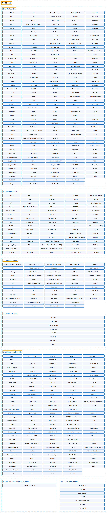

# 9.2 Models

## Classification

## Glossary

| Term | Definition | 中文翻译 | Source |
|---|---|---|---|
| **9.2 Models** 模型 | (context) "Explore the Models Timeline to discover **the latest text, vision, audio and multimodal model architectures in Transformers**." | （语境）浏览 Models Timeline，了解 **Transformers 中最新的文本、视觉、音频和多模态模型架构**。 | [Hugging Face, n.d., "Transformers", para. 6](https://huggingface.co/docs/transformers/v5.20.2/en/index) |
| **9.2.1 Text models** 文本模型 | (No definition) | （无定义） | [Hugging Face, n.d., "Text models", documentation menu](https://huggingface.co/docs/transformers/v5.20.2/en/index) |
| **9.2.2 Vision models** 视觉模型 | (No definition) | （无定义） | [Hugging Face, n.d., "Vision models", documentation menu](https://huggingface.co/docs/transformers/v5.20.2/en/index) |
| **9.2.3 Audio models** 音频模型 | (No definition) | （无定义） | [Hugging Face, n.d., "Audio models", documentation menu](https://huggingface.co/docs/transformers/v5.20.2/en/index) |
| **9.2.4 Video models** 视频模型 | (No definition) | （无定义） | [Hugging Face, n.d., "Video models", documentation menu](https://huggingface.co/docs/transformers/v5.20.2/en/index) |
| **9.2.5 Multimodal models** 多模态模型 | (No definition) | （无定义） | [Hugging Face, n.d., "Multimodal models", documentation menu](https://huggingface.co/docs/transformers/v5.20.2/en/index) |
| **9.2.6 Reinforcement learning models** 强化学习模型 | (No definition) | （无定义） | [Hugging Face, n.d., "Reinforcement learning models", documentation menu](https://huggingface.co/docs/transformers/v5.20.2/en/index) |
| **9.2.7 Time series models** 时间序列模型 | (No definition) | （无定义） | [Hugging Face, n.d., "Time series models", documentation menu](https://huggingface.co/docs/transformers/v5.20.2/en/index) |

## References

Hugging Face. (n.d.). *Transformers documentation* (Version 5.20.2). Retrieved October 30, 2026, from <https://huggingface.co/docs/transformers/v5.20.2/en/index>
