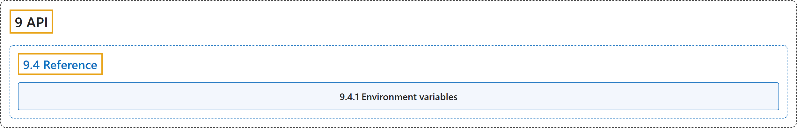

# 9.4 Reference

## Classification

## Glossary

| Term | Definition | 中文翻译 | Source |
|---|---|---|---|
| **9.4 Reference** 参考 | (context) "Most of these variables are **read once, when Transformers is imported**." | （语境）这些变量大多**只在导入 Transformers 时读取一次**。 | [Hugging Face, n.d., "Environment variables", para. 2](https://huggingface.co/docs/transformers/v5.20.2/en/reference/environment_variables#environment-variables) |
| **9.4.1 Environment variables** 环境变量 | "Most of these variables are **read once, when Transformers is imported**." | 这些变量大多**只在导入 Transformers 时读取一次**。 | [Hugging Face, n.d., "Environment variables", para. 2](https://huggingface.co/docs/transformers/v5.20.2/en/reference/environment_variables#environment-variables) |

## References

Hugging Face. (n.d.). *Transformers documentation* (Version 5.20.2). Retrieved October 30, 2026, from <https://huggingface.co/docs/transformers/v5.20.2/en/index>
