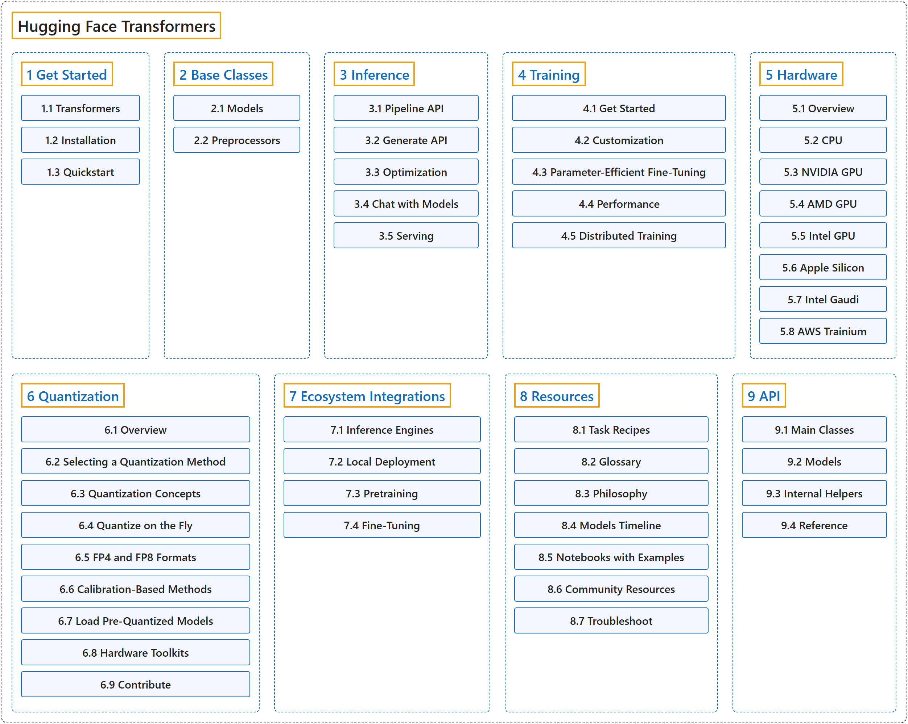

# Hugging Face Transformers

## Classification

## Glossary

| Term | Definition | 中文翻译 | Source |
|---|---|---|---|
| **Hugging Face Transformers** Hugging Face Transformers | "Transformers acts as **the model-definition framework for state-of-the-art machine learning models in text, computer vision, audio, video, and multimodal models, for both inference and training**." | Transformers 充当**最先进的机器学习模型的模型定义框架，覆盖文本、计算机视觉、音频、视频和多模态模型，既用于推理也用于训练**。 | [Hugging Face, n.d., "Transformers", para. 1](https://huggingface.co/docs/transformers/v5.20.2/en/index) |
| **[1 Get Started](get-started/index.md)** 入门 | (context) "Transformers is designed to be **fast and easy to use so that everyone can start learning or building with transformer models**." | （语境）Transformers 的设计目标是**快速、易用，让每个人都能开始学习或用 transformer 模型构建应用**。 | [Hugging Face, n.d., "Quickstart", para. 1](https://huggingface.co/docs/transformers/v5.20.2/en/quicktour) |
| **[2 Base Classes](base-classes/index.md)** 基础类 | (context) "Transformers provides **many pretrained models that are ready to use with a single line of code**." | （语境）Transformers 提供**许多只需一行代码就能使用的预训练模型**。 | [Hugging Face, n.d., "Loading models", para. 1](https://huggingface.co/docs/transformers/v5.20.2/en/models) |
| **[3 Inference](inference/index.md)** 推理 | (context) "The Pipeline is **a simple but powerful inference API** that is readily available for a variety of machine learning tasks with any model from the Hugging Face Hub." | （语境）Pipeline 是**一个简单而强大的推理 API**，可以直接搭配 Hugging Face Hub 上的任何模型，用于各种机器学习任务。 | [Hugging Face, n.d., "Pipeline", para. 1](https://huggingface.co/docs/transformers/v5.20.2/en/pipeline_tutorial) |
| **[4 Training](training/index.md)** 训练 | (context) "Trainer is **a complete training and evaluation loop for Transformers models**." | （语境）Trainer 是**一个面向 Transformers 模型的完整训练与评估循环**。 | [Hugging Face, n.d., "Trainer", para. 1](https://huggingface.co/docs/transformers/v5.20.2/en/trainer) |
| **[5 Hardware](hardware/index.md)** 硬件 | "Transformers **runs on CPUs, NVIDIA GPUs, AMD GPUs, Apple Silicon, Google TPUs, AWS Trainium instances, and more** through their PyTorch backends." | Transformers 通过各自的 PyTorch 后端**运行在 CPU、NVIDIA GPU、AMD GPU、Apple Silicon、Google TPU、AWS Trainium 实例等硬件上**。 | [Hugging Face, n.d., "Hardware", para. 1](https://huggingface.co/docs/transformers/v5.20.2/en/hardware) |
| **[6 Quantization](quantization/index.md)** 量化 | "Quantization **lowers the memory requirements of loading and using a model by storing the weights in a lower precision** while trying to preserve as much accuracy as possible." | 量化**通过以更低精度存储权重，降低加载和使用模型的内存需求**，同时尽量保留准确率。 | [Hugging Face, n.d., "Overview" (Quantization), para. 1](https://huggingface.co/docs/transformers/v5.20.2/en/quantization/overview) |
| **[7 Ecosystem Integrations](ecosystem-integrations/index.md)** 生态集成 | (context) "Transformers models are **compatible with inference engines like vLLM and SGLang**." | （语境）Transformers 模型**与 vLLM、SGLang 等推理引擎兼容**。 | [Hugging Face, n.d., "Building a compatible model backend for inference", para. 1](https://huggingface.co/docs/transformers/v5.20.2/en/community_integrations/transformers_as_backend) |
| **[8 Resources](resources/index.md)** 资源 | (context) "This glossary defines **general machine learning and 🤗 Transformers terms** to help you better understand the documentation." | （语境）本术语表定义**一般的机器学习术语和 🤗 Transformers 术语**，帮助你更好地理解文档。 | [Hugging Face, n.d., "Glossary", para. 1](https://huggingface.co/docs/transformers/v5.20.2/en/glossary) |
| **[9 API](api/index.md)** API | (context) "In many cases, the architecture you want to use can be guessed from the name or the path of the pretrained model you are supplying to the `from_pretrained()` method. AutoClasses are here to do this job for you so that you **automatically retrieve the relevant model given the name/path to the pretrained weights/config/vocabulary**." | （语境）很多情况下，你要用的架构可以从你传给 `from_pretrained()` 方法的预训练模型的名称或路径猜出来。AutoClasses 替你完成这件事，让你**根据预训练权重、配置或词表的名称或路径自动取得相应的模型**。 | [Hugging Face, n.d., "Auto classes", para. 1](https://huggingface.co/docs/transformers/v5.20.2/en/model_doc/auto) |

## References

Hugging Face. (n.d.). *Transformers documentation* (Version 5.20.2). Retrieved October 30, 2026, from <https://huggingface.co/docs/transformers/v5.20.2/en/index>
