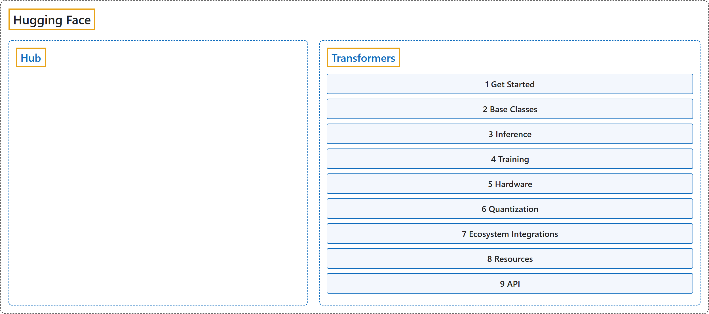

# Hugging Face

## Classification

## Glossary

| Term | Definition | 中文翻译 | Source |
|---|---|---|---|
| **Hugging Face** Hugging Face | (No definition) | （无定义） | [Hugging Face, n.d., "Documentations"](https://huggingface.co/docs) |
| **[Hub](hub/index.md)** Hub | "The Hugging Face Hub is **the reference AI platform** for **open ML**." | Hugging Face Hub 是**参考级 AI 平台**，面向**开放机器学习**。 | [Hugging Face, n.d., "Hugging Face Hub documentation", para. 1](https://huggingface.co/docs/hub/index) |
| **[Transformers](transformers/index.md)** Transformers | "Transformers acts as **the model-definition framework for state-of-the-art machine learning models in text, computer vision, audio, video, and multimodal models, for both inference and training**." | Transformers 充当**最先进的机器学习模型的模型定义框架，覆盖文本、计算机视觉、音频、视频和多模态模型，既用于推理也用于训练**。 | [Hugging Face, n.d., "Transformers", para. 1](https://huggingface.co/docs/transformers/v5.20.2/en/index) |

## References

Hugging Face. (n.d.). *Hugging Face Hub documentation*. Retrieved November 8, 2026, from <https://huggingface.co/docs/hub/index>

Hugging Face. (n.d.). *Transformers documentation* (Version 5.20.2). Retrieved October 30, 2026, from <https://huggingface.co/docs/transformers/v5.20.2/en/index>
