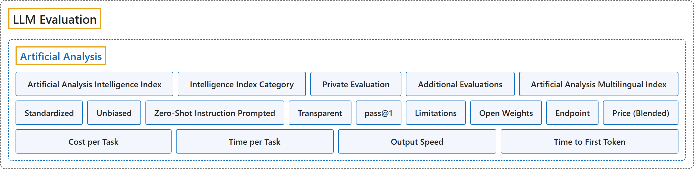

# Artificial Analysis

## Classification

## Glossary

| Term | Definition | 中文翻译 | Source |
|---|---|---|---|
| **Artificial Analysis** Artificial Analysis | (Summary) A company that **benchmarks AI models, API endpoints and systems** on intelligence, quality, performance and price, measuring **the performance customers actually get** across providers rather than the best a piece of hardware can do. | （概述）一家**为 AI 模型、API 端点和系统做基准测试**的公司，测智能、质量、性能和价格，衡量的是各家服务商那里**客户实际得到的性能**，而不是某种硬件能达到的最好水平。 | [Artificial Analysis, n.d.-a, "Scope"](https://artificialanalysis.ai/methodology#scope) |
| **Artificial Analysis Intelligence Index** Artificial Analysis 智能指数 | (Summary) A **weighted average over a suite of evaluations** (nine in version 5.0.1, the version cached) that **sums up a language model's intelligence** across knowledge work, coding, science and general knowledge, meant for comparing models. | （概述）对**一组评测取加权平均**（缓存时的 5.0.1 版共九项），**综合概括语言模型的智能水平**，覆盖知识工作、编程、科学与常识，用于比较模型。 | [Artificial Analysis, n.d.-b, "Artificial Analysis Intelligence Index"](https://artificialanalysis.ai/methodology/intelligence-benchmarking#artificial-analysis-intelligence-index) |
| **Intelligence Index Category** 智能指数类别 | (Summary) One of the **four groups the index is built from**, Knowledge Work, Coding, Science and General, each **weighted 25%**, with its own per-evaluation weights inside. | （概述）指数所由构成的**四个组**之一：Knowledge Work、Coding、Science、General，每组**权重 25%**，组内各项评测另有权重。 | [Artificial Analysis, n.d.-b, "Artificial Analysis Intelligence Index"](https://artificialanalysis.ai/methodology/intelligence-benchmarking#artificial-analysis-intelligence-index) |
| **Private Evaluation** 私有评测 | (Summary) An evaluation in the index that is **marked Private** in the suite table, as opposed to one built on a **publicly released dataset**. | （概述）指数中在评测表里**标为 Private** 的评测，相对于建立在**公开发布的数据集**之上的评测。 | [Artificial Analysis, n.d.-b, "Artificial Analysis Intelligence Index"](https://artificialanalysis.ai/methodology/intelligence-benchmarking#artificial-analysis-intelligence-index) |
| **Additional Evaluations** 附加评测 | (Summary) Evaluations run **beyond the index suite**, such as multilingual, visual and mathematical ones, which are **reported separately** and do not count toward the index score. | （概述）在**指数套件之外**运行的评测，如多语言、视觉、数学类，**单独报告**，不计入指数得分。 | [Artificial Analysis, n.d.-b, "Additional Evaluations"](https://artificialanalysis.ai/methodology/intelligence-benchmarking#additional-evaluations) |
| **Artificial Analysis Multilingual Index** Artificial Analysis 多语言指数 | (Summary) A separate index of **multilingual ability**, based on **the Global-MMLU-Lite evaluation** in the languages Artificial Analysis supports, Chinese among them. | （概述）一项单独的**多语言能力**指数，依据 **Global-MMLU-Lite 评测**，覆盖 Artificial Analysis 支持的语言，其中包括中文。 | [Artificial Analysis, n.d.-b, "Additional Evaluations"](https://artificialanalysis.ai/methodology/intelligence-benchmarking#additional-evaluations) |
| **Standardized** 标准化 | (Summary) An evaluation principle: every model is tested under **identical conditions**, with the same prompting, temperature settings and **evaluation criteria**. | （概述）一条评测原则：每个模型都在**相同条件**下测试，提示方式、温度设置和**评判标准**都一样。 | [Artificial Analysis, n.d.-b, "Intelligence Evaluation Principles"](https://artificialanalysis.ai/methodology/intelligence-benchmarking#intelligence-evaluation-principles) |
| **Unbiased** 无偏 | (Summary) An evaluation principle: answers that do follow the prompt's instructions are **not unfairly penalized**, through clear prompts and **flexible answer extraction and validation**. | （概述）一条评测原则：确实遵守了提示指令的回答**不受不公平的扣分**，靠的是清楚的提示和**灵活的答案抽取与校验**。 | [Artificial Analysis, n.d.-b, "Intelligence Evaluation Principles"](https://artificialanalysis.ai/methodology/intelligence-benchmarking#intelligence-evaluation-principles) |
| **Zero-Shot Instruction Prompted** 零样本指令提示 | (Summary) An evaluation principle: models get **clear instructions without examples**, so the test shows whether they **follow directions without few-shot learning**. | （概述）一条评测原则：给模型**清楚的指令而不给示例**，于是测出的是模型能否**不靠少样本学习就按指示做**。 | [Artificial Analysis, n.d.-b, "Intelligence Evaluation Principles"](https://artificialanalysis.ai/methodology/intelligence-benchmarking#intelligence-evaluation-principles) |
| **Transparent** 透明 | (Summary) An evaluation principle: the **methodology is disclosed**, including prompt templates, evaluation criteria and **known limitations**. | （概述）一条评测原则：**公开方法**，包括提示模板、评判标准和**已知局限**。 | [Artificial Analysis, n.d.-b, "Intelligence Evaluation Principles"](https://artificialanalysis.ai/methodology/intelligence-benchmarking#intelligence-evaluation-principles) |
| **pass@1** pass@1 | (Summary) Scoring in which a model must give **the correct answer on its first attempt**; for evaluations run several times, the result is **averaged over all repeats**. | （概述）一种计分方式：模型必须**第一次尝试就答对**；对重复运行多次的评测，结果**在所有重复上取平均**。 | [Artificial Analysis, n.d.-b, "General Testing Parameters"](https://artificialanalysis.ai/methodology/intelligence-benchmarking#general-testing-parameters) |
| **Limitations** 局限 | (Summary) The index is said to **have limitations and not to fit every use case**; it is a **primarily text-based, English-language suite**, with visual reasoning, speech input and multilingual ability measured separately. | （概述）该指数被说明**有局限、并不适用于每种用例**；它是一套**以文本为主的英语评测**，视觉推理、语音输入和多语言能力另行测量。 | [Artificial Analysis, n.d.-b, "Artificial Analysis Intelligence Index"](https://artificialanalysis.ai/methodology/intelligence-benchmarking#artificial-analysis-intelligence-index) |
| **Open Weights** 开放权重 | (Summary) A model whose **weights its creator has released publicly**; the term is used instead of "open source" because many such licenses **do not meet the full definition** of open-source software. | （概述）**创建者已公开发布权重**的模型；用这个说法而不说"开源"，是因为许多此类许可**达不到开源软件的完整定义**。 | [Artificial Analysis, n.d.-a, "Definitions"](https://artificialanalysis.ai/methodology#definitions) |
| **Endpoint** 端点 | (Summary) A **hosted instance of a model** reached through an API; one model may have **several endpoints** at different providers. | （概述）通过 API 访问的**模型托管实例**；同一个模型可能在不同服务商那里有**多个端点**。 | [Artificial Analysis, n.d.-a, "Definitions"](https://artificialanalysis.ai/methodology#definitions) |
| **Price (Blended)** 混合价格 | (Summary) A single price for easier comparison, **assuming a 7:2:1 mix** of cache-hit, input and **output tokens**. | （概述）为便于比较而算出的单一价格，**假定按 7:2:1 混合**缓存命中、输入和**输出令牌**。 | [Artificial Analysis, n.d.-a, "Definitions"](https://artificialanalysis.ai/methodology#definitions) |
| **Cost per Task** 每任务成本 | (Summary) The **weighted-average cost in US dollars** of one Intelligence Index task; because it follows actual token use, models that **write longer answers or more reasoning** cost more even at the same per-token price. | （概述）完成一道智能指数任务的**加权平均美元成本**；由于它按实际令牌用量计算，**回答更长或推理更多**的模型即使单价相同也更贵。 | [Artificial Analysis, n.d.-a, "Definitions"](https://artificialanalysis.ai/methodology#definitions) |
| **Time per Task** 每任务时间 | (Summary) The **estimated weighted-average time** for one Intelligence Index task, derived from **tokens per task and the model's output speed** rather than from timing the evaluation runs. | （概述）完成一道智能指数任务的**估计加权平均时间**，由**每题令牌数和模型的输出速度**推算，而不是给评测运行计时。 | [Artificial Analysis, n.d.-a, "Definitions"](https://artificialanalysis.ai/methodology#definitions) |
| **Output Speed** 输出速度 | (Summary) **Output tokens per second**, reasoning tokens included, over **a request's full duration** from sending it to receiving the final token. | （概述）**每秒输出令牌数**，含推理令牌，按**请求的完整时长**计算，从发出请求到收到最后一个令牌。 | [Artificial Analysis, n.d.-a, "Definitions"](https://artificialanalysis.ai/methodology#definitions) |
| **Time to First Token** 首令牌时间 | (Summary) The seconds between **sending a request** and **receiving the first token** of the response, which for reasoning models is the first reasoning token. | （概述）从**发出请求**到**收到响应的第一个令牌**之间的秒数；对推理模型来说是第一个推理令牌。 | [Artificial Analysis, n.d.-a, "Definitions"](https://artificialanalysis.ai/methodology#definitions) |

## References

Artificial Analysis. (n.d.-a). *Artificial Analysis benchmarking methodology*. Retrieved November 10, 2026, from <https://artificialanalysis.ai/methodology>

Artificial Analysis. (n.d.-b). *Artificial Analysis intelligence benchmarking methodology* (Intelligence Index v5.0.1). Retrieved November 10, 2026, from <https://artificialanalysis.ai/methodology/intelligence-benchmarking>
