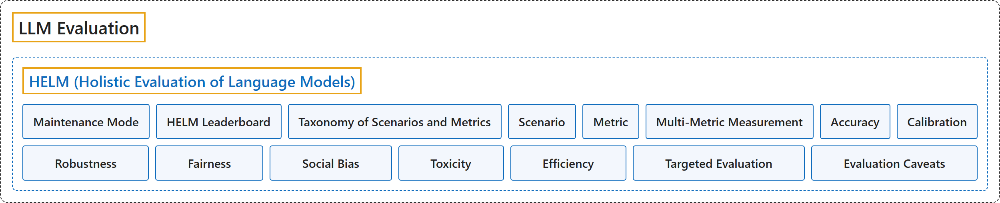

# HELM

## Classification

## Glossary

| Term | Definition | 中文翻译 | Source |
|---|---|---|---|
| **HELM (Holistic Evaluation of Language Models)** HELM（语言模型整体评估） | "Holistic Evaluation of Language Models (HELM) is **an open source Python framework** created by the Center for Research on Foundation Models (CRFM) at Stanford for **holistic, reproducible and transparent evaluation of foundation models**, including large language models (LLMs) and multimodal models." | 语言模型整体评估（HELM）是斯坦福基础模型研究中心（CRFM）创建的**开源 Python 框架**，用于对基础模型（包括大语言模型 LLM 和多模态模型）进行**整体、可复现、透明的评估**。 | [Stanford CRFM, n.d.-a, "Holistic Evaluation of Language Models (HELM)", para. 2](https://crfm-helm.readthedocs.io/en/latest/#holistic-evaluation-of-language-models-helm) |
| **Maintenance Mode** 维护模式 | (context) "However, **no new features will be added to HELM**, and **no new evaluations will be added** to the HELM leaderboards." | （语境）不过，**HELM 不会再增加新功能**，HELM 排行榜也**不会再增加新的评测**。 | [Stanford CRFM, n.d.-b, "Maintenance Mode Policy", para. 2](https://crfm-helm.readthedocs.io/en/latest/maintenance_mode/#maintenance-mode-policy) |
| **HELM Leaderboard** HELM 排行榜 | (context) "We maintain **official leaderboards** with results from **evaluating recent models on notable benchmarks** using this framework." | （语境）我们维护**官方排行榜**，其结果来自用本框架**在知名基准上评测近期模型**。 | [Stanford CRFM, n.d.-a, "Leaderboards", para. 1](https://crfm-helm.readthedocs.io/en/latest/#leaderboards) |
| **Taxonomy of Scenarios and Metrics** 场景与指标分类体系 | (context) "Holistic Evaluation of Language Models (HELM) has two levels: (i) **an abstract taxonomy of scenarios and metrics** to define the design space for language model evaluation and (ii) **a concrete set of implemented scenarios and metrics** that were selected to prioritize coverage (e.g. different English varieties), value (e.g. user-facing applications), and feasibility (e.g. limited engineering resources)." | （语境）语言模型整体评估（HELM）有两个层次：(i) **场景与指标的抽象分类体系**，用以界定语言模型评估的设计空间；(ii) **一组具体实现的场景与指标**，其选择优先考虑覆盖面（如不同的英语变体）、价值（如面向用户的应用）和可行性（如有限的工程资源）。 | [Liang et al., 2023, section 1.1, para. 1](https://arxiv.org/html/2211.09110#S1.SS1) |
| **Scenario** 场景 | "A scenario instantiates **a desired use case** for **a language model**." | 场景把**一个期望用例**具体化，这个用例是针对**语言模型**的。 | [Liang et al., 2023, section 2.1, para. 1](https://arxiv.org/html/2211.09110#S2.SS1) |
| **Metric** 指标 | "Metrics **concretely operationalize** the **abstract desiderata** we require of useful systems." | 指标**具体地操作化**了我们对有用系统所要求的**抽象期望**。 | [Liang et al., 2023, section 2.3, para. 1](https://arxiv.org/html/2211.09110#S2.SS3) |
| **Multi-Metric Measurement** 多指标测量 | (context) "We measure **7 metrics** (accuracy, calibration, robustness, fairness, bias, toxicity, and efficiency) for each of **16 core scenarios** to the extent possible (87.5% of the time)" | （语境）我们对 **16 个核心场景**中的每一个尽可能测量 **7 项指标**（准确性、校准、鲁棒性、公平性、偏见、毒性和效率），做到了 87.5% 的情况。 | [Liang et al., 2023, Abstract](https://arxiv.org/html/2211.09110) |
| **Accuracy** 准确性 | (context) "Throughout this work, we will use accuracy as **an umbrella term** for **the standard accuracy-like metric** for each scenario." | （语境）本文通篇把准确性用作一个**总称**，指每个场景的**标准的类准确率指标**。 | [Liang et al., 2023, section 4.3, para. 1](https://arxiv.org/html/2211.09110#S4.SS3) |
| **Calibration** 校准 | (context) "a model is calibrated if it **assigns meaningful probabilities** to **its predictions**." | （语境）如果模型**赋予有意义的概率**于**它的预测**，它就是校准的。 | [Liang et al., 2023, section 4.4, para. 2](https://arxiv.org/html/2211.09110#S4.SS4) |
| **Robustness** 鲁棒性 | (context) "That is, given **a set of transformations** for a given instance, we measure **the worst-case performance** of a model across these transformations" | （语境）也就是说，给定某个实例的**一组变换**，我们测量模型在这些变换上的**最差表现**。 | [Liang et al., 2023, section 4.5, para. 2](https://arxiv.org/html/2211.09110#S4.SS5) |
| **Fairness** 公平性 | "Fairness refers to **disparities in the task-specific accuracy** of models **across social groups**." | 公平性指模型的**任务准确率差异**，体现在**不同社会群体之间**。 | [Liang et al., 2023, section 4.7, para. 1](https://arxiv.org/html/2211.09110#S4.SS7) |
| **Social Bias** 社会偏见 | "we explicitly define social bias as “**a systematic asymmetry** in **language choice**”" | 我们明确把社会偏见定义为"一种**系统性不对称**，体现在**语言选择**上"。 | [Liang et al., 2023, section 4.7, para. 1](https://arxiv.org/html/2211.09110#S4.SS7) |
| **Toxicity** 毒性 | (context) "here we use the term as **an umbrella for related concepts** like **hate speech, violent speech, and abusive language**" | （语境）这里我们把这个词用作**相关概念的总称**，如**仇恨言论、暴力言论和辱骂性语言**。 | [Liang et al., 2023, section 4.8, para. 1](https://arxiv.org/html/2211.09110#S4.SS8) |
| **Efficiency** 效率 | (context) "We evaluate the efficiency of language models across **both training and inference**, examining **energy, carbon, and wall-clock efficiency** as relevant." | （语境）我们在**训练和推理两方面**评估语言模型的效率，视情况考察**能耗、碳排放和实际耗时效率**。 | [Liang et al., 2023, section 4.9, para. 1](https://arxiv.org/html/2211.09110#S4.SS9) |
| **Targeted Evaluation** 定向评估 | (context) "We also perform **7 targeted evaluations**, based on 26 targeted scenarios, to **more deeply analyze specific aspects** (e.g. knowledge, reasoning, memorization/copyright, disinformation)." | （语境）我们还进行了 **7 项定向评估**，基于 26 个定向场景，以**更深入地分析特定方面**（如知识、推理、记忆/版权、虚假信息）。 | [Liang et al., 2023, Abstract](https://arxiv.org/html/2211.09110) |
| **Evaluation Caveats** 评估注意事项 | (context) "To be explicit, while some models may **perform poorly under our evaluation**, they may **perform well in other contexts**." | （语境）明确地说，有些模型虽然**在我们的评估中表现不佳**，但可能**在其他情境中表现良好**。 | [Liang et al., 2023, section 1.1, "Caveats and considerations"](https://arxiv.org/html/2211.09110#S1.SS1.SSS0.Px5) |

## References

Liang, P., Bommasani, R., Lee, T., Tsipras, D., Soylu, D., Yasunaga, M., Zhang, Y., Narayanan, D., Wu, Y., Kumar, A., Newman, B., Yuan, B., Yan, B., Zhang, C., Cosgrove, C., Manning, C. D., Ré, C., Acosta-Navas, D., Hudson, D. A., . . . Koreeda, Y. (2023). *Holistic evaluation of language models* (arXiv:2211.09110v2). arXiv. <https://doi.org/10.48550/arXiv.2211.09110>

Stanford CRFM. (n.d.-a). *Holistic Evaluation of Language Models (HELM)* [Documentation]. Retrieved November 10, 2026, from <https://crfm-helm.readthedocs.io/en/latest/>

Stanford CRFM. (n.d.-b). Maintenance mode policy. In *HELM documentation*. Retrieved November 10, 2026, from <https://crfm-helm.readthedocs.io/en/latest/maintenance_mode/>
