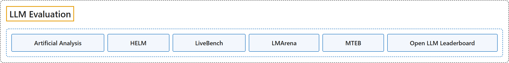

# LLM Evaluation

## Classification

## Glossary

| Term | Definition | 中文翻译 | Source |
|---|---|---|---|
| **LLM Evaluation** 大模型评测 | (No definition) | （无定义） | - |
| **[Artificial Analysis](artificial-analysis.md)** Artificial Analysis | (Summary) A company that **benchmarks AI models, API endpoints and systems** on intelligence, quality, performance and price, measuring **the performance customers actually get** across providers rather than the best a piece of hardware can do. | （概述）一家**为 AI 模型、API 端点和系统做基准测试**的公司，测智能、质量、性能和价格，衡量的是各家服务商那里**客户实际得到的性能**，而不是某种硬件能达到的最好水平。 | [Artificial Analysis, n.d., "Scope"](https://artificialanalysis.ai/methodology#scope) |
| **[HELM](helm.md)** HELM（语言模型整体评估） | "Holistic Evaluation of Language Models (HELM) is **an open source Python framework** created by the Center for Research on Foundation Models (CRFM) at Stanford for **holistic, reproducible and transparent evaluation of foundation models**, including large language models (LLMs) and multimodal models." | 语言模型整体评估（HELM）是斯坦福基础模型研究中心（CRFM）创建的**开源 Python 框架**，用于对基础模型（包括大语言模型 LLM 和多模态模型）进行**整体、可复现、透明的评估**。 | [Stanford CRFM, n.d., "Holistic Evaluation of Language Models (HELM)", para. 2](https://crfm-helm.readthedocs.io/en/latest/#holistic-evaluation-of-language-models-helm) |
| **[LiveBench](livebench.md)** LiveBench | "Introducing LiveBench: **a benchmark for LLMs** designed with **test set contamination and objective evaluation** in mind." | 介绍 LiveBench：**一个面向 LLM 的基准**，设计时考虑了**测试集污染与客观评测**。 | [LiveBench, n.d., "Introduction", para. 1](https://github.com/LiveBench/LiveBench#introduction) |
| **[LMArena](lmarena.md)** LMArena | (Summary) A community platform, formerly Chatbot Arena and now calling itself Arena, where people **compare the answers of two anonymous models to their own prompt** and **vote for the one they prefer**; the votes build public leaderboards. | （概述）一个社区平台，前身是 Chatbot Arena，现在自称 Arena：人们**比较两个匿名模型对自己提示的回答**，并**投票选出更喜欢的一个**；这些投票构成公开排行榜。 | [Arena, n.d., "How It Works"](https://lmarena.ai/how-it-works) |
| **[MTEB](mteb.md)** MTEB（大规模文本嵌入基准） | "MTEB is the go-to documentation for **evaluating embeddings models** across **a variety of tasks, modalities and domains**." | MTEB 是**评测嵌入模型**的首选文档，覆盖**多种任务、模态和领域**。 | [MTEB, n.d., "MTEB", para. 2](https://docs.mteb.org/#mteb) |
| **[Open LLM Leaderboard](open-llm-leaderboard.md)** Open LLM Leaderboard | (Summary) A project **curated by the Hugging Face team** to **evaluate and rank open LLMs and chatbots** with reproducible scores; the documentation now describes it in the past tense. | （概述）一个**由 Hugging Face 团队主持**的项目，**评测并排名开放的 LLM 和聊天机器人**，给出可复现的分数；文档现在用过去时描述它。 | [Hugging Face, n.d., "Leaderboards and Evaluations"](https://huggingface.co/docs/leaderboards/index) |

## Comparison

This site's own comparison, drawn from the pages above; scores and rankings are not kept here, since they change every week.

| Site | What it measures | 测什么 | Questions it can answer | 适合回答的问题 | Status (2026-11-10) | Link |
|---|---|---|---|---|---|---|
| [Artificial Analysis](artificial-analysis.md) | A weighted index of nine evaluations (knowledge work, coding, science, general), plus price, output speed and latency per API endpoint | 九项评测的加权指数（知识工作、编程、科学、常识），以及各 API 端点的价格、输出速度和延迟 | Which model gives the most capability for the money or the time? How does an open-weights model compare with closed ones on the same harness? | 哪个模型的能力最划算（按价钱或按时间）？开放权重模型和闭源模型在同一套测试下差多少？ | Active; the index is versioned (v5.0.1 when cached), so compare scores only within one version | <https://artificialanalysis.ai/methodology/intelligence-benchmarking> |
| [HELM](helm.md) | Seven metrics beyond accuracy (calibration, robustness, fairness, bias, toxicity, efficiency) over standardized scenarios, plus domain leaderboards | 准确性之外的七项指标（校准、鲁棒性、公平性、偏见、毒性、效率），在统一的场景上测；另有各领域排行榜 | Does a model trade accuracy for robustness, calibration or safety? How did models compare under identical prompts? | 模型是否用鲁棒性、校准或安全性换来了准确率？在完全相同的提示下各模型比较如何？ | Maintenance mode since June 1, 2026: no new evaluations | <https://crfm-helm.readthedocs.io/en/latest/> |
| [LiveBench](livebench.md) | 2.0: seven suites, five of them agentic, graded automatically; 1.0: seven categories with single answers, Instruction Following among them | 2.0：七个套件，五个是智能体任务，自动评分；1.0：七个单答案类别，含指令遵循 | How does a model do on fresh, automatically graded tasks it is unlikely to have seen? (1.0) How well does it follow verifiable format instructions? | 模型在不太可能见过、自动评分的新题上表现如何？（1.0）能否遵守可验证的格式指令？ | 2.0 updated 2026-11-09; 1.0 last release 2026-06-25 | <https://livebench.ai/#/methodology> |
| [LMArena](lmarena.md) | Human preference from anonymous pairwise votes, turned into Bradley-Terry scores, with and without style control | 匿名两两对比中人的偏好，换算成 Bradley-Terry 分数，分有无风格控制两种 | Which model's answers do people prefer in open-ended chat? Does a lead survive style control? | 开放式对话里人们更喜欢哪个模型的回答？去掉风格因素后领先是否还在？ | Active; scores of newly released models start as preliminary | <https://lmarena.ai/how-it-works> |
| [MTEB](mteb.md) | Embedding models on retrieval, classification, clustering, semantic similarity and pair classification, across many tasks and languages | 嵌入模型在检索、分类、聚类、语义相似度、成对分类上的表现，覆盖大量任务与语言 | Which embedding model to use for retrieval or RAG, and in which language? | 检索或 RAG 用哪个嵌入模型，针对哪种语言？ | Active; `mteb` 2.0 | <https://docs.mteb.org/overview/> |
| [Open LLM Leaderboard](open-llm-leaderboard.md) | Open models on six benchmarks (IFEval, BBH, MATH Lvl 5, GPQA, MuSR, MMLU-Pro) with one reproducible harness | 开放模型在六项基准（IFEval、BBH、MATH Lvl 5、GPQA、MuSR、MMLU-Pro）上的成绩，用同一套可复现工具 | How did an open base or fine-tuned model compare under a fixed harness, as a historical record? | 某个开放的基础模型或微调模型在固定测试工具下曾经排在哪里（作为历史记录）？ | No longer running (the documentation speaks of it in the past tense); v1 archived June 2024 | <https://huggingface.co/docs/leaderboards/open_llm_leaderboard/about> |

## References

Arena. (n.d.). *How it works*. Retrieved November 10, 2026, from <https://lmarena.ai/how-it-works>

Artificial Analysis. (n.d.). *Artificial Analysis benchmarking methodology*. Retrieved November 10, 2026, from <https://artificialanalysis.ai/methodology>

Hugging Face. (n.d.). Leaderboards and evaluations. In *Leaderboards documentation*. Retrieved November 10, 2026, from <https://huggingface.co/docs/leaderboards/index>

LiveBench. (n.d.). *LiveBench* [Source code]. GitHub. Retrieved November 10, 2026, from <https://github.com/LiveBench/LiveBench>

MTEB. (n.d.). *MTEB: Massive Text Embedding Benchmark* [Documentation]. Retrieved November 10, 2026, from <https://docs.mteb.org/>

Stanford CRFM. (n.d.). *Holistic Evaluation of Language Models (HELM)* [Documentation]. Retrieved November 10, 2026, from <https://crfm-helm.readthedocs.io/en/latest/>
