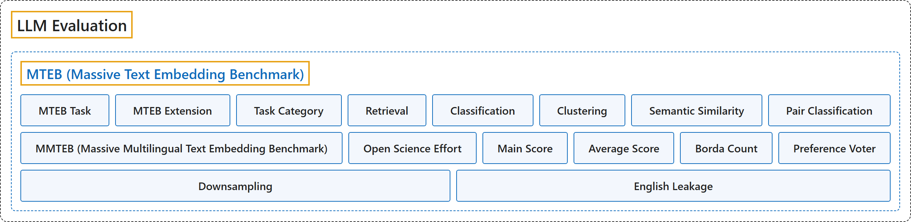

# MTEB

## Classification

## Glossary

| Term | Definition | 中文翻译 | Source |
|---|---|---|---|
| **MTEB (Massive Text Embedding Benchmark)** MTEB（大规模文本嵌入基准） | "MTEB is the go-to documentation for **evaluating embeddings models** across **a variety of tasks, modalities and domains**." | MTEB 是**评测嵌入模型**的首选文档，覆盖**多种任务、模态和领域**。 | [MTEB, n.d.-a, "MTEB", para. 2](https://docs.mteb.org/#mteb) |
| **MTEB Task** MTEB 任务 | (context) "MTEB covers **more than a 1000 different tasks** from covering a diverse set of tasks from **historic Swedish patent classification to documentation retrieval for Python**." | （语境）MTEB 涵盖**一千多项不同任务**，种类多样，从**历史上的瑞典专利分类到 Python 文档检索**。 | [MTEB, n.d.-a, "MTEB", para. 2](https://docs.mteb.org/#mteb) |
| **MTEB Extension** MTEB 扩展 | (context) "This package was initially introduced as a package for **evaluating text embeddings predominantly for English**, but have since been **extended for broad languages coverage and multiple modalities**" | （语境）这个包最初是作为**主要针对英语的文本嵌入评测**包推出的，后来已**扩展到广泛的语言覆盖和多种模态**。 | [MTEB, n.d.-a, "MTEB", para. 3](https://docs.mteb.org/#mteb) |
| **Task Category** 任务类别 | "While MTEB covers multiple task types, we categorize them into **5 broad categories based on the type of evaluation they require**, these categories are **not mutually exclusive** but provide a useful way to navigate the large collection of tasks in MTEB." | MTEB 涵盖多种任务类型，我们把它们**按所需的评测类型分为 5 个大类**；这些类别**并不互斥**，但为浏览 MTEB 中的大量任务提供了一个有用的途径。 | [MTEB, n.d.-b, "Tasks", para. 1](https://docs.mteb.org/overview/#tasks) |
| **Retrieval** 检索 | "**Asymmetric matching** between queries and a corpus across **different embedding regions**." | 查询与语料库之间的**非对称匹配**，跨越**不同的嵌入区域**。 | [MTEB, n.d.-b, "Tasks", list item 1](https://docs.mteb.org/overview/#tasks) |
| **Classification** 分类 | "Embeddings **linearly separable by category**, evaluated using **a classifier or regression probe**." | 嵌入**可按类别线性分开**，用**分类器或回归探针**来评测。 | [MTEB, n.d.-b, "Tasks", list item 2](https://docs.mteb.org/overview/#tasks) |
| **Clustering** 聚类 | "**Globally coherent embeddings** where distances reflect **semantic grouping**." | **全局一致的嵌入**，其距离反映**语义分组**。 | [MTEB, n.d.-b, "Tasks", list item 3](https://docs.mteb.org/overview/#tasks) |
| **Semantic Similarity** 语义相似度 | "**Fine-grained similarity** between item pairs, where **cosine similarity reflects human judgments**." | 成对条目之间的**细粒度相似度**，其中**余弦相似度反映人的判断**。 | [MTEB, n.d.-b, "Tasks", list item 4](https://docs.mteb.org/overview/#tasks) |
| **Pair Classification** 成对分类 | "Embeddings capturing **relationships between item pairs**, such as **entailment or paraphrase**." | 嵌入捕捉**成对条目之间的关系**，如**蕴涵或复述**。 | [MTEB, n.d.-b, "Tasks", list item 5](https://docs.mteb.org/overview/#tasks) |
| **MMTEB (Massive Multilingual Text Embedding Benchmark)** MMTEB（大规模多语言文本嵌入基准） | (context) "we introduce the Massive Multilingual Text Embedding Benchmark (MMTEB) – **a large-scale, community-driven expansion of MTEB**, covering **over 500 quality-controlled evaluation tasks** across 250+ languages." | （语境）我们推出大规模多语言文本嵌入基准（MMTEB），它是**对 MTEB 的大规模、社区驱动的扩展**，涵盖 250 多种语言中的 **500 多项经过质量控制的评测任务**。 | [Enevoldsen et al., 2025, Abstract](https://arxiv.org/html/2502.13595) |
| **Open Science Effort** 开放科学协作 | (context) "To ensure the broad applicability of MMTEB across various domains, we **recruited a diverse group of contributors**. We actively encouraged participation from industry professionals, low-resource language communities, and academic researchers. To clarify authorship assignment and recognize desired contributions, we implemented a point-based system, similar to Lovenia et al. (2024). To facilitate transparency, **coordination was managed through GitHub**." | （语境）为确保 MMTEB 在各领域广泛适用，我们**招募了多样的贡献者群体**。我们积极鼓励业界专业人士、低资源语言社区和学术研究者参与。为明确署名分配并认可所需的贡献，我们实行了一套积分制，类似 Lovenia 等（2024）。为便于透明，**协调工作通过 GitHub 进行**。 | [Enevoldsen et al., 2025, section 2.1, para. 1](https://arxiv.org/html/2502.13595#S2.SS1) |
| **Main Score** 主得分 | "**The primary metric** used to **evaluate task performance**." | 用于**评估任务表现**的**主要指标**。 | [Enevoldsen et al., 2025, appendix B.4, Table 5](https://arxiv.org/html/2502.13595#A2.SS4) |
| **Average Score** 平均得分 | (context) "For our performance metrics, we report **average scores across all tasks**, scores per task category, and **weighted by task category**." | （语境）在表现指标上，我们报告**所有任务上的平均得分**、各任务类别的得分，以及**按任务类别加权**的得分。 | [Enevoldsen et al., 2025, section 3.2, para. 1](https://arxiv.org/html/2502.13595#S3.SS2) |
| **Borda Count** 波达计数 | (context) "We compute **model ranks** using **the Borda count method** (Colombo et al., 2022), derived from social choice theory." | （语境）我们用 **Borda 计数法**（Colombo 等，2022）计算**模型排名**，该方法源自社会选择理论。 | [Enevoldsen et al., 2025, section 3.2, para. 1](https://arxiv.org/html/2502.13595#S3.SS2) |
| **Preference Voter** 偏好投票者 | (context) "To compute this score, we consider **each task as a preference voter** voting for each model, and scores are **aggregated according to the Borda Count method**." | （语境）为计算这一得分，我们把**每项任务视为一个偏好投票者**，为每个模型投票，得分**按 Borda 计数法汇总**。 | [Enevoldsen et al., 2025, section 3.2, para. 1](https://arxiv.org/html/2502.13595#S3.SS2) |
| **Downsampling** 降采样 | (context) "we introduce **a novel downsampling method based on inter-task correlation**, ensuring a diverse selection while **preserving relative model rankings**." | （语境）我们引入**一种基于任务间相关性的新降采样方法**，确保选择多样，同时**保持模型的相对排名**。 | [Enevoldsen et al., 2025, Abstract](https://arxiv.org/html/2502.13595) |
| **English Leakage** 英语泄漏 | (context) "While MMTEB filters out machine-translated datasets, it **permits (human) translations**. This inclusion leads to tasks like SIB200ClusteringS2S, where labels from English samples are transferred to their translations, potentially **introducing bias towards English** or models trained on translated content." | （语境）MMTEB 虽然过滤掉了机器翻译的数据集，但**允许（人工）翻译**。这一做法带来了像 SIB200ClusteringS2S 这样的任务：英语样本的标签被转用到其译文上，可能**引入偏向英语**或偏向用译文训练的模型的偏差。 | [Enevoldsen et al., 2025, "Limitations", "English Leakage"](https://arxiv.org/html/2502.13595#Sx1.SS0.SSS0.Px1) |

## References

Enevoldsen, K., Chung, I., Kerboua, I., Kardos, M., Mathur, A., Stap, D., Gala, J., Siblini, W., Krzemiński, D., Winata, G. I., Sturua, S., Utpala, S., Ciancone, M., Schaeffer, M., Sequeira, G., Misra, D., Dhakal, S., Rystrøm, J., Solomatin, R., . . . Muennighoff, N. (2025). *MMTEB: Massive multilingual text embedding benchmark* (arXiv:2502.13595). arXiv. <https://doi.org/10.48550/arXiv.2502.13595>

MTEB. (n.d.-a). *MTEB: Massive Text Embedding Benchmark* [Documentation]. Retrieved November 10, 2026, from <https://docs.mteb.org/>

MTEB. (n.d.-b). Overview. In *MTEB documentation*. Retrieved November 10, 2026, from <https://docs.mteb.org/overview/>
