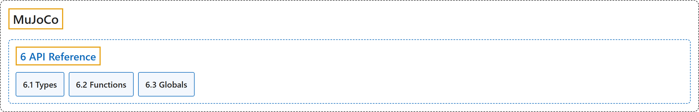

# 6. API Reference

## Classification

## Glossary

| Term | Definition | 中文翻译 | Source |
|---|---|---|---|
| **6 API Reference** API 参考 | "This chapter is **the reference manual for the MuJoCo API**." | 本章是 **MuJoCo API 的参考手册**。 | [Google DeepMind, n.d.-a, "API Reference", para. 1](https://mujoco.readthedocs.io/en/stable/APIreference/index.html#api-reference) |
| **[6.1 Types](types.md)** 类型 | (No definition) | （无定义） | [Google DeepMind, n.d.-d, "Types"](https://mujoco.readthedocs.io/en/stable/APIreference/APItypes.html#types) |
| **[6.2 Functions](functions.md)** 函数 | (context) "The main header mujoco.h exposes **a large number of functions**." | （语境）主头文件 mujoco.h 提供了**大量函数**。 | [Google DeepMind, n.d.-b, "Functions", para. 1](https://mujoco.readthedocs.io/en/stable/APIreference/APIfunctions.html#functions) |
| **[6.3 Globals](globals.md)** 全局变量 | (No definition) | （无定义） | [Google DeepMind, n.d.-c, "Globals"](https://mujoco.readthedocs.io/en/stable/APIreference/APIglobals.html#globals) |

## References

Google DeepMind. (n.d.-a). *API Reference*. MuJoCo Documentation (Version 3.17.0). Retrieved October 31, 2026, from <https://mujoco.readthedocs.io/en/stable/APIreference/index.html>

Google DeepMind. (n.d.-b). *Functions*. MuJoCo Documentation (Version 3.17.0). Retrieved October 31, 2026, from <https://mujoco.readthedocs.io/en/stable/APIreference/APIfunctions.html>

Google DeepMind. (n.d.-c). *Globals*. MuJoCo Documentation (Version 3.17.0). Retrieved October 31, 2026, from <https://mujoco.readthedocs.io/en/stable/APIreference/APIglobals.html>

Google DeepMind. (n.d.-d). *Types*. MuJoCo Documentation (Version 3.17.0). Retrieved October 31, 2026, from <https://mujoco.readthedocs.io/en/stable/APIreference/APItypes.html>
