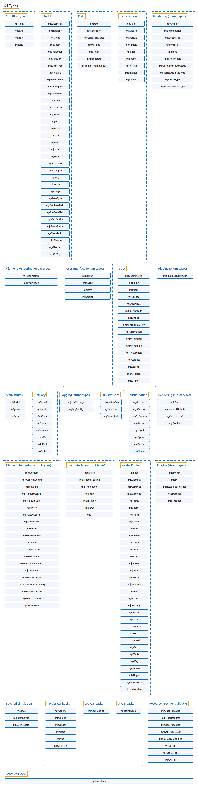

# 6.1 Types

## Classification

## Glossary

| Term | Definition | 中文翻译 | Source |
|---|---|---|---|
| **6.1 Types** 类型 | (No definition) | （无定义） | [Google DeepMind, n.d., "Types"](https://mujoco.readthedocs.io/en/stable/APIreference/APItypes.html#types) |
| **Primitive types** 基本类型 | "Four **primitive types: mjtNum, mjtByte, mjtBool, and mjtSize**." | 四种**基本类型：mjtNum、mjtByte、mjtBool 和 mjtSize**。 | [Google DeepMind, n.d., "Primitive types", item 1](https://mujoco.readthedocs.io/en/stable/APIreference/APItypes.html#primitive-types) |
| **mjtNum** mjtNum | "This is **the floating-point type used throughout the simulator**." | 这是**整个仿真器中使用的浮点类型**。 | [Google DeepMind, n.d., "mjtNum", para. 1](https://mujoco.readthedocs.io/en/stable/APIreference/APItypes.html#mjtnum) |
| **mjtByte** mjtByte | "**Byte type used to represent small integers and binary data**." | **用于表示小整数和二进制数据的字节类型**。 | [Google DeepMind, n.d., "mjtByte", para. 1](https://mujoco.readthedocs.io/en/stable/APIreference/APItypes.html#mjtbyte) |
| **mjtBool** mjtBool | "**Boolean type used to represent true/false values**." | **用于表示真/假值的布尔类型**。 | [Google DeepMind, n.d., "mjtBool", para. 1](https://mujoco.readthedocs.io/en/stable/APIreference/APItypes.html#mjtbool) |
| **mjtSize** mjtSize | "**Size type used to represent buffer sizes**." | **用于表示缓冲区大小的尺寸类型**。 | [Google DeepMind, n.d., "mjtSize", para. 1](https://mujoco.readthedocs.io/en/stable/APIreference/APItypes.html#mjtsize) |
| **Model** 模型枚举 | "Enums used in **mjModel**." | 用于 **mjModel** 的枚举。 | [Google DeepMind, n.d., "Model", item 2](https://mujoco.readthedocs.io/en/stable/APIreference/APItypes.html#model) |
| **mjtDisableBit** mjtDisableBit | "**Constants which are powers of 2**. They are used as **bitmasks for the field disableflags of mjOption**." | **2 的幂次常量**。它们用作 **mjOption 中 disableflags 字段的位掩码**。 | [Google DeepMind, n.d., "mjtDisableBit", para. 1](https://mujoco.readthedocs.io/en/stable/APIreference/APItypes.html#mjtdisablebit) |
| **mjtEnableBit** mjtEnableBit | "**Constants which are powers of 2**. They are used as **bitmasks for the field enableflags of mjOption**." | **2 的幂次常量**。它们用作 **mjOption 中 enableflags 字段的位掩码**。 | [Google DeepMind, n.d., "mjtEnableBit", para. 1](https://mujoco.readthedocs.io/en/stable/APIreference/APItypes.html#mjtenablebit) |
| **mjtJoint** mjtJoint | "**Primitive joint types**." | **基本关节类型**。 | [Google DeepMind, n.d., "mjtJoint", para. 1](https://mujoco.readthedocs.io/en/stable/APIreference/APItypes.html#mjtjoint) |
| **mjtGeom** mjtGeom | "**Geometric types supported by MuJoCo**." | **MuJoCo 支持的几何类型**。 | [Google DeepMind, n.d., "mjtGeom", para. 1](https://mujoco.readthedocs.io/en/stable/APIreference/APItypes.html#mjtgeom) |
| **mjtProjection** mjtProjection | "**Type of camera projection**." | **相机投影的类型**。 | [Google DeepMind, n.d., "mjtProjection", para. 1](https://mujoco.readthedocs.io/en/stable/APIreference/APItypes.html#mjtprojection) |
| **mjtCamLight** mjtCamLight | "**Dynamic modes for cameras and lights, specifying how the camera/light position and orientation are computed**." | **相机和光源的动态模式，指定相机/光源的位置和朝向如何计算**。 | [Google DeepMind, n.d., "mjtCamLight", para. 1](https://mujoco.readthedocs.io/en/stable/APIreference/APItypes.html#mjtcamlight) |
| **mjtLightType** mjtLightType | "**The type of a light source** describing how its position, orientation and other properties will interact with the objects in the scene." | **光源的类型**，描述其位置、朝向及其他属性如何与场景中的物体相互作用。 | [Google DeepMind, n.d., "mjtLightType", para. 1](https://mujoco.readthedocs.io/en/stable/APIreference/APItypes.html#mjtlighttype) |
| **mjtTexture** mjtTexture | "**Texture types, specifying how the texture will be mapped**." | **纹理类型，指定纹理将如何映射**。 | [Google DeepMind, n.d., "mjtTexture", para. 1](https://mujoco.readthedocs.io/en/stable/APIreference/APItypes.html#mjttexture) |
| **mjtTextureRole** mjtTextureRole | "**Texture roles, specifying how the renderer should interpret the texture**." | **纹理角色，指定渲染器应如何解释该纹理**。 | [Google DeepMind, n.d., "mjtTextureRole", para. 1](https://mujoco.readthedocs.io/en/stable/APIreference/APItypes.html#mjttexturerole) |
| **mjtColorSpace** mjtColorSpace | "**Type of color space encoding for textures**." | **纹理的色彩空间编码类型**。 | [Google DeepMind, n.d., "mjtColorSpace", para. 1](https://mujoco.readthedocs.io/en/stable/APIreference/APItypes.html#mjtcolorspace) |
| **mjtIntegrator** mjtIntegrator | "**Numerical integrator types**." | **数值积分器类型**。 | [Google DeepMind, n.d., "mjtIntegrator", para. 1](https://mujoco.readthedocs.io/en/stable/APIreference/APItypes.html#mjtintegrator) |
| **mjtCone** mjtCone | "**Available friction cone types**." | **可用的摩擦锥类型**。 | [Google DeepMind, n.d., "mjtCone", para. 1](https://mujoco.readthedocs.io/en/stable/APIreference/APItypes.html#mjtcone) |
| **mjtJacobian** mjtJacobian | "**Available Jacobian types**." | **可用的雅可比矩阵类型**。 | [Google DeepMind, n.d., "mjtJacobian", para. 1](https://mujoco.readthedocs.io/en/stable/APIreference/APItypes.html#mjtjacobian) |
| **mjtSolver** mjtSolver | "**Available constraint solver algorithms**." | **可用的约束求解器算法**。 | [Google DeepMind, n.d., "mjtSolver", para. 1](https://mujoco.readthedocs.io/en/stable/APIreference/APItypes.html#mjtsolver) |
| **mjtEq** mjtEq | "**Equality constraint types**." | **等式约束类型**。 | [Google DeepMind, n.d., "mjtEq", para. 1](https://mujoco.readthedocs.io/en/stable/APIreference/APItypes.html#mjteq) |
| **mjtWrap** mjtWrap | "**Tendon wrapping object types**." | **肌腱缠绕对象类型**。 | [Google DeepMind, n.d., "mjtWrap", para. 1](https://mujoco.readthedocs.io/en/stable/APIreference/APItypes.html#mjtwrap) |
| **mjtTrn** mjtTrn | "**Actuator transmission types**." | **执行器传动类型**。 | [Google DeepMind, n.d., "mjtTrn", para. 1](https://mujoco.readthedocs.io/en/stable/APIreference/APItypes.html#mjttrn) |
| **mjtDyn** mjtDyn | "**Actuator dynamics types**." | **执行器动力学类型**。 | [Google DeepMind, n.d., "mjtDyn", para. 1](https://mujoco.readthedocs.io/en/stable/APIreference/APItypes.html#mjtdyn) |
| **mjtGain** mjtGain | "**Actuator gain types**." | **执行器增益类型**。 | [Google DeepMind, n.d., "mjtGain", para. 1](https://mujoco.readthedocs.io/en/stable/APIreference/APItypes.html#mjtgain) |
| **mjtBias** mjtBias | "**Actuator bias types**." | **执行器偏置类型**。 | [Google DeepMind, n.d., "mjtBias", para. 1](https://mujoco.readthedocs.io/en/stable/APIreference/APItypes.html#mjtbias) |
| **mjtCtrlChart** mjtCtrlChart | "**Orientation input charts of so3 actuators**." | **so3 执行器的朝向输入坐标卡**。 | [Google DeepMind, n.d., "mjtCtrlChart", para. 1](https://mujoco.readthedocs.io/en/stable/APIreference/APItypes.html#mjtctrlchart) |
| **mjtCtrlInput** mjtCtrlInput | "**Input bitflags of actuators**: the input subset of pid and dcmotor actuators, and the declared input of actuators with fixed or affine gain." | **执行器的输入位标志**：pid 和 dcmotor 执行器的输入子集，以及固定增益或仿射增益执行器的声明输入。 | [Google DeepMind, n.d., "mjtCtrlInput", para. 1](https://mujoco.readthedocs.io/en/stable/APIreference/APItypes.html#mjtctrlinput) |
| **mjtObj** mjtObj | "**MuJoCo object types**." | **MuJoCo 对象类型**。 | [Google DeepMind, n.d., "mjtObj", para. 1](https://mujoco.readthedocs.io/en/stable/APIreference/APItypes.html#mjtobj) |
| **mjtSensor** mjtSensor | "**Sensor types**." | **传感器类型**。 | [Google DeepMind, n.d., "mjtSensor", para. 1](https://mujoco.readthedocs.io/en/stable/APIreference/APItypes.html#mjtsensor) |
| **mjtStage** mjtStage | "These are **the compute stages for the skipstage parameters of mj_forwardSkip and mj_inverseSkip**." | 这些是 **mj_forwardSkip 和 mj_inverseSkip 的 skipstage 参数所用的计算阶段**。 | [Google DeepMind, n.d., "mjtStage", para. 1](https://mujoco.readthedocs.io/en/stable/APIreference/APItypes.html#mjtstage) |
| **mjtDataType** mjtDataType | "These are **the possible sensor data types**, used in mjData.sensor_datatype." | 这些是**可能的传感器数据类型**，用于 mjData.sensor_datatype。 | [Google DeepMind, n.d., "mjtDataType", para. 1](https://mujoco.readthedocs.io/en/stable/APIreference/APItypes.html#mjtdatatype) |
| **mjtConDataField** mjtConDataField | "**Types of data fields returned by contact sensors**." | **接触传感器返回的数据字段类型**。 | [Google DeepMind, n.d., "mjtConDataField", para. 1](https://mujoco.readthedocs.io/en/stable/APIreference/APItypes.html#mjtcondatafield) |
| **mjtRayDataField** mjtRayDataField | "**Data fields returned by rangefinder sensors**." | **测距传感器返回的数据字段**。 | [Google DeepMind, n.d., "mjtRayDataField", para. 1](https://mujoco.readthedocs.io/en/stable/APIreference/APItypes.html#mjtraydatafield) |
| **mjtCamOutBit** mjtCamOutBit | "**Camera output type bitflags**." | **相机输出类型位标志**。 | [Google DeepMind, n.d., "mjtCamOutBit", para. 1](https://mujoco.readthedocs.io/en/stable/APIreference/APItypes.html#mjtcamoutbit) |
| **mjtSameFrame** mjtSameFrame | "**Types of frame alignment of elements with their parent bodies**." | **元素与其父刚体之间坐标系对齐的类型**。 | [Google DeepMind, n.d., "mjtSameFrame", para. 1](https://mujoco.readthedocs.io/en/stable/APIreference/APItypes.html#mjtsameframe) |
| **mjtSleepPolicy** mjtSleepPolicy | "**Sleep policy associated with a tree**." | **与一棵树关联的休眠策略**。 | [Google DeepMind, n.d., "mjtSleepPolicy", para. 1](https://mujoco.readthedocs.io/en/stable/APIreference/APItypes.html#mjtsleeppolicy) |
| **mjtLRMode** mjtLRMode | "**Mode for actuator length range computation**." | **执行器长度范围计算的模式**。 | [Google DeepMind, n.d., "mjtLRMode", para. 1](https://mujoco.readthedocs.io/en/stable/APIreference/APItypes.html#mjtlrmode) |
| **mjtFlexSelf** mjtFlexSelf | "**Types of flex self-collisions midphase**." | **柔性体自碰撞中间阶段的类型**。 | [Google DeepMind, n.d., "mjtFlexSelf", para. 1](https://mujoco.readthedocs.io/en/stable/APIreference/APItypes.html#mjtflexself) |
| **mjtSDFType** mjtSDFType | "**Formulas used to combine SDFs when calling mjc_distance and mjc_gradient**." | **调用 mjc_distance 和 mjc_gradient 时用于组合 SDF 的公式**。 | [Google DeepMind, n.d., "mjtSDFType", para. 1](https://mujoco.readthedocs.io/en/stable/APIreference/APItypes.html#mjtsdftype) |
| **Data** 数据枚举 | "Enums used in **mjData**." | 用于 **mjData** 的枚举。 | [Google DeepMind, n.d., "Data", item 2](https://mujoco.readthedocs.io/en/stable/APIreference/APItypes.html#data) |
| **mjtState** mjtState | "**State component elements as integer bitflags and several convenient combinations of these flags**." | **以整数位标志表示的状态分量元素，以及这些标志的几种便捷组合**。 | [Google DeepMind, n.d., "mjtState", para. 1](https://mujoco.readthedocs.io/en/stable/APIreference/APItypes.html#mjtstate) |
| **mjtConstraint** mjtConstraint | "**Constraint types**." | **约束类型**。 | [Google DeepMind, n.d., "mjtConstraint", para. 1](https://mujoco.readthedocs.io/en/stable/APIreference/APItypes.html#mjtconstraint) |
| **mjtConstraintState** mjtConstraintState | "These values are used by the solver internally to **keep track of the constraint states**." | 这些值由求解器在内部使用，以**跟踪约束状态**。 | [Google DeepMind, n.d., "mjtConstraintState", para. 1](https://mujoco.readthedocs.io/en/stable/APIreference/APItypes.html#mjtconstraintstate) |
| **mjtWarning** mjtWarning | "**Warning types**." | **警告类型**。 | [Google DeepMind, n.d., "mjtWarning", para. 1](https://mujoco.readthedocs.io/en/stable/APIreference/APItypes.html#mjtwarning) |
| **mjtTimer** mjtTimer | "**Timer types**." | **计时器类型**。 | [Google DeepMind, n.d., "mjtTimer", para. 1](https://mujoco.readthedocs.io/en/stable/APIreference/APItypes.html#mjttimer) |
| **mjtSleepState** mjtSleepState | "**Sleep state of an object**." | **对象的休眠状态**。 | [Google DeepMind, n.d., "mjtSleepState", para. 1](https://mujoco.readthedocs.io/en/stable/APIreference/APItypes.html#mjtsleepstate) |
| **Logging (enum types)** 日志枚举 | (No definition) | （无定义） | [Google DeepMind, n.d., "Logging"](https://mujoco.readthedocs.io/en/stable/APIreference/APItypes.html#logging) |
| **mjtLogLevel** mjtLogLevel | "**Log message severity level**." | **日志消息的严重级别**。 | [Google DeepMind, n.d., "mjtLogLevel", para. 1](https://mujoco.readthedocs.io/en/stable/APIreference/APItypes.html#mjtloglevel) |
| **mjtLogTopic** mjtLogTopic | "**Topic identifiers for informational messages**." | **信息类消息的主题标识符**。 | [Google DeepMind, n.d., "mjtLogTopic", para. 1](https://mujoco.readthedocs.io/en/stable/APIreference/APItypes.html#mjtlogtopic) |
| **Visualization** 可视化枚举 | "Enums for **abstract visualization**." | 用于**抽象可视化**的枚举。 | [Google DeepMind, n.d., "Visualization", item 2](https://mujoco.readthedocs.io/en/stable/APIreference/APItypes.html#visualization) |
| **mjtCatBit** mjtCatBit | "These are **the available categories of geoms in the abstract visualizer**." | 这些是**抽象可视化器中可用的 geom 类别**。 | [Google DeepMind, n.d., "mjtCatBit", para. 1](https://mujoco.readthedocs.io/en/stable/APIreference/APItypes.html#mjtcatbit) |
| **mjtMouse** mjtMouse | "These are **the mouse actions that the abstract visualizer recognizes**." | 这些是**抽象可视化器能识别的鼠标动作**。 | [Google DeepMind, n.d., "mjtMouse", para. 1](https://mujoco.readthedocs.io/en/stable/APIreference/APItypes.html#mjtmouse) |
| **mjtPertBit** mjtPertBit | "These bitmasks **enable the translational and rotational components of the mouse perturbation**." | 这些位掩码**启用鼠标扰动的平移分量和旋转分量**。 | [Google DeepMind, n.d., "mjtPertBit", para. 1](https://mujoco.readthedocs.io/en/stable/APIreference/APItypes.html#mjtpertbit) |
| **mjtCamera** mjtCamera | "These are **the possible camera types**, used in mjvCamera.type." | 这些是**可能的相机类型**，用于 mjvCamera.type。 | [Google DeepMind, n.d., "mjtCamera", para. 1](https://mujoco.readthedocs.io/en/stable/APIreference/APItypes.html#mjtcamera) |
| **mjtLabel** mjtLabel | "These are **the abstract visualization elements that can have text labels**." | 这些是**可以带文本标签的抽象可视化元素**。 | [Google DeepMind, n.d., "mjtLabel", para. 1](https://mujoco.readthedocs.io/en/stable/APIreference/APItypes.html#mjtlabel) |
| **mjtFrame** mjtFrame | "These are **the MuJoCo objects whose spatial frames can be rendered**." | 这些是**其空间坐标系可以被渲染的 MuJoCo 对象**。 | [Google DeepMind, n.d., "mjtFrame", para. 1](https://mujoco.readthedocs.io/en/stable/APIreference/APItypes.html#mjtframe) |
| **mjtVisFlag** mjtVisFlag | "These are **indices in the array mjvOption.flags, whose elements enable/disable the visualization of the corresponding model or decoration element**." | 这些是**数组 mjvOption.flags 中的索引，其元素启用/禁用相应模型元素或装饰元素的可视化**。 | [Google DeepMind, n.d., "mjtVisFlag", para. 1](https://mujoco.readthedocs.io/en/stable/APIreference/APItypes.html#mjtvisflag) |
| **mjtRndFlag** mjtRndFlag | "These are **indices in the array mjvScene.flags, whose elements enable/disable OpenGL rendering effects**." | 这些是**数组 mjvScene.flags 中的索引，其元素启用/禁用 OpenGL 渲染效果**。 | [Google DeepMind, n.d., "mjtRndFlag", para. 1](https://mujoco.readthedocs.io/en/stable/APIreference/APItypes.html#mjtrndflag) |
| **mjtStereo** mjtStereo | "These are **the possible stereo rendering types**." | 这些是**可能的立体渲染类型**。 | [Google DeepMind, n.d., "mjtStereo", para. 1](https://mujoco.readthedocs.io/en/stable/APIreference/APItypes.html#mjtstereo) |
| **Rendering (enum types)** 渲染枚举 | "Enums used by **the classic renderer**." | 经典渲染器所用的枚举。 | [Google DeepMind, n.d., "Rendering", item 2](https://mujoco.readthedocs.io/en/stable/APIreference/APItypes.html#rendering) |
| **mjtGridPos** mjtGridPos | "These are **the possible grid positions for text overlays**." | 这些是**文本叠加层可能的网格位置**。 | [Google DeepMind, n.d., "mjtGridPos", para. 1](https://mujoco.readthedocs.io/en/stable/APIreference/APItypes.html#mjtgridpos) |
| **mjtFramebuffer** mjtFramebuffer | "These are **the possible framebuffers**." | 这些是**可能的帧缓冲区**。 | [Google DeepMind, n.d., "mjtFramebuffer", para. 1](https://mujoco.readthedocs.io/en/stable/APIreference/APItypes.html#mjtframebuffer) |
| **mjtDepthMap** mjtDepthMap | "These are **the depth mapping options**." | 这些是**深度映射选项**。 | [Google DeepMind, n.d., "mjtDepthMap", para. 1](https://mujoco.readthedocs.io/en/stable/APIreference/APItypes.html#mjtdepthmap) |
| **mjtFontScale** mjtFontScale | "These are **the possible font sizes**." | 这些是**可能的字体大小**。 | [Google DeepMind, n.d., "mjtFontScale", para. 1](https://mujoco.readthedocs.io/en/stable/APIreference/APItypes.html#mjtfontscale) |
| **mjtFont** mjtFont | "These are **the possible font types**." | 这些是**可能的字体类型**。 | [Google DeepMind, n.d., "mjtFont", para. 1](https://mujoco.readthedocs.io/en/stable/APIreference/APItypes.html#mjtfont) |
| **mjrPixelFormat** mjrPixelFormat | "**pixel format for textures**" | **纹理的像素格式** | [Google DeepMind, n.d., "mjrPixelFormat", code comment](https://mujoco.readthedocs.io/en/stable/APIreference/APItypes.html#mjrpixelformat) |
| **mjrVertexAttributeUsage** mjrVertexAttributeUsage | "**usage/purpose of a vertex attribute**" | **顶点属性的用途/目的** | [Google DeepMind, n.d., "mjrVertexAttributeUsage", code comment](https://mujoco.readthedocs.io/en/stable/APIreference/APItypes.html#mjrvertexattributeusage) |
| **mjrVertexAttributeType** mjrVertexAttributeType | "**data format of a vertex attribute**" | **顶点属性的数据格式** | [Google DeepMind, n.d., "mjrVertexAttributeType", code comment](https://mujoco.readthedocs.io/en/stable/APIreference/APItypes.html#mjrvertexattributetype) |
| **mjrIndexType** mjrIndexType | "**data type of index buffer data**" | **索引缓冲区数据的数据类型** | [Google DeepMind, n.d., "mjrIndexType", code comment](https://mujoco.readthedocs.io/en/stable/APIreference/APItypes.html#mjrindextype) |
| **mjrMeshPrimitiveType** mjrMeshPrimitiveType | "**type of mesh primitive**" | **网格图元的类型** | [Google DeepMind, n.d., "mjrMeshPrimitiveType", code comment](https://mujoco.readthedocs.io/en/stable/APIreference/APItypes.html#mjrmeshprimitivetype) |
| **Filament Rendering (enum types)** Filament 渲染枚举 | "Enums used by **the filament renderer**." | filament 渲染器所用的枚举。 | [Google DeepMind, n.d., "Filament Rendering", item 2](https://mujoco.readthedocs.io/en/stable/APIreference/APItypes.html#filament-rendering) |
| **mjrGraphicsApi** mjrGraphicsApi | "**The underlying graphics API to use for Filament rendering**." | **Filament 渲染所用的底层图形 API**。 | [Google DeepMind, n.d., "mjrGraphicsApi", para. 1](https://mujoco.readthedocs.io/en/stable/APIreference/APItypes.html#mjrgraphicsapi) |
| **mjrDrawMode** mjrDrawMode | "**High-level control for how to draw objects in the scene for Filament rendering**." | **Filament 渲染中关于如何绘制场景中物体的高层控制**。 | [Google DeepMind, n.d., "mjrDrawMode", para. 1](https://mujoco.readthedocs.io/en/stable/APIreference/APItypes.html#mjrdrawmode) |
| **User Interface (enum types)** 用户界面枚举 | "Enums used by **the mjUI user interface package**." | mjUI 用户界面包所用的枚举。 | [Google DeepMind, n.d., "User Interface", item 2](https://mujoco.readthedocs.io/en/stable/APIreference/APItypes.html#user-interface) |
| **mjtButton** mjtButton | "**Mouse button IDs used in the UI framework**." | **UI 框架中使用的鼠标按键 ID**。 | [Google DeepMind, n.d., "mjtButton", para. 1](https://mujoco.readthedocs.io/en/stable/APIreference/APItypes.html#mjtbutton) |
| **mjtEvent** mjtEvent | "**Event types used in the UI framework**." | **UI 框架中使用的事件类型**。 | [Google DeepMind, n.d., "mjtEvent", para. 1](https://mujoco.readthedocs.io/en/stable/APIreference/APItypes.html#mjtevent) |
| **mjtItem** mjtItem | "**Item types used in the UI framework**." | **UI 框架中使用的条目类型**。 | [Google DeepMind, n.d., "mjtItem", para. 1](https://mujoco.readthedocs.io/en/stable/APIreference/APItypes.html#mjtitem) |
| **mjtSection** mjtSection | "**State of a UI section**." | **UI 分区的状态**。 | [Google DeepMind, n.d., "mjtSection", para. 1](https://mujoco.readthedocs.io/en/stable/APIreference/APItypes.html#mjtsection) |
| **Spec** 模型规格枚举 | "Enums used for **procedural model manipulation**." | 用于**程序化模型操作**的枚举。 | [Google DeepMind, n.d., "Spec", item 2](https://mujoco.readthedocs.io/en/stable/APIreference/APItypes.html#spec) |
| **mjtGeomInertia** mjtGeomInertia | "**Type of inertia inference**." | **惯性推断的类型**。 | [Google DeepMind, n.d., "mjtGeomInertia", para. 1](https://mujoco.readthedocs.io/en/stable/APIreference/APItypes.html#mjtgeominertia) |
| **mjtBuiltin** mjtBuiltin | "**Type of built-in procedural texture**." | **内置程序化纹理的类型**。 | [Google DeepMind, n.d., "mjtBuiltin", para. 1](https://mujoco.readthedocs.io/en/stable/APIreference/APItypes.html#mjtbuiltin) |
| **mjtMark** mjtMark | "**Mark type for procedural textures**." | **程序化纹理的标记类型**。 | [Google DeepMind, n.d., "mjtMark", para. 1](https://mujoco.readthedocs.io/en/stable/APIreference/APItypes.html#mjtmark) |
| **mjtLimited** mjtLimited | "**Type of limit specification**." | **限位设定的类型**。 | [Google DeepMind, n.d., "mjtLimited", para. 1](https://mujoco.readthedocs.io/en/stable/APIreference/APItypes.html#mjtlimited) |
| **mjtAlignFree** mjtAlignFree | "**Whether to align free joints with the inertial frame**." | **是否将自由关节与惯性坐标系对齐**。 | [Google DeepMind, n.d., "mjtAlignFree", para. 1](https://mujoco.readthedocs.io/en/stable/APIreference/APItypes.html#mjtalignfree) |
| **mjtPassthrough** mjtPassthrough | "**Which assets the compiler leaves by reference instead of loading into mjModel, a bitmask**; see compiler/passthrough." | **编译器以引用方式保留、而不加载到 mjModel 中的资源，是一个位掩码**；参见 compiler/passthrough。 | [Google DeepMind, n.d., "mjtPassthrough", para. 1](https://mujoco.readthedocs.io/en/stable/APIreference/APItypes.html#mjtpassthrough) |
| **mjtEmbed** mjtEmbed | "**Whether an asset’s payload is in the model or the asset is by reference**; see texture/embed." | **资源的有效载荷是在模型中，还是该资源以引用方式存在**；参见 texture/embed。 | [Google DeepMind, n.d., "mjtEmbed", para. 1](https://mujoco.readthedocs.io/en/stable/APIreference/APItypes.html#mjtembed) |
| **mjtInertiaFromGeom** mjtInertiaFromGeom | "**Whether to infer body inertias from child geoms**." | **是否从子 geom 推断刚体惯性**。 | [Google DeepMind, n.d., "mjtInertiaFromGeom", para. 1](https://mujoco.readthedocs.io/en/stable/APIreference/APItypes.html#mjtinertiafromgeom) |
| **mjtOrientation** mjtOrientation | "**Type of orientation specifier**." | **朝向描述符的类型**。 | [Google DeepMind, n.d., "mjtOrientation", para. 1](https://mujoco.readthedocs.io/en/stable/APIreference/APItypes.html#mjtorientation) |
| **mjtMeshInertia** mjtMeshInertia | "**Type of mesh inertia computation**." | **网格惯性计算的类型**。 | [Google DeepMind, n.d., "mjtMeshInertia", para. 1](https://mujoco.readthedocs.io/en/stable/APIreference/APItypes.html#mjtmeshinertia) |
| **mjtMeshBuiltin** mjtMeshBuiltin | "**Type of built-in procedural mesh**." | **内置程序化网格的类型**。 | [Google DeepMind, n.d., "mjtMeshBuiltin", para. 1](https://mujoco.readthedocs.io/en/stable/APIreference/APItypes.html#mjtmeshbuiltin) |
| **mjtFlexSection** mjtFlexSection | "**Cross-section of 1D flex elasticity**, see section." | **一维柔性体弹性的横截面**，参见 section。 | [Google DeepMind, n.d., "mjtFlexSection", para. 1](https://mujoco.readthedocs.io/en/stable/APIreference/APItypes.html#mjtflexsection) |
| **mjtConflict** mjtConflict | "**Conflict resolution mode for attach**." | **附加（attach）时的冲突解决模式**。 | [Google DeepMind, n.d., "mjtConflict", para. 1](https://mujoco.readthedocs.io/en/stable/APIreference/APItypes.html#mjtconflict) |
| **mjtScaling** mjtScaling | "**Physical policy of a frame’s scale**, see scaling." | **坐标系 scale 的物理策略**，参见 scaling。 | [Google DeepMind, n.d., "mjtScaling", para. 1](https://mujoco.readthedocs.io/en/stable/APIreference/APItypes.html#mjtscaling) |
| **mjtActuator** mjtActuator | "**The actuator element an actuator is written with: general or one of its shortcuts**." | **编写某个执行器时所用的执行器元素：general 或其快捷方式之一**。 | [Google DeepMind, n.d., "mjtActuator", para. 1](https://mujoco.readthedocs.io/en/stable/APIreference/APItypes.html#mjtactuator) |
| **mjtCTimer** mjtCTimer | "**Compiler timing categories**, used in mjs_getTimer." | **编译器计时类别**，用于 mjs_getTimer。 | [Google DeepMind, n.d., "mjtCTimer", para. 1](https://mujoco.readthedocs.io/en/stable/APIreference/APItypes.html#mjtctimer) |
| **Plugins (enum types)** 插件枚举 | "Enums used by **engine plugins**." | 引擎插件所用的枚举。 | [Google DeepMind, n.d., "Plugins", item 2](https://mujoco.readthedocs.io/en/stable/APIreference/APItypes.html#plugins) |
| **mjtPluginCapabilityBit** mjtPluginCapabilityBit | "**Capabilities declared by an engine plugin**." | **引擎插件所声明的能力**。 | [Google DeepMind, n.d., "mjtPluginCapabilityBit", para. 1](https://mujoco.readthedocs.io/en/stable/APIreference/APItypes.html#mjtplugincapabilitybit) |
| **Main structs** 主结构体 | "The three central struct types for physics simulation are **mjModel, mjOption (embedded in mjModel) and mjData**." | 物理仿真的三个核心结构体类型是 **mjModel、mjOption（嵌入在 mjModel 中）和 mjData**。 | [Google DeepMind, n.d., "Struct types", para. 1](https://mujoco.readthedocs.io/en/stable/APIreference/APItypes.html#struct-types) |
| **mjModel** mjModel | "This is **the main data structure holding the MuJoCo model**." | 这是**保存 MuJoCo 模型的主数据结构**。 | [Google DeepMind, n.d., "mjModel", para. 1](https://mujoco.readthedocs.io/en/stable/APIreference/APItypes.html#mjmodel) |
| **mjOption** mjOption | "This is **the data structure with simulation options**." | 这是**包含仿真选项的数据结构**。 | [Google DeepMind, n.d., "mjOption", para. 1](https://mujoco.readthedocs.io/en/stable/APIreference/APItypes.html#mjoption) |
| **mjData** mjData | "This is **the main data structure holding the simulation state**." | 这是**保存仿真状态的主数据结构**。 | [Google DeepMind, n.d., "mjData", para. 1](https://mujoco.readthedocs.io/en/stable/APIreference/APItypes.html#mjdata) |
| **Auxiliary** 辅助结构体 | "Auxiliary struct types, **also used by the engine**." | 辅助结构体类型，**也被引擎使用**。 | [Google DeepMind, n.d., "Auxiliary", item 3](https://mujoco.readthedocs.io/en/stable/APIreference/APItypes.html#auxiliary) |
| **mjVisual** mjVisual | "This is **the data structure with abstract visualization options**." | 这是**包含抽象可视化选项的数据结构**。 | [Google DeepMind, n.d., "mjVisual", para. 1](https://mujoco.readthedocs.io/en/stable/APIreference/APItypes.html#mjvisual) |
| **mjStatistic** mjStatistic | "This is **the data structure with model statistics precomputed by the compiler or set by the user**." | 这是**包含由编译器预先计算或由用户设置的模型统计量的数据结构**。 | [Google DeepMind, n.d., "mjStatistic", para. 1](https://mujoco.readthedocs.io/en/stable/APIreference/APItypes.html#mjstatistic) |
| **mjPreContact** mjPreContact | "This is **the data structure holding information about one contact filled out by a narrowphase collision detector**." | 这是**保存由窄相碰撞检测器填写的单个接触信息的数据结构**。 | [Google DeepMind, n.d., "mjPreContact", para. 1](https://mujoco.readthedocs.io/en/stable/APIreference/APItypes.html#mjprecontact) |
| **mjContact** mjContact | "This is **the data structure holding information about one contact**." | 这是**保存单个接触信息的数据结构**。 | [Google DeepMind, n.d., "mjContact", para. 1](https://mujoco.readthedocs.io/en/stable/APIreference/APItypes.html#mjcontact) |
| **mjResource** mjResource | "A resource is **an abstraction of a file in a filesystem**." | 资源是**对文件系统中文件的一种抽象**。 | [Google DeepMind, n.d., "mjResource", para. 1](https://mujoco.readthedocs.io/en/stable/APIreference/APItypes.html#mjresource) |
| **mjVFS** mjVFS | "This is **the data structure of the virtual file system**." | 这是**虚拟文件系统的数据结构**。 | [Google DeepMind, n.d., "mjVFS", para. 1](https://mujoco.readthedocs.io/en/stable/APIreference/APItypes.html#mjvfs) |
| **mjLROpt** mjLROpt | "**Options for configuring the automatic actuator length-range computation**." | **用于配置自动执行器长度范围计算的选项**。 | [Google DeepMind, n.d., "mjLROpt", para. 1](https://mujoco.readthedocs.io/en/stable/APIreference/APItypes.html#mjlropt) |
| **mjCache** mjCache | "**Asset cache used by the compiler to avoid repeated slow recompilation**." | **编译器用来避免重复缓慢重新编译的资源缓存**。 | [Google DeepMind, n.d., "mjCache", para. 1](https://mujoco.readthedocs.io/en/stable/APIreference/APItypes.html#mjcache) |
| **Logging (struct types)** 日志结构体 | (No definition) | （无定义） | [Google DeepMind, n.d., "Logging"](https://mujoco.readthedocs.io/en/stable/APIreference/APItypes.html#tylogstructure) |
| **mjLogMessage** mjLogMessage | "**Structured log message passed to mjfLogHandler callbacks**." | **传递给 mjfLogHandler 回调的结构化日志消息**。 | [Google DeepMind, n.d., "mjLogMessage", para. 1](https://mujoco.readthedocs.io/en/stable/APIreference/APItypes.html#mjlogmessage) |
| **mjLogConfig** mjLogConfig | "**Configuration for the default log handler**." | **默认日志处理器的配置**。 | [Google DeepMind, n.d., "mjLogConfig", para. 1](https://mujoco.readthedocs.io/en/stable/APIreference/APItypes.html#mjlogconfig) |
| **Sim statistics** 仿真统计结构体 | "Structs for **collecting simulation statistics**." | 用于**收集仿真统计信息**的结构体。 | [Google DeepMind, n.d., "Sim statistics", item 3](https://mujoco.readthedocs.io/en/stable/APIreference/APItypes.html#sim-statistics) |
| **mjWarningStat** mjWarningStat | "This is **the data structure holding information about one warning type**." | 这是**保存某一种警告类型信息的数据结构**。 | [Google DeepMind, n.d., "mjWarningStat", para. 1](https://mujoco.readthedocs.io/en/stable/APIreference/APItypes.html#mjwarningstat) |
| **mjTimerStat** mjTimerStat | "This is **the data structure holding information about one timer**." | 这是**保存单个计时器信息的数据结构**。 | [Google DeepMind, n.d., "mjTimerStat", para. 1](https://mujoco.readthedocs.io/en/stable/APIreference/APItypes.html#mjtimerstat) |
| **mjSolverStat** mjSolverStat | "This is **the data structure holding information about one solver iteration**." | 这是**保存单次求解器迭代信息的数据结构**。 | [Google DeepMind, n.d., "mjSolverStat", para. 1](https://mujoco.readthedocs.io/en/stable/APIreference/APItypes.html#mjsolverstat) |
| **Visualisation** 可视化结构体 | "Structs for **abstract visualization**." | 用于**抽象可视化**的结构体。 | [Google DeepMind, n.d., "Visualisation", item 3](https://mujoco.readthedocs.io/en/stable/APIreference/APItypes.html#visualisation) |
| **mjvPerturb** mjvPerturb | "This is **the data structure holding information about mouse perturbations**." | 这是**保存鼠标扰动信息的数据结构**。 | [Google DeepMind, n.d., "mjvPerturb", para. 1](https://mujoco.readthedocs.io/en/stable/APIreference/APItypes.html#mjvperturb) |
| **mjvCamera** mjvCamera | "This is **the data structure describing one abstract camera**." | 这是**描述一个抽象相机的数据结构**。 | [Google DeepMind, n.d., "mjvCamera", para. 1](https://mujoco.readthedocs.io/en/stable/APIreference/APItypes.html#mjvcamera) |
| **mjvGLCamera** mjvGLCamera | "This is **the data structure describing one OpenGL camera**." | 这是**描述一个 OpenGL 相机的数据结构**。 | [Google DeepMind, n.d., "mjvGLCamera", para. 1](https://mujoco.readthedocs.io/en/stable/APIreference/APItypes.html#mjvglcamera) |
| **mjvGeom** mjvGeom | "This is **the data structure describing one abstract visualization geom** - which could correspond to a model geom or to a decoration element constructed by the visualizer." | 这是**描述一个抽象可视化 geom 的数据结构**，它可能对应模型中的某个 geom，也可能对应可视化器构造的装饰元素。 | [Google DeepMind, n.d., "mjvGeom", para. 1](https://mujoco.readthedocs.io/en/stable/APIreference/APItypes.html#mjvgeom) |
| **mjvLight** mjvLight | "This is **the data structure describing one OpenGL light**." | 这是**描述一个 OpenGL 光源的数据结构**。 | [Google DeepMind, n.d., "mjvLight", para. 1](https://mujoco.readthedocs.io/en/stable/APIreference/APItypes.html#mjvlight) |
| **mjvOption** mjvOption | "This structure contains **options that enable and disable the visualization of various elements**." | 该结构体包含**启用和禁用各种元素可视化的选项**。 | [Google DeepMind, n.d., "mjvOption", para. 1](https://mujoco.readthedocs.io/en/stable/APIreference/APItypes.html#mjvoption) |
| **mjvScene** mjvScene | "This structure contains **everything needed to render the 3D scene in OpenGL**." | 该结构体包含**在 OpenGL 中渲染三维场景所需的一切**。 | [Google DeepMind, n.d., "mjvScene", para. 1](https://mujoco.readthedocs.io/en/stable/APIreference/APItypes.html#mjvscene) |
| **mjvFigure** mjvFigure | "This structure contains **everything needed to render a 2D plot in OpenGL**." | 该结构体包含**在 OpenGL 中渲染二维图表所需的一切**。 | [Google DeepMind, n.d., "mjvFigure", para. 1](https://mujoco.readthedocs.io/en/stable/APIreference/APItypes.html#mjvfigure) |
| **Rendering (struct types)** 渲染结构体 | "Structs used by **the classic renderer**." | 经典渲染器所用的结构体。 | [Google DeepMind, n.d., "Rendering", item 3](https://mujoco.readthedocs.io/en/stable/APIreference/APItypes.html#tyrenderstructure) |
| **mjrRect** mjrRect | "This structure **specifies a rectangle**." | 该结构体**指定一个矩形**。 | [Google DeepMind, n.d., "mjrRect", para. 1](https://mujoco.readthedocs.io/en/stable/APIreference/APItypes.html#mjrrect) |
| **mjrVertexAttribute** mjrVertexAttribute | "This structure **specifies the attributes for a single vertex**." | 该结构体**指定单个顶点的属性**。 | [Google DeepMind, n.d., "mjrVertexAttribute", para. 1](https://mujoco.readthedocs.io/en/stable/APIreference/APItypes.html#mjrvertexattribute) |
| **mjrRendererInfo** mjrRendererInfo | "This structure contains **information about the available renderer and its current context**." | 该结构体包含**可用渲染器及其当前上下文的信息**。 | [Google DeepMind, n.d., "mjrRendererInfo", para. 1](https://mujoco.readthedocs.io/en/stable/APIreference/APItypes.html#mjrrendererinfo) |
| **mjrContext** mjrContext | "This structure contains **the custom OpenGL rendering context, with the ids of all OpenGL resources uploaded to the GPU**." | 该结构体包含**自定义的 OpenGL 渲染上下文，以及所有已上传到 GPU 的 OpenGL 资源的 id**。 | [Google DeepMind, n.d., "mjrContext", para. 1](https://mujoco.readthedocs.io/en/stable/APIreference/APItypes.html#mjrcontext) |
| **Filament Rendering (struct types)** Filament 渲染结构体 | "Structs used by **the filament renderer**." | filament 渲染器所用的结构体。 | [Google DeepMind, n.d., "Filament Rendering", item 3](https://mujoco.readthedocs.io/en/stable/APIreference/APItypes.html#tyfilamentrenderstructure) |
| **mjrfContext** mjrfContext | "The Context is **the main entry point for the filament rendering library**." | Context 是 **filament 渲染库的主入口**。 | [Google DeepMind, n.d., "mjrfContext", para. 1](https://mujoco.readthedocs.io/en/stable/APIreference/APItypes.html#mjrfcontext) |
| **mjrfContextConfig** mjrfContextConfig | "**Parameters for creating filament graphics context**." | **用于创建 filament 图形上下文的参数**。 | [Google DeepMind, n.d., "mjrfContextConfig", para. 1](https://mujoco.readthedocs.io/en/stable/APIreference/APItypes.html#mjrfcontextconfig) |
| **mjrfTexture** mjrfTexture | "A texture is **a 2D or 3D (cubemap) image that adds visual detail to a rendered model, such as color or bumpiness, without increasing geometric complexity**." | 纹理是**一种二维或三维（立方体贴图）图像，它为渲染模型添加颜色或凹凸等视觉细节，而不增加几何复杂度**。 | [Google DeepMind, n.d., "mjrfTexture", para. 1](https://mujoco.readthedocs.io/en/stable/APIreference/APItypes.html#mjrftexture) |
| **mjrfTextureConfig** mjrfTextureConfig | "**Parameters for creating a texture**." | **用于创建纹理的参数**。 | [Google DeepMind, n.d., "mjrfTextureConfig", para. 1](https://mujoco.readthedocs.io/en/stable/APIreference/APItypes.html#mjrftextureconfig) |
| **mjrfTextureData** mjrfTextureData | "**Binary data payload for a texture**." | **纹理的二进制数据载荷**。 | [Google DeepMind, n.d., "mjrfTextureData", para. 1](https://mujoco.readthedocs.io/en/stable/APIreference/APItypes.html#mjrftexturedata) |
| **mjrfMesh** mjrfMesh | "A mesh **describes the surface geometry of an object to be rendered**." | 网格**描述待渲染物体的表面几何**。 | [Google DeepMind, n.d., "mjrfMesh", para. 1](https://mujoco.readthedocs.io/en/stable/APIreference/APItypes.html#mjrfmesh) |
| **mjrfMeshConfig** mjrfMeshConfig | "**Parameters for creating a mesh**." | **用于创建网格的参数**。 | [Google DeepMind, n.d., "mjrfMeshConfig", para. 1](https://mujoco.readthedocs.io/en/stable/APIreference/APItypes.html#mjrfmeshconfig) |
| **mjrfMeshData** mjrfMeshData | "**Binary data for a mesh**." | **网格的二进制数据**。 | [Google DeepMind, n.d., "mjrfMeshData", para. 1](https://mujoco.readthedocs.io/en/stable/APIreference/APItypes.html#mjrfmeshdata) |
| **mjrfScene** mjrfScene | "A Scene is **a collection of Lights and Renderables that describes what is to be rendered**." | Scene 是**一组光源和可渲染物，描述要渲染的内容**。 | [Google DeepMind, n.d., "mjrfScene", para. 1](https://mujoco.readthedocs.io/en/stable/APIreference/APItypes.html#mjrfscene) |
| **mjrfSceneParams** mjrfSceneParams | "**Parameters for creating a scene**." | **用于创建场景的参数**。 | [Google DeepMind, n.d., "mjrfSceneParams", para. 1](https://mujoco.readthedocs.io/en/stable/APIreference/APItypes.html#mjrfsceneparams) |
| **mjrfLight** mjrfLight | "A light is **a source of illumination**." | 光源是**照明的来源**。 | [Google DeepMind, n.d., "mjrfLight", para. 1](https://mujoco.readthedocs.io/en/stable/APIreference/APItypes.html#mjrflight) |
| **mjrfLightParams** mjrfLightParams | "**Parameters for creating a light**." | **用于创建光源的参数**。 | [Google DeepMind, n.d., "mjrfLightParams", para. 1](https://mujoco.readthedocs.io/en/stable/APIreference/APItypes.html#mjrflightparams) |
| **mjrfRenderable** mjrfRenderable | "A renderable is **a single object that is to be drawn**." | 可渲染物是**一个待绘制的单个对象**。 | [Google DeepMind, n.d., "mjrfRenderable", para. 1](https://mujoco.readthedocs.io/en/stable/APIreference/APItypes.html#mjrfrenderable) |
| **mjrfRenderableParams** mjrfRenderableParams | "**Parameters for creating a renderable**." | **用于创建可渲染物的参数**。 | [Google DeepMind, n.d., "mjrfRenderableParams", para. 1](https://mujoco.readthedocs.io/en/stable/APIreference/APItypes.html#mjrfrenderableparams) |
| **mjrfMaterial** mjrfMaterial | "Materials **describe the properties of the surface of a renderable**, effectively dictating how the surface interacts with lights to produce a final pixel color in the output image." | 材质**描述可渲染物表面的属性**，实际上决定了表面如何与光源相互作用，从而在输出图像中产生最终的像素颜色。 | [Google DeepMind, n.d., "mjrfMaterial", para. 1](https://mujoco.readthedocs.io/en/stable/APIreference/APItypes.html#mjrfmaterial) |
| **mjrfRenderTarget** mjrfRenderTarget | "A RenderTarget is **a memory buffer that holds the results of a rendering operation**." | RenderTarget 是**保存渲染操作结果的内存缓冲区**。 | [Google DeepMind, n.d., "mjrfRenderTarget", para. 1](https://mujoco.readthedocs.io/en/stable/APIreference/APItypes.html#mjrfrendertarget) |
| **mjrfRenderTargetConfig** mjrfRenderTargetConfig | "**Parameters for creating a render target**." | **用于创建渲染目标的参数**。 | [Google DeepMind, n.d., "mjrfRenderTargetConfig", para. 1](https://mujoco.readthedocs.io/en/stable/APIreference/APItypes.html#mjrfrendertargetconfig) |
| **mjrfRenderRequest** mjrfRenderRequest | "**A single rendering operation**." | **单次渲染操作**。 | [Google DeepMind, n.d., "mjrfRenderRequest", para. 1](https://mujoco.readthedocs.io/en/stable/APIreference/APItypes.html#mjrfrenderrequest) |
| **mjrfReadRequest** mjrfReadRequest | "**A single pixel read operation**." | **单次像素读取操作**。 | [Google DeepMind, n.d., "mjrfReadRequest", para. 1](https://mujoco.readthedocs.io/en/stable/APIreference/APItypes.html#mjrfreadrequest) |
| **mjrfFrameStats** mjrfFrameStats | "**Information about a single frame of rendering**." | **关于单帧渲染的信息**。 | [Google DeepMind, n.d., "mjrfFrameStats", para. 1](https://mujoco.readthedocs.io/en/stable/APIreference/APItypes.html#mjrfframestats) |
| **User Interface (struct types)** 用户界面结构体 | "Structs used by **the UI framework**." | UI 框架所用的结构体。 | [Google DeepMind, n.d., "User Interface", item 3](https://mujoco.readthedocs.io/en/stable/APIreference/APItypes.html#tyuistructure) |
| **mjuiState** mjuiState | "This C struct represents **the global state of the window, keyboard and mouse, input event descriptors, and all window rectangles (including the visible UI rectangles)**." | 这个 C 结构体表示**窗口、键盘和鼠标的全局状态、输入事件描述符，以及所有窗口矩形（包括可见的 UI 矩形）**。 | [Google DeepMind, n.d., "mjuiState", para. 1](https://mujoco.readthedocs.io/en/stable/APIreference/APItypes.html#mjuistate) |
| **mjuiThemeSpacing** mjuiThemeSpacing | "This structure **defines the spacing of UI items in the theme**." | 该结构体**定义主题中 UI 条目的间距**。 | [Google DeepMind, n.d., "mjuiThemeSpacing", para. 1](https://mujoco.readthedocs.io/en/stable/APIreference/APItypes.html#mjuithemespacing) |
| **mjuiThemeColor** mjuiThemeColor | "This structure **defines the colors of UI items in the theme**." | 该结构体**定义主题中 UI 条目的颜色**。 | [Google DeepMind, n.d., "mjuiThemeColor", para. 1](https://mujoco.readthedocs.io/en/stable/APIreference/APItypes.html#mjuithemecolor) |
| **mjuiItem** mjuiItem | "This structure **defines one UI item**." | 该结构体**定义一个 UI 条目**。 | [Google DeepMind, n.d., "mjuiItem", para. 1](https://mujoco.readthedocs.io/en/stable/APIreference/APItypes.html#mjuiitem) |
| **mjuiSection** mjuiSection | "This structure **defines one section of the UI**." | 该结构体**定义 UI 的一个分区**。 | [Google DeepMind, n.d., "mjuiSection", para. 1](https://mujoco.readthedocs.io/en/stable/APIreference/APItypes.html#mjuisection) |
| **mjuiDef** mjuiDef | "This structure **defines one entry in the definition table used for simplified UI construction**." | 该结构体**定义用于简化 UI 构建的定义表中的一项**。 | [Google DeepMind, n.d., "mjuiDef", para. 1](https://mujoco.readthedocs.io/en/stable/APIreference/APItypes.html#mjuidef) |
| **mjUI** mjUI | "This C struct **represents an entire UI**." | 这个 C 结构体**表示一个完整的 UI**。 | [Google DeepMind, n.d., "mjUI", para. 1](https://mujoco.readthedocs.io/en/stable/APIreference/APItypes.html#mjui) |
| **Model Editing** 模型编辑结构体 | "Structs used for **procedural model manipulation**." | 用于**程序化模型操作**的结构体。 | [Google DeepMind, n.d., "Model Editing", item 3](https://mujoco.readthedocs.io/en/stable/APIreference/APItypes.html#model-editing) |
| **mjSpec** mjSpec | "**Model specification**." | **模型规格**。 | [Google DeepMind, n.d., "mjSpec", para. 1](https://mujoco.readthedocs.io/en/stable/APIreference/APItypes.html#mjspec) |
| **mjsElement** mjsElement | "**Special type corresponding to any element**." | **对应任意元素的特殊类型**。 | [Google DeepMind, n.d., "mjsElement", para. 1](https://mujoco.readthedocs.io/en/stable/APIreference/APItypes.html#mjselement) |
| **mjsCompiler** mjsCompiler | "**Compiler options**." | **编译器选项**。 | [Google DeepMind, n.d., "mjsCompiler", para. 1](https://mujoco.readthedocs.io/en/stable/APIreference/APItypes.html#mjscompiler) |
| **mjsAuthored** mjsAuthored | "**Authored tracking bitmasks for mjModel structs**." | **跟踪 mjModel 结构体中哪些字段由作者设定的位掩码**。 | [Google DeepMind, n.d., "mjsAuthored", para. 1](https://mujoco.readthedocs.io/en/stable/APIreference/APItypes.html#mjsauthored) |
| **mjsBody** mjsBody | "**Body specification**." | **刚体规格**。 | [Google DeepMind, n.d., "mjsBody", para. 1](https://mujoco.readthedocs.io/en/stable/APIreference/APItypes.html#mjsbody) |
| **mjsFrame** mjsFrame | "**Frame specification**." | **坐标系规格**。 | [Google DeepMind, n.d., "mjsFrame", para. 1](https://mujoco.readthedocs.io/en/stable/APIreference/APItypes.html#mjsframe) |
| **mjsJoint** mjsJoint | "**Joint specification**." | **关节规格**。 | [Google DeepMind, n.d., "mjsJoint", para. 1](https://mujoco.readthedocs.io/en/stable/APIreference/APItypes.html#mjsjoint) |
| **mjsGeom** mjsGeom | "**Geom specification**." | **geom 规格**。 | [Google DeepMind, n.d., "mjsGeom", para. 1](https://mujoco.readthedocs.io/en/stable/APIreference/APItypes.html#mjsgeom) |
| **mjsSite** mjsSite | "**Site specification**." | **site 规格**。 | [Google DeepMind, n.d., "mjsSite", para. 1](https://mujoco.readthedocs.io/en/stable/APIreference/APItypes.html#mjssite) |
| **mjsCamera** mjsCamera | "**Camera specification**." | **相机规格**。 | [Google DeepMind, n.d., "mjsCamera", para. 1](https://mujoco.readthedocs.io/en/stable/APIreference/APItypes.html#mjscamera) |
| **mjsLight** mjsLight | "**Light specification**." | **光源规格**。 | [Google DeepMind, n.d., "mjsLight", para. 1](https://mujoco.readthedocs.io/en/stable/APIreference/APItypes.html#mjslight) |
| **mjsFlex** mjsFlex | "**Flex specification**." | **柔性体规格**。 | [Google DeepMind, n.d., "mjsFlex", para. 1](https://mujoco.readthedocs.io/en/stable/APIreference/APItypes.html#mjsflex) |
| **mjsMesh** mjsMesh | "**Mesh specification**." | **网格规格**。 | [Google DeepMind, n.d., "mjsMesh", para. 1](https://mujoco.readthedocs.io/en/stable/APIreference/APItypes.html#mjsmesh) |
| **mjsHField** mjsHField | "**Height field specification**." | **高度场规格**。 | [Google DeepMind, n.d., "mjsHField", para. 1](https://mujoco.readthedocs.io/en/stable/APIreference/APItypes.html#mjshfield) |
| **mjsSkin** mjsSkin | "**Skin specification**." | **蒙皮规格**。 | [Google DeepMind, n.d., "mjsSkin", para. 1](https://mujoco.readthedocs.io/en/stable/APIreference/APItypes.html#mjsskin) |
| **mjsTexture** mjsTexture | "**Texture specification**." | **纹理规格**。 | [Google DeepMind, n.d., "mjsTexture", para. 1](https://mujoco.readthedocs.io/en/stable/APIreference/APItypes.html#mjstexture) |
| **mjsMaterial** mjsMaterial | "**Material specification**." | **材质规格**。 | [Google DeepMind, n.d., "mjsMaterial", para. 1](https://mujoco.readthedocs.io/en/stable/APIreference/APItypes.html#mjsmaterial) |
| **mjsPair** mjsPair | "**Pair specification**." | **接触对规格**。 | [Google DeepMind, n.d., "mjsPair", para. 1](https://mujoco.readthedocs.io/en/stable/APIreference/APItypes.html#mjspair) |
| **mjsExclude** mjsExclude | "**Exclude specification**." | **接触排除规格**。 | [Google DeepMind, n.d., "mjsExclude", para. 1](https://mujoco.readthedocs.io/en/stable/APIreference/APItypes.html#mjsexclude) |
| **mjsEquality** mjsEquality | "**Equality specification**." | **等式约束规格**。 | [Google DeepMind, n.d., "mjsEquality", para. 1](https://mujoco.readthedocs.io/en/stable/APIreference/APItypes.html#mjsequality) |
| **mjsTendon** mjsTendon | "**Tendon specification**." | **肌腱规格**。 | [Google DeepMind, n.d., "mjsTendon", para. 1](https://mujoco.readthedocs.io/en/stable/APIreference/APItypes.html#mjstendon) |
| **mjsWrap** mjsWrap | "**Wrapping object specification**." | **缠绕对象规格**。 | [Google DeepMind, n.d., "mjsWrap", para. 1](https://mujoco.readthedocs.io/en/stable/APIreference/APItypes.html#mjswrap) |
| **mjsActuator** mjsActuator | "**Actuator specification**." | **执行器规格**。 | [Google DeepMind, n.d., "mjsActuator", para. 1](https://mujoco.readthedocs.io/en/stable/APIreference/APItypes.html#mjsactuator) |
| **mjsSensor** mjsSensor | "**Sensor specification**." | **传感器规格**。 | [Google DeepMind, n.d., "mjsSensor", para. 1](https://mujoco.readthedocs.io/en/stable/APIreference/APItypes.html#mjssensor) |
| **mjsNumeric** mjsNumeric | "**Custom numeric field specification**." | **自定义数值字段规格**。 | [Google DeepMind, n.d., "mjsNumeric", para. 1](https://mujoco.readthedocs.io/en/stable/APIreference/APItypes.html#mjsnumeric) |
| **mjsText** mjsText | "**Custom text specification**." | **自定义文本规格**。 | [Google DeepMind, n.d., "mjsText", para. 1](https://mujoco.readthedocs.io/en/stable/APIreference/APItypes.html#mjstext) |
| **mjsTuple** mjsTuple | "**Tuple specification**." | **元组规格**。 | [Google DeepMind, n.d., "mjsTuple", para. 1](https://mujoco.readthedocs.io/en/stable/APIreference/APItypes.html#mjstuple) |
| **mjsKey** mjsKey | "**Keyframe specification**." | **关键帧规格**。 | [Google DeepMind, n.d., "mjsKey", para. 1](https://mujoco.readthedocs.io/en/stable/APIreference/APItypes.html#mjskey) |
| **mjsDefault** mjsDefault | "**Default specification**." | **默认设置规格**。 | [Google DeepMind, n.d., "mjsDefault", para. 1](https://mujoco.readthedocs.io/en/stable/APIreference/APItypes.html#mjsdefault) |
| **mjsPlugin** mjsPlugin | "**Plugin specification**." | **插件规格**。 | [Google DeepMind, n.d., "mjsPlugin", para. 1](https://mujoco.readthedocs.io/en/stable/APIreference/APItypes.html#mjsplugin) |
| **mjsOrientation** mjsOrientation | "**Alternative orientation specifiers**." | **可替代的朝向描述符**。 | [Google DeepMind, n.d., "mjsOrientation", para. 1](https://mujoco.readthedocs.io/en/stable/APIreference/APItypes.html#mjsorientation) |
| **Array handles** 数组句柄 | "**C handles for C++ strings and vector types**." | **用于 C++ 字符串和向量类型的 C 句柄**。 | [Google DeepMind, n.d., "Array handles", para. 1](https://mujoco.readthedocs.io/en/stable/APIreference/APItypes.html#array-handles) |
| **mjString** mjString | (No definition) | （无定义） | [Google DeepMind, n.d., "Array handles"](https://mujoco.readthedocs.io/en/stable/APIreference/APItypes.html#mjstring) |
| **mjStringVec** mjStringVec | (No definition) | （无定义） | [Google DeepMind, n.d., "Array handles"](https://mujoco.readthedocs.io/en/stable/APIreference/APItypes.html#mjstringvec) |
| **mjIntVec** mjIntVec | (No definition) | （无定义） | [Google DeepMind, n.d., "Array handles"](https://mujoco.readthedocs.io/en/stable/APIreference/APItypes.html#mjintvec) |
| **mjIntVecVec** mjIntVecVec | (No definition) | （无定义） | [Google DeepMind, n.d., "Array handles"](https://mujoco.readthedocs.io/en/stable/APIreference/APItypes.html#mjintvecvec) |
| **mjFloatVec** mjFloatVec | (No definition) | （无定义） | [Google DeepMind, n.d., "Array handles"](https://mujoco.readthedocs.io/en/stable/APIreference/APItypes.html#mjfloatvec) |
| **mjFloatVecVec** mjFloatVecVec | (No definition) | （无定义） | [Google DeepMind, n.d., "Array handles"](https://mujoco.readthedocs.io/en/stable/APIreference/APItypes.html#mjfloatvecvec) |
| **mjDoubleVec** mjDoubleVec | (No definition) | （无定义） | [Google DeepMind, n.d., "Array handles"](https://mujoco.readthedocs.io/en/stable/APIreference/APItypes.html#mjdoublevec) |
| **mjByteVec** mjByteVec | (No definition) | （无定义） | [Google DeepMind, n.d., "Array handles"](https://mujoco.readthedocs.io/en/stable/APIreference/APItypes.html#mjbytevec) |
| **Plugins (struct types)** 插件结构体 | "Structs used by **engine plugins**." | 引擎插件所用的结构体。 | [Google DeepMind, n.d., "Plugins", item 3](https://mujoco.readthedocs.io/en/stable/APIreference/APItypes.html#typluginstructure) |
| **mjpPlugin** mjpPlugin | "This structure contains **the definition of a single engine plugin**." | 该结构体包含**单个引擎插件的定义**。 | [Google DeepMind, n.d., "mjpPlugin", para. 1](https://mujoco.readthedocs.io/en/stable/APIreference/APItypes.html#mjpplugin) |
| **mjSDF** mjSDF | "**Data structure used by the Signed Distance Functions API for computing distances and gradients between SDF geoms**." | **符号距离函数 API 用来计算 SDF geom 之间距离和梯度的数据结构**。 | [Google DeepMind, n.d., "mjSDF", para. 1](https://mujoco.readthedocs.io/en/stable/APIreference/APItypes.html#mjsdf) |
| **mjpResourceProvider** mjpResourceProvider | "This data structure contains **the definition of a resource provider**." | 该数据结构包含**资源提供者的定义**。 | [Google DeepMind, n.d., "mjpResourceProvider", para. 1](https://mujoco.readthedocs.io/en/stable/APIreference/APItypes.html#mjpresourceprovider) |
| **mjpDecoder** mjpDecoder | "This data structure **defines a decoder**." | 该数据结构**定义一个解码器**。 | [Google DeepMind, n.d., "mjpDecoder", para. 1](https://mujoco.readthedocs.io/en/stable/APIreference/APItypes.html#mjpdecoder) |
| **mjpEncoder** mjpEncoder | "This data structure **defines an encoder**." | 该数据结构**定义一个编码器**。 | [Google DeepMind, n.d., "mjpEncoder", para. 1](https://mujoco.readthedocs.io/en/stable/APIreference/APItypes.html#mjpencoder) |
| **Batched simulation** 批量仿真结构体 | "These types are used by **the batch API**, declared in mjbatch.h." | 这些类型由**批量 API** 使用，声明于 mjbatch.h。 | [Google DeepMind, n.d., "Batched simulation", para. 1](https://mujoco.readthedocs.io/en/stable/APIreference/APItypes.html#batched-simulation) |
| **mjBatch** mjBatch | "**An opaque handle to nsim simulations of one model and the thread pool that runs them**, created by mjb_makeBatch and freed by mjb_deleteBatch." | **一个不透明句柄，指向同一模型的 nsim 个仿真以及运行它们的线程池**，由 mjb_makeBatch 创建、由 mjb_deleteBatch 释放。 | [Google DeepMind, n.d., "mjBatch", para. 1](https://mujoco.readthedocs.io/en/stable/APIreference/APItypes.html#mjbatch) |
| **mjBatchConfig** mjBatchConfig | "**The parameters of mjb_makeBatch**, set to their defaults by mjb_defaultConfig." | **mjb_makeBatch 的参数**，由 mjb_defaultConfig 设为默认值。 | [Google DeepMind, n.d., "mjBatchConfig", para. 1](https://mujoco.readthedocs.io/en/stable/APIreference/APItypes.html#mjbatchconfig) |
| **mjBatchRecord** mjBatchRecord | "**A field or state recorded by mjb_rollout after every substep**." | **由 mjb_rollout 在每个子步之后记录的字段或状态**。 | [Google DeepMind, n.d., "mjBatchRecord", para. 1](https://mujoco.readthedocs.io/en/stable/APIreference/APItypes.html#mjbatchrecord) |
| **Physics Callbacks** 物理回调函数类型 | "These function types are used by **physics callbacks**." | 这些函数类型由**物理回调**使用。 | [Google DeepMind, n.d., "Physics Callbacks", para. 1](https://mujoco.readthedocs.io/en/stable/APIreference/APItypes.html#physics-callbacks) |
| **mjfGeneric** mjfGeneric | "This is **the function type of the callbacks mjcb_passive and mjcb_control**." | 这是**回调 mjcb_passive 和 mjcb_control 的函数类型**。 | [Google DeepMind, n.d., "mjfGeneric", para. 1](https://mujoco.readthedocs.io/en/stable/APIreference/APItypes.html#mjfgeneric) |
| **mjfConFilt** mjfConFilt | "This is **the function type of the callback mjcb_contactfilter**." | 这是**回调 mjcb_contactfilter 的函数类型**。 | [Google DeepMind, n.d., "mjfConFilt", para. 1](https://mujoco.readthedocs.io/en/stable/APIreference/APItypes.html#mjfconfilt) |
| **mjfSensor** mjfSensor | "This is **the function type of the callback mjcb_sensor**." | 这是**回调 mjcb_sensor 的函数类型**。 | [Google DeepMind, n.d., "mjfSensor", para. 1](https://mujoco.readthedocs.io/en/stable/APIreference/APItypes.html#mjfsensor) |
| **mjfTime** mjfTime | "This is **the function type of the callback mjcb_time**." | 这是**回调 mjcb_time 的函数类型**。 | [Google DeepMind, n.d., "mjfTime", para. 1](https://mujoco.readthedocs.io/en/stable/APIreference/APItypes.html#mjftime) |
| **mjfAct** mjfAct | "This is **the function type of the callbacks mjcb_act_dyn, mjcb_act_gain and mjcb_act_bias**." | 这是**回调 mjcb_act_dyn、mjcb_act_gain 和 mjcb_act_bias 的函数类型**。 | [Google DeepMind, n.d., "mjfAct", para. 1](https://mujoco.readthedocs.io/en/stable/APIreference/APItypes.html#mjfact) |
| **mjfCollision** mjfCollision | "This is **the function type of the callbacks in the collision table mjCOLLISIONFUNC**." | 这是**碰撞表 mjCOLLISIONFUNC 中各回调的函数类型**。 | [Google DeepMind, n.d., "mjfCollision", para. 1](https://mujoco.readthedocs.io/en/stable/APIreference/APItypes.html#mjfcollision) |
| **Log Callbacks** 日志回调函数类型 | (No definition) | （无定义） | [Google DeepMind, n.d., "Log Callbacks"](https://mujoco.readthedocs.io/en/stable/APIreference/APItypes.html#log-callbacks) |
| **mjfLogHandler** mjfLogHandler | "This is **the function type of the log handler callback installed via mju_setLogHandler**." | 这是**通过 mju_setLogHandler 安装的日志处理回调的函数类型**。 | [Google DeepMind, n.d., "mjfLogHandler", para. 1](https://mujoco.readthedocs.io/en/stable/APIreference/APItypes.html#mjfloghandler) |
| **UI Callbacks** UI 回调函数类型 | "These function types are used by **the UI framework**." | 这些函数类型由 **UI 框架**使用。 | [Google DeepMind, n.d., "UI Callbacks", para. 1](https://mujoco.readthedocs.io/en/stable/APIreference/APItypes.html#ui-callbacks) |
| **mjfItemEnable** mjfItemEnable | "This is **the function type of the predicate function used by the UI framework to determine if each item is enabled or disabled**." | 这是 **UI 框架用来判断每个条目是启用还是禁用的谓词函数的函数类型**。 | [Google DeepMind, n.d., "mjfItemEnable", para. 1](https://mujoco.readthedocs.io/en/stable/APIreference/APItypes.html#mjfitemenable) |
| **Resource Provider Callbacks** 资源提供者回调函数类型 | "These callbacks are used by **resource providers**." | 这些回调由**资源提供者**使用。 | [Google DeepMind, n.d., "Resource Provider Callbacks", para. 1](https://mujoco.readthedocs.io/en/stable/APIreference/APItypes.html#resource-provider-callbacks) |
| **mjfOpenResource** mjfOpenResource | "This callback is **for opening a resource**; returns zero on failure." | 该回调**用于打开资源**；失败时返回零。 | [Google DeepMind, n.d., "mjfOpenResource", para. 1](https://mujoco.readthedocs.io/en/stable/APIreference/APItypes.html#mjfopenresource) |
| **mjfReadResource** mjfReadResource | "This callback is **for reading a resource**." | 该回调**用于读取资源**。 | [Google DeepMind, n.d., "mjfReadResource", para. 1](https://mujoco.readthedocs.io/en/stable/APIreference/APItypes.html#mjfreadresource) |
| **mjfCloseResource** mjfCloseResource | "This callback is **for closing a resource**, and is responsible for freeing any allocated memory." | 该回调**用于关闭资源**，并负责释放所有已分配的内存。 | [Google DeepMind, n.d., "mjfCloseResource", para. 1](https://mujoco.readthedocs.io/en/stable/APIreference/APItypes.html#mjfcloseresource) |
| **mjfGetResourceDir** mjfGetResourceDir | "This callback is **for returning the directory of a resource**, by setting dir to the directory string with ndir being size of directory string." | 该回调**用于返回资源所在的目录**，方法是把 dir 设为目录字符串、ndir 设为该字符串的长度。 | [Google DeepMind, n.d., "mjfGetResourceDir", para. 1](https://mujoco.readthedocs.io/en/stable/APIreference/APItypes.html#mjfgetresourcedir) |
| **mjfResourceModified** mjfResourceModified | "This callback is **for checking if a resource was modified since it was last read**." | 该回调**用于检查资源自上次读取以来是否被修改过**。 | [Google DeepMind, n.d., "mjfResourceModified", para. 1](https://mujoco.readthedocs.io/en/stable/APIreference/APItypes.html#mjfresourcemodified) |
| **mjfDecode** mjfDecode | "This callback is given an opened resource, and is **responsible for decoding it into a mjSpec**." | 该回调接收一个已打开的资源，并**负责将其解码为 mjSpec**。 | [Google DeepMind, n.d., "mjfDecode", para. 1](https://mujoco.readthedocs.io/en/stable/APIreference/APItypes.html#mjfdecode) |
| **mjfCanDecode** mjfCanDecode | "This callback is given an opened resource, and is **responsible for returning true if the resource can be decoded by the mjpDecoder**." | 该回调接收一个已打开的资源，并**负责在该资源可被 mjpDecoder 解码时返回 true**。 | [Google DeepMind, n.d., "mjfCanDecode", para. 1](https://mujoco.readthedocs.io/en/stable/APIreference/APItypes.html#mjfcandecode) |
| **mjfEncode** mjfEncode | "This callback **populates the mjResource data member with bytes representing the given spec in the format associated with the owning plugin**." | 该回调**用表示给定 spec 的字节填充 mjResource 的 data 成员，格式为所属插件关联的格式**。 | [Google DeepMind, n.d., "mjfEncode", para. 1](https://mujoco.readthedocs.io/en/stable/APIreference/APItypes.html#mjfencode) |
| **Batch callbacks** 批量回调函数类型 | "This function type is used by **the batch API**." | 该函数类型由**批量 API** 使用。 | [Google DeepMind, n.d., "Batch callbacks", para. 1](https://mujoco.readthedocs.io/en/stable/APIreference/APItypes.html#batch-callbacks) |
| **mjfBatchFunc** mjfBatchFunc | "This is **the function type run by mjb_apply on simulation sim, on a batch thread**." | 这是 **mjb_apply 在某个批量线程上对仿真 sim 运行的函数类型**。 | [Google DeepMind, n.d., "mjfBatchFunc", para. 1](https://mujoco.readthedocs.io/en/stable/APIreference/APItypes.html#mjfbatchfunc) |

## References

Google DeepMind. (n.d.). *Types*. MuJoCo Documentation (Version 3.17.0). Retrieved October 31, 2026, from <https://mujoco.readthedocs.io/en/stable/APIreference/APItypes.html>
