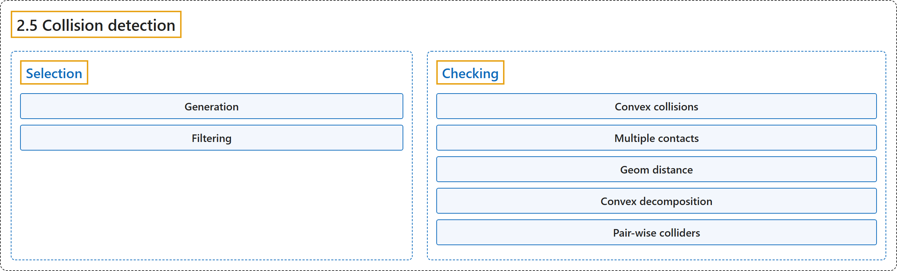

# 2.5 Collision detection

## Classification

## Glossary

| Term | Definition | 中文翻译 | Source |
|---|---|---|---|
| **2.5 Collision detection** 碰撞检测 | (context) "Collision detection **operates on geoms, which are geometric entities rigidly attached to the underlying bodies**." | （语境）碰撞检测**作用于 geom，即刚性附着在底层刚体上的几何实体**。 | [Google DeepMind, n.d., "Collision detection", para. 1](https://mujoco.readthedocs.io/en/stable/computation/index.html#collision-detection) |
| **Selection** 选择 | "MuJoCo has **flexible mechanisms for deciding which geom pairs are checked in detail**." | MuJoCo 有**灵活的机制来决定哪些 geom 对要做详细检查**。 | [Google DeepMind, n.d., "Selection", para. 1](https://mujoco.readthedocs.io/en/stable/computation/index.html#selection) |
| **Generation** 生成 | "First we **generate a list of candidate geom pairs by merging from two sources**: pairs of bodies that might contain colliding geoms and the explicit list of geom pairs defined with the pair element in MJCF." | 首先，我们**合并两个来源，生成候选 geom 对列表**：可能包含碰撞 geom 的刚体对，以及用 MJCF 中 pair 元素定义的显式 geom 对列表。 | [Google DeepMind, n.d., "Selection", item 1](https://mujoco.readthedocs.io/en/stable/computation/index.html#selection) |
| **Broad-phase collision detection** 粗阶段碰撞检测 | "The body pairs are generated via **broad-phase collision detection based on a modified sweep-and-prune algorithm**." | 刚体对通过**基于改进的扫掠剪枝算法的粗阶段碰撞检测**生成。 | [Google DeepMind, n.d., "Selection", item 1](https://mujoco.readthedocs.io/en/stable/computation/index.html#selection) |
| **Mid-phase collision detection** 中阶段碰撞检测 | "Then, for each body pair, **mid-phase collision detection is performed using a static bounding volume hierarchy (a BVH binary tree) of axis-aligned bounding boxes (AABB)**." | 然后，对每个刚体对，**用由轴对齐包围盒（AABB）构成的静态包围体层次结构（BVH 二叉树）进行中阶段碰撞检测**。 | [Google DeepMind, n.d., "Selection", item 1](https://mujoco.readthedocs.io/en/stable/computation/index.html#selection) |
| **Filtering** 过滤 | "Next we **apply four filters to the list generated in the previous step**." | 接下来**对上一步生成的列表应用四个过滤器**。 | [Google DeepMind, n.d., "Selection", item 2](https://mujoco.readthedocs.io/en/stable/computation/index.html#selection) |
| **Checking** 检查 | "Detailed collision checking, also known as **near-phase or narrow-phase collision detection**, is performed by functions that depend on the geom types in the pair." | 详细的碰撞检查，也称为**近阶段或窄阶段碰撞检测**，由依赖于 geom 对类型的函数完成。 | [Google DeepMind, n.d., "Checking", para. 1](https://mujoco.readthedocs.io/en/stable/computation/index.html#checking) |
| **Convex collisions** 凸碰撞 | "All collisions involving pairs of geoms that do not have an analytic collider (e.g., meshes), **are handled by one of two general-purpose convex collision detection (CCD) pipelines**:" | 所有涉及没有解析碰撞器的 geom 对（例如网格）的碰撞，**由两条通用凸碰撞检测（CCD）流水线之一处理**： | [Google DeepMind, n.d., "Convex collisions", para. 1](https://mujoco.readthedocs.io/en/stable/computation/index.html#convex-collisions) |
| **native pipeline** 原生流水线 | "The native CCD pipeline (“nativeccd”) is **implemented natively in MuJoCo, based on the Gilbert-Johnson-Keerthi and Expanding Polytope algorithms** (GJK / EPA)." | 原生 CCD 流水线（“nativeccd”）**在 MuJoCo 中原生实现，基于 Gilbert-Johnson-Keerthi 算法和扩展多胞体算法**（GJK / EPA）。 | [Google DeepMind, n.d., "Convex collisions", item 1](https://mujoco.readthedocs.io/en/stable/computation/index.html#convex-collisions) |
| **libccd pipeline** libccd 流水线 | "This legacy pipeline is **based on the libccd library, and uses Minkowski Portal Refinement** (MPR)." | 这条旧版流水线**基于 libccd 库，使用闵可夫斯基入口细化**（MPR）。 | [Google DeepMind, n.d., "Convex collisions", item 2](https://mujoco.readthedocs.io/en/stable/computation/index.html#convex-collisions) |
| **Multiple contacts** 多接触点 | "Both of MuJoCo’s CCD pipelines **can return multiple points per contacting pair** (“multiccd”)." | MuJoCo 的两条 CCD 流水线都**能为每个接触对返回多个点**（“multiccd”）。 | [Google DeepMind, n.d., "Multiple contacts", para. 1](https://mujoco.readthedocs.io/en/stable/computation/index.html#multiple-contacts) |
| **multi-run pipeline** 多次运行流水线 | "Multiple contact points are found **by rotating the two geoms by ±1e-3 radians around the tangential axes and re-running the collision routine**." | 多个接触点的求法是**把两个 geom 绕切向轴旋转 ±1e-3 弧度，然后重新运行碰撞例程**。 | [Google DeepMind, n.d., "Multiple contacts", item 1](https://mujoco.readthedocs.io/en/stable/computation/index.html#multiple-contacts) |
| **single-shot pipeline** 单次流水线 | "The single-shot pipeline is **used in conjunction with the native CCD pipeline**, i.e., when the nativeccd flag is enabled." | 单次流水线**与原生 CCD 流水线配合使用**，即在启用 nativeccd 标志时。 | [Google DeepMind, n.d., "Multiple contacts", item 2](https://mujoco.readthedocs.io/en/stable/computation/index.html#multiple-contacts) |
| **Geom distance** geom 距离 | (context) "The narrow-phase collision functions described above **drive the mj_geomDistance function and associated collision sensors**." | （语境）上面介绍的窄阶段碰撞函数**驱动 mj_geomDistance 函数及相关的碰撞传感器**。 | [Google DeepMind, n.d., "Geom distance", para. 1](https://mujoco.readthedocs.io/en/stable/computation/index.html#geom-distance) |
| **Convex decomposition** 凸分解 | "In order to model a non-convex object other than a height field, **the user must decompose it into a union of convex geoms** (which can be primitive shapes or meshes) and attach them to the same body." | 要建模高度场以外的非凸物体，**用户必须把它分解为若干凸 geom 的并集**（可以是基本形状或网格），并把它们附着到同一个刚体上。 | [Google DeepMind, n.d., "Convex decomposition", para. 1](https://mujoco.readthedocs.io/en/stable/computation/index.html#convex-decomposition) |
| **Pair-wise colliders** 成对碰撞器 | (context) "The table below **provides information about the colliders used for different geom pairs**." | （语境）下表**给出不同 geom 对所用碰撞器的信息**。 | [Google DeepMind, n.d., "Pair-wise colliders", para. 1](https://mujoco.readthedocs.io/en/stable/computation/index.html#pair-wise-colliders) |

## References

Google DeepMind. (n.d.). *Computation*. MuJoCo Documentation (Version 3.17.0). Retrieved October 31, 2026, from <https://mujoco.readthedocs.io/en/stable/computation/index.html>
