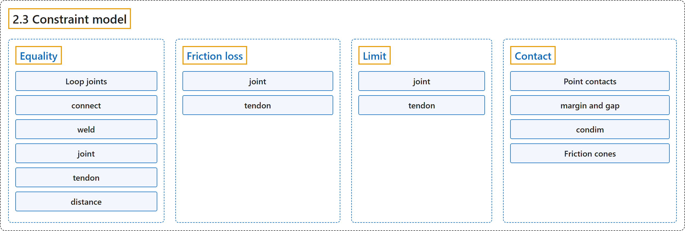

# 2.3 Constraint model

## Classification

## Glossary

| Term | Definition | 中文翻译 | Source |
|---|---|---|---|
| **2.3 Constraint model** 约束模型 | (context) "MuJoCo has **a very flexible constraint model**, which is nevertheless handled in a uniform way by the solver described later." | （语境）MuJoCo 有**一个非常灵活的约束模型**，但它由后面介绍的求解器统一处理。 | [Google DeepMind, n.d., "Constraint model", para. 1](https://mujoco.readthedocs.io/en/stable/computation/index.html#constraint-model) |
| **Equality** 等式约束 | (context) "There are **five types of equality constraints** described next." | （语境）接下来介绍**五种等式约束**。 | [Google DeepMind, n.d., "Equality", para. 3](https://mujoco.readthedocs.io/en/stable/computation/index.html#equality) |
| **Loop joints** 环路关节 | "Among other applications, equality constraints can be used to create “loop joints”, i.e., **joints that cannot be modeled via the kinematic tree**." | 在其他用途之外，等式约束可用于构造“环路关节”，即**无法通过运动学树建模的关节**。 | [Google DeepMind, n.d., "Equality", para. 2](https://mujoco.readthedocs.io/en/stable/computation/index.html#equality) |
| **connect** 连接约束 | "This constraint **connects two bodies at a point, effectively creating a ball joint outside the kinematic tree**." | 这种约束**在一点上连接两个刚体，相当于在运动学树之外创建一个球关节**。 | [Google DeepMind, n.d., "Equality", item 1](https://mujoco.readthedocs.io/en/stable/computation/index.html#equality) |
| **weld** 焊接约束 | "This constraint **welds two bodies together, suppressing all relative degrees of freedom between them**." | 这种约束**把两个刚体焊在一起，消除它们之间的所有相对自由度**。 | [Google DeepMind, n.d., "Equality", item 2](https://mujoco.readthedocs.io/en/stable/computation/index.html#equality) |
| **joint** 关节约束 | "This constraint applies only to scalar joints: hinge and slide. It can be used **to lock one joint into a constant position, or to couple two joints via a quartic polynomial**." | 这种约束只适用于标量关节：铰链关节和滑动关节。它可用于**把一个关节锁定在固定位置，或通过四次多项式耦合两个关节**。 | [Google DeepMind, n.d., "Equality", item 3](https://mujoco.readthedocs.io/en/stable/computation/index.html#equality) |
| **tendon** 肌腱约束 | "This constraint is very similar to the joint constraint above, but **applies to the length of tendons instead of the position of joints**." | 这种约束与上面的关节约束非常相似，但**作用于肌腱的长度，而不是关节的位置**。 | [Google DeepMind, n.d., "Equality", item 4](https://mujoco.readthedocs.io/en/stable/computation/index.html#equality) |
| **distance** 距离约束 | (context) "Distance equality constraints **were removed in MuJoCo version 2.2.2**." | （语境）距离等式约束**已在 MuJoCo 2.2.2 版中移除**。 | [Google DeepMind, n.d., "Equality", item 5](https://mujoco.readthedocs.io/en/stable/computation/index.html#equality) |
| **Friction loss** 摩擦损失 | "Friction loss is also known as **dry friction, or static friction, or load-independent friction** (in contrast with Coulomb friction which scales with normal force)." | 摩擦损失也称为**干摩擦、静摩擦或与载荷无关的摩擦**（与随法向力变化的库仑摩擦相对）。 | [Google DeepMind, n.d., "Friction loss", para. 1](https://mujoco.readthedocs.io/en/stable/computation/index.html#friction-loss) |
| **joint** 关节摩擦损失 | "Friction loss can be defined not only for scalar joints (slide and hinge), but also for ball joints which have 3 degrees of freedom, and free joints which have 6 degrees of freedom. When defined, it is **applied independently to all degrees of freedom of the affected joint**." | 摩擦损失不仅可以为标量关节（滑动关节和铰链关节）定义，也可以为有 3 个自由度的球关节和有 6 个自由度的自由关节定义。定义后，它**独立地作用于所涉关节的所有自由度**。 | [Google DeepMind, n.d., "Friction loss", item 1](https://mujoco.readthedocs.io/en/stable/computation/index.html#friction-loss) |
| **tendon** 肌腱摩擦损失 | "Tendons are scalar quantities, thus **defining friction loss for a tendon always adds one scalar constraint**." | 肌腱是标量，因此**为肌腱定义摩擦损失总是增加一个标量约束**。 | [Google DeepMind, n.d., "Friction loss", item 2](https://mujoco.readthedocs.io/en/stable/computation/index.html#friction-loss) |
| **Limit** 限位 | "Limits as well as contacts have a well-defined spatial residual, but unlike equality constraints **they are uni-lateral, i.e. they introduce inequality rather than equality constraints**." | 限位和接触一样有明确定义的空间残差，但与等式约束不同，**它们是单边的，即引入的是不等式约束而不是等式约束**。 | [Google DeepMind, n.d., "Limit", para. 1](https://mujoco.readthedocs.io/en/stable/computation/index.html#limit) |
| **joint** 关节限位 | "Limits **can be defined for scalar joints (hinge and slide) as well as for ball joints**." | 限位**可以为标量关节（铰链关节和滑动关节）定义，也可以为球关节定义**。 | [Google DeepMind, n.d., "Limit", item 1](https://mujoco.readthedocs.io/en/stable/computation/index.html#limit) |
| **tendon** 肌腱限位 | "Tendon are scalar quantities and **their limits are treated as described above**." | 肌腱是标量，**它们的限位按上述方式处理**。 | [Google DeepMind, n.d., "Limit", item 2](https://mujoco.readthedocs.io/en/stable/computation/index.html#limit) |
| **Contact** 接触 | "Contacts are **the most elaborate constraint type**, both in terms of specifying them in the model and in terms of the computations that need to be performed." | 接触是**最复杂的约束类型**，无论是在模型中指定它们，还是在需要进行的计算方面。 | [Google DeepMind, n.d., "Contact", para. 1](https://mujoco.readthedocs.io/en/stable/computation/index.html#contact) |
| **Point contacts** 点接触 | "MuJoCo works with point contacts, **defined geometrically by a point between two geoms and a spatial frame centered at that point**, both expressed in global coordinates." | MuJoCo 使用点接触，它**在几何上由两个 geom 之间的一个点和以该点为中心的空间坐标系定义**，两者都用全局坐标表示。 | [Google DeepMind, n.d., "Contact", para. 2](https://mujoco.readthedocs.io/en/stable/computation/index.html#contact) |
| **margin and gap** 余量与间隙 | "Together they **define three regimes of contact detection and force generation**, illustrated in the figure below." | 它们一起**定义了接触检测和力生成的三种状态**，如下图所示。 | [Google DeepMind, n.d., "margin and gap", para. 1](https://mujoco.readthedocs.io/en/stable/computation/index.html#margin-and-gap) |
| **No contact** 无接触 | "No contact (distance > margin + gap): **The geom surfaces, including their gap buffers, are not overlapping**. No contact is generated." | No contact（distance > margin + gap）：**geom 表面（包括其间隙缓冲）没有重叠**。不生成接触。 | [Google DeepMind, n.d., "margin and gap", item 1](https://mujoco.readthedocs.io/en/stable/computation/index.html#margin-and-gap) |
| **Inactive contact** 非活动接触 | "Inactive contact (margin < distance ≤ margin + gap): **A contact is detected and included in mjData.contact, but no contact force is generated** (efc_address = -1)." | Inactive contact（margin < distance ≤ margin + gap）：**检测到接触并纳入 mjData.contact，但不生成接触力**（efc_address = -1）。 | [Google DeepMind, n.d., "margin and gap", item 2](https://mujoco.readthedocs.io/en/stable/computation/index.html#margin-and-gap) |
| **Active contact** 活动接触 | "Active contact (distance ≤ margin): **The contact is active and constraint forces are generated**." | Active contact（distance ≤ margin）：**接触处于活动状态，并生成约束力**。 | [Google DeepMind, n.d., "margin and gap", item 3](https://mujoco.readthedocs.io/en/stable/computation/index.html#margin-and-gap) |
| **condim** 接触维数 | "The condim parameter **determines the contact type**, and has the following meaning:" | condim 参数**决定接触类型**，含义如下： | [Google DeepMind, n.d., "condim", para. 1](https://mujoco.readthedocs.io/en/stable/computation/index.html#condim) |
| **condim = 1** condim = 1 | "This corresponds to **a frictionless contact** and adds only one scalar constraint." | 这对应于**无摩擦接触**，只增加一个标量约束。 | [Google DeepMind, n.d., "condim", item 1](https://mujoco.readthedocs.io/en/stable/computation/index.html#condim) |
| **condim = 3** condim = 3 | "This is **a regular frictional contact, which can generate normal force as well as a tangential friction force opposing slip**." | 这是**常规的摩擦接触，可以产生法向力以及阻碍滑动的切向摩擦力**。 | [Google DeepMind, n.d., "condim", item 2](https://mujoco.readthedocs.io/en/stable/computation/index.html#condim) |
| **condim = 4** condim = 4 | "In addition to normal and tangential force, this contact **can generate torsional friction torque opposing rotation around the contact normal**, corresponding to a torque generated by a contacting surface patch." | 除了法向力和切向力，这种接触**还能产生阻碍绕接触法线转动的扭转摩擦力矩**，对应于接触面片产生的力矩。 | [Google DeepMind, n.d., "condim", item 3](https://mujoco.readthedocs.io/en/stable/computation/index.html#condim) |
| **condim = 6** condim = 6 | "This contact **can oppose motion in all relative degrees of freedom between the two geoms**." | 这种接触**可以阻碍两个 geom 之间所有相对自由度上的运动**。 | [Google DeepMind, n.d., "condim", item 4](https://mujoco.readthedocs.io/en/stable/computation/index.html#condim) |
| **Friction cones** 摩擦锥 | (context) "Now we describe **the friction cones and the corresponding Jacobians more formally**." | （语境）现在**更形式化地介绍摩擦锥及相应的雅可比矩阵**。 | [Google DeepMind, n.d., "Friction cones", para. 1](https://mujoco.readthedocs.io/en/stable/computation/index.html#friction-cones) |

## References

Google DeepMind. (n.d.). *Computation*. MuJoCo Documentation (Version 3.17.0). Retrieved October 31, 2026, from <https://mujoco.readthedocs.io/en/stable/computation/index.html>
