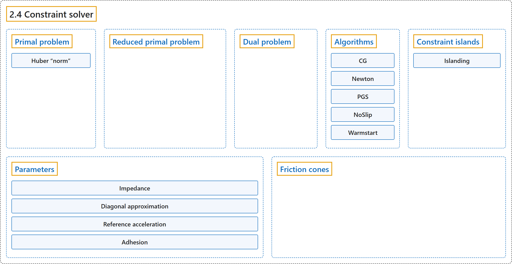

# 2.4 Constraint solver

## Classification

## Glossary

| Term | Definition | 中文翻译 | Source |
|---|---|---|---|
| **2.4 Constraint solver** 约束求解器 | (context) "First, the constraint forces are defined as **the unique global solution to a convex optimization problem**." | （语境）首先，约束力被定义为**一个凸优化问题的唯一全局解**。 | [Google DeepMind, n.d., "Constraint solver", para. 1](https://mujoco.readthedocs.io/en/stable/computation/index.html#constraint-solver) |
| **Primal problem** 原问题 | "We first formulate **the optimization problem whose solution yields the constrained acceleration**" | 我们先写出**其解给出受约束加速度的优化问题** | [Google DeepMind, n.d., "Primal problem", para. 1](https://mujoco.readthedocs.io/en/stable/computation/index.html#primal-problem) |
| **Huber “norm”** Huber“范数” | "The Huber “norm” is **based on the Huber function from robust statistics**: it is a quadratic around zero, and transitions smoothly to a linear function when the absolute value of the argument crosses a threshold – in this case given by the friction loss parameters." | Huber“范数”**基于稳健统计中的 Huber 函数**：它在零附近是二次的，当自变量的绝对值越过某个阈值（这里由摩擦损失参数给出）时，平滑地过渡为线性函数。 | [Google DeepMind, n.d., "Primal problem", para. 5](https://mujoco.readthedocs.io/en/stable/computation/index.html#primal-problem) |
| **Reduced primal problem** 约化原问题 | "It turns out that **the primal problem can be reduced to unconstrained optimization over accelerations**." | 事实证明，**原问题可以约化为关于加速度的无约束优化**。 | [Google DeepMind, n.d., "Reduced primal problem", para. 1](https://mujoco.readthedocs.io/en/stable/computation/index.html#reduced-primal-problem) |
| **Dual problem** 对偶问题 | "We then transform the primal problem over accelerations into its Lagrange dual. The dual is **a convex optimization problem over constraint forces, which also play the role of Lagrange multipliers for the primal problem**." | 然后把关于加速度的原问题转换为它的拉格朗日对偶。对偶问题是**一个关于约束力的凸优化问题，约束力同时充当原问题的拉格朗日乘子**。 | [Google DeepMind, n.d., "Constraint solver", para. 2](https://mujoco.readthedocs.io/en/stable/computation/index.html#constraint-solver) |
| **Algorithms** 算法 | "Here we describe **the numerical algorithms (or “solvers”) for solving the above convex optimization problems**." | 这里介绍**求解上述凸优化问题的数值算法（即“求解器”）**。 | [Google DeepMind, n.d., "Algorithms", para. 1](https://mujoco.readthedocs.io/en/stable/computation/index.html#algorithms) |
| **CG** 共轭梯度法 | "This algorithm **uses the non-linear conjugate gradient method with the Hager-Zhang formula**." | 该算法**使用带 Hager-Zhang 公式的非线性共轭梯度法**。 | [Google DeepMind, n.d., "Algorithms", item 1](https://mujoco.readthedocs.io/en/stable/computation/index.html#algorithms) |
| **Newton** 牛顿法 | "This algorithm **implements the exact Newton method, with analytical second-order derivatives and Cholesky factorization of the Hessian**." | 该算法**实现精确的牛顿法，使用解析二阶导数和 Hessian 矩阵的 Cholesky 分解**。 | [Google DeepMind, n.d., "Algorithms", item 2](https://mujoco.readthedocs.io/en/stable/computation/index.html#algorithms) |
| **PGS** 投影高斯-赛德尔法 | "Unlike gradient-based methods which improve the solution along oblique directions, **Gauss-Seidel works on one scalar component at a time, and sets it to its optimal value given the current values of all other components**." | 与沿斜方向改进解的基于梯度的方法不同，**高斯-赛德尔法每次处理一个标量分量，在其他所有分量取当前值的条件下把它设为最优值**。 | [Google DeepMind, n.d., "Algorithms", item 3](https://mujoco.readthedocs.io/en/stable/computation/index.html#algorithms) |
| **NoSlip** 无滑移后处理 | "This is **not a standalone solver but a post-processing step**, enabled by setting noslip_iterations to a positive value in option." | 它**不是独立的求解器，而是一个后处理步骤**，通过在 option 中把 noslip_iterations 设为正值来启用。 | [Google DeepMind, n.d., "Algorithms", item 4](https://mujoco.readthedocs.io/en/stable/computation/index.html#algorithms) |
| **Warmstart** 热启动 | "Before solving, the solver **warmstarts the constraint forces from the previous time step**." | 在求解之前，求解器**用上一个时间步的约束力进行热启动**。 | [Google DeepMind, n.d., "Algorithms", item 5](https://mujoco.readthedocs.io/en/stable/computation/index.html#algorithms) |
| **Constraint islands** 约束岛 | "A constraint island is **a disjoint sub-graph which can be solved for independently**, because constraint forces cannot propagate between islands." | 约束岛是**一个可以独立求解的不相交子图**，因为约束力不能在岛之间传播。 | [Google DeepMind, n.d., "Constraint islands", para. 1](https://mujoco.readthedocs.io/en/stable/computation/index.html#constraint-islands) |
| **Islanding** 分岛 | "Constraint island discovery and construction (“islanding”) **involves finding these disjoint subgraphs and reordering both the DOFs and constraints to make them memory-contiguous**." | 约束岛的发现与构建（“分岛”）**包括找出这些不相交子图，并对自由度和约束重新排序，使它们在内存中连续**。 | [Google DeepMind, n.d., "Constraint islands", para. 1](https://mujoco.readthedocs.io/en/stable/computation/index.html#constraint-islands) |
| **Parameters** 参数 | "To summarize, the constraint behavior is determined by **three per-constraint quantities**" | 总之，约束行为由**每个约束的三个量**决定 | [Google DeepMind, n.d., "Parameters", para. 9](https://mujoco.readthedocs.io/en/stable/computation/index.html#parameters) |
| **Impedance** 阻抗 | "It is then natural to introduce **a model parameter which directly controls the interpolation**. We call this parameter impedance and denote it" | 于是很自然地引入**一个直接控制这种插值的模型参数**。我们把这个参数称为阻抗，记作 | [Google DeepMind, n.d., "Parameters", para. 3](https://mujoco.readthedocs.io/en/stable/computation/index.html#parameters) |
| **Diagonal approximation** 对角近似 | "The approximation (which is limited to the diagonal) is **constructed using the “end-effector” inertias of all bodies, joints and tendons when the model is in the initial configuration** mjModel.qpos0." | 这种近似（仅限于对角线）**用模型处于初始构型时所有刚体、关节和肌腱的“末端执行器”惯量构造**，即 mjModel.qpos0。 | [Google DeepMind, n.d., "Parameters", para. 4](https://mujoco.readthedocs.io/en/stable/computation/index.html#parameters) |
| **Reference acceleration** 参考加速度 | "Next we explain how the reference acceleration is computed. As already mentioned, we use **a spring-damper model parameterized by damping and stiffness coefficients** element-wise:" | 接下来说明参考加速度如何计算。如前所述，我们使用**一个逐元素地由阻尼系数和刚度系数参数化的弹簧阻尼模型**： | [Google DeepMind, n.d., "Parameters", para. 7](https://mujoco.readthedocs.io/en/stable/computation/index.html#parameters) |
| **Adhesion** 黏附 | "the feasible force set is **the friction cone translated down the contact normal**" | 可行力集合是**沿接触法线向下平移后的摩擦锥** | [Google DeepMind, n.d., "Parameters", item 2](https://mujoco.readthedocs.io/en/stable/computation/index.html#parameters) |
| **Friction cones** 摩擦锥 | "As explained above, MuJoCo allows **both elliptic friction cones and pyramidal approximations to them**; the selected solver determines which type of friction cone is used." | 如前所述，MuJoCo 允许**椭圆摩擦锥以及对它的棱锥近似**；所选求解器决定使用哪种摩擦锥。 | [Google DeepMind, n.d., "Friction cones", para. 1](https://mujoco.readthedocs.io/en/stable/computation/index.html#socones) |

## References

Google DeepMind. (n.d.). *Computation*. MuJoCo Documentation (Version 3.17.0). Retrieved October 31, 2026, from <https://mujoco.readthedocs.io/en/stable/computation/index.html>
