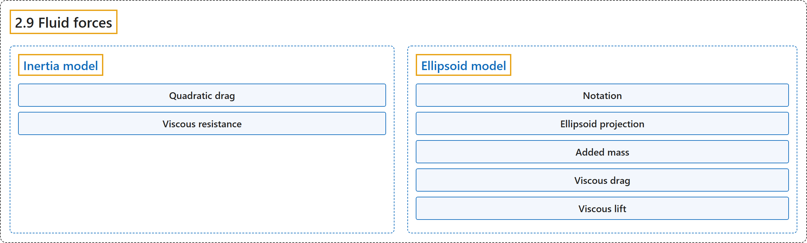

# 2.9 Fluid forces

## Classification

## Glossary

| Term | Definition | 中文翻译 | Source |
|---|---|---|---|
| **2.9 Fluid forces** 流体力 | (context) "Nevertheless we provide **two phenomenological models which are sufficient for simulating behaviors such as flying and swimming**." | （语境）不过我们提供了**两种唯象模型，足以模拟飞行和游泳等行为**。 | [Google DeepMind, n.d., "Fluid forces", para. 1](https://mujoco.readthedocs.io/en/stable/computation/fluid.html#fluid-forces) |
| **Inertia model** 惯量模型 | "In this model **the shape of each body, for fluid dynamics purposes, is assumed to be the equivalent inertia box**, which can also be visualized." | 在这个模型中，**出于流体动力学的目的，每个刚体的形状被假定为等效惯量盒**，它也可以被可视化。 | [Google DeepMind, n.d., "Inertia model", para. 1](https://mujoco.readthedocs.io/en/stable/computation/fluid.html#inertia-model) |
| **Quadratic drag** 二次阻力 | "scale quadratically with the velocity of the body, and are **a valid approximation of the fluid forces at high Reynolds numbers**" | 随刚体速度呈二次方变化，是**高雷诺数下流体力的有效近似** | [Google DeepMind, n.d., "Inertia model", para. 3](https://mujoco.readthedocs.io/en/stable/computation/fluid.html#inertia-model) |
| **Viscous resistance** 黏性阻力 | "scale linearly with the body velocity, and **approximate the fluid forces at low Reynolds numbers**" | 随刚体速度呈线性变化，**近似低雷诺数下的流体力** | [Google DeepMind, n.d., "Inertia model", para. 4](https://mujoco.readthedocs.io/en/stable/computation/fluid.html#inertia-model) |
| **Ellipsoid model** 椭球模型 | "In this section we describe and derive **a stateless model of the forces exerted onto a moving rigid body by the surrounding fluid, based on an ellipsoidal approximation of geom shape**." | 本节介绍并推导**一个无状态模型，描述周围流体作用在运动刚体上的力，它基于对 geom 形状的椭球近似**。 | [Google DeepMind, n.d., "Ellipsoid model", para. 2](https://mujoco.readthedocs.io/en/stable/computation/fluid.html#ellipsoid-model) |
| **Notation** 记号 | (context) "The problem is described in **a reference frame aligned with the sides of the ellipsoid and moving with it**." | （语境）问题在**一个与椭球各边对齐并随其运动的参考坐标系**中描述。 | [Google DeepMind, n.d., "Notation", para. 1](https://mujoco.readthedocs.io/en/stable/computation/fluid.html#notation) |
| **Reynolds number** 雷诺数 | "The Reynolds number is **the ratio between inertial and viscous forces within a flow**" | 雷诺数是**流动中惯性力与黏性力之比** | [Google DeepMind, n.d., "Notation", para. 2](https://mujoco.readthedocs.io/en/stable/computation/fluid.html#notation) |
| **Circulation** 环量 | "to denote circulation, which is **the line integral of the velocity field around a closed curve**" | 表示环量，它是**速度场沿一条闭合曲线的线积分** | [Google DeepMind, n.d., "Notation", para. 3](https://mujoco.readthedocs.io/en/stable/computation/fluid.html#notation) |
| **Vorticity** 涡量 | "For a rigid-body motion, **the vorticity is twice the angular velocity**." | 对于刚体运动，**涡量是角速度的两倍**。 | [Google DeepMind, n.d., "Notation", para. 3](https://mujoco.readthedocs.io/en/stable/computation/fluid.html#notation) |
| **Ellipsoid projection** 椭球投影 | "**the area projected by the ellipsoid onto the plane normal to**" | **椭球在法向平面上的投影面积** | [Google DeepMind, n.d., "Ellipsoid projection", lemma](https://mujoco.readthedocs.io/en/stable/computation/fluid.html#ellipsoid-projection) |
| **Added mass** 附加质量 | "For a body moving in a fluid, added mass or virtual mass **measures the inertia of the fluid that is moved due to the body’s motion**." | 对于在流体中运动的物体，附加质量或虚拟质量**度量因物体运动而被带动的流体的惯性**。 | [Google DeepMind, n.d., "Added mass", para. 1](https://mujoco.readthedocs.io/en/stable/computation/fluid.html#added-mass) |
| **Viscous drag** 黏性拖曳 | "The drag force **acts to oppose the motion of the body relative to the surrounding flow**." | 拖曳力**阻碍物体相对于周围流体的运动**。 | [Google DeepMind, n.d., "Viscous drag", para. 1](https://mujoco.readthedocs.io/en/stable/computation/fluid.html#viscous-drag) |
| **Viscous resistance** 黏性阻力 | "Finally the viscous resistance terms, also known as linear drag, **well approvimate the fluid forces for Reynolds numbers around or below**" | 最后，黏性阻力项（也称线性阻力）**能很好地近似雷诺数在某量级附近或以下时的流体力** | [Google DeepMind, n.d., "Viscous drag", para. 7](https://mujoco.readthedocs.io/en/stable/computation/fluid.html#viscous-drag) |
| **Viscous lift** 黏性升力 | (context) "In the next subsections we define **two sources of circulation and the resulting lift forces**." | （语境）在接下来的小节中，我们定义**两种环量来源以及由此产生的升力**。 | [Google DeepMind, n.d., "Viscous lift", para. 1](https://mujoco.readthedocs.io/en/stable/computation/fluid.html#viscous-lift) |
| **Kutta-Joukowski theorem** 库塔-茹科夫斯基定理 | "The Kutta-Joukowski theorem **calculates the lift**" | 库塔-茹科夫斯基定理**计算升力** | [Google DeepMind, n.d., "Viscous lift", para. 1](https://mujoco.readthedocs.io/en/stable/computation/fluid.html#viscous-lift) |
| **Magnus force** 马格努斯力 | "The Magnus effect **describes the motion of a rotating object moving through a fluid**." | 马格努斯效应**描述在流体中运动的旋转物体的运动**。 | [Google DeepMind, n.d., "Magnus force", para. 2](https://mujoco.readthedocs.io/en/stable/computation/fluid.html#magnus-force) |
| **Stagnation point** 驻点 | "A stagnation point is **a location in the flow field where the velocity is zero**." | 驻点是**流场中速度为零的位置**。 | [Google DeepMind, n.d., "Kutta condition", para. 1](https://mujoco.readthedocs.io/en/stable/computation/fluid.html#kutta-condition) |
| **Kutta condition** 库塔条件 | "A moving body with a sharp trailing (rear) edge will generate in the surrounding flow **a circulation of sufficient strength to hold the rear stagnation point at the trailing edge**. This is the Kutta condition, a fluid dynamic phenomenon that can be observed for solid bodies with sharp corners, such as slender bodies or the trailing edges of airfoils." | 带有尖锐后缘的运动物体会在周围流体中产生**足够强的环量，使后驻点保持在后缘处**。这就是库塔条件，一种可以在有尖角的固体上观察到的流体动力学现象，例如细长物体或翼型的后缘。 | [Google DeepMind, n.d., "Kutta condition", para. 1](https://mujoco.readthedocs.io/en/stable/computation/fluid.html#kutta-condition) |

## References

Google DeepMind. (n.d.). *Fluid forces*. MuJoCo Documentation (Version 3.17.0). Retrieved October 31, 2026, from <https://mujoco.readthedocs.io/en/stable/computation/fluid.html>
