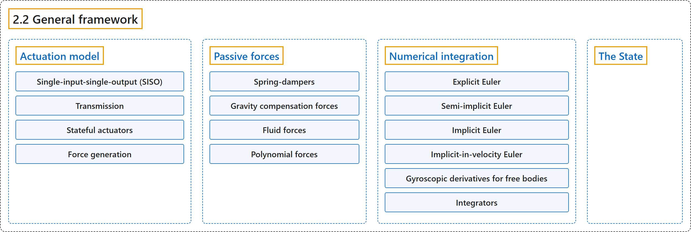

# 2.2 General framework

## Classification

## Glossary

| Term | Definition | 中文翻译 | Source |
|---|---|---|---|
| **2.2 General framework** 一般框架 | (No definition) | （无定义） | [Google DeepMind, n.d., "General framework"](https://mujoco.readthedocs.io/en/stable/computation/index.html#general-framework) |
| **Actuation model** 驱动模型 | "These three components of an actuator – **transmission, activation dynamics, and force generation – determine how the actuator works**." | 驱动器的这三个组成部分，**即传动、激活动力学和力生成，决定了驱动器如何工作**。 | [Google DeepMind, n.d., "Actuation model", para. 3](https://mujoco.readthedocs.io/en/stable/computation/index.html#actuation-model) |
| **Single-input-single-output (SISO)** 单输入单输出（SISO） | "Most actuators are **single-input-single-output (SISO)**" | 大多数驱动器是**单输入单输出（SISO）的** | [Google DeepMind, n.d., "Actuation model", para. 1](https://mujoco.readthedocs.io/en/stable/computation/index.html#actuation-model) |
| **Transmission** 传动 | "The transmission **attaches the actuator to the rest of the system**." | 传动**把驱动器连接到系统的其余部分**。 | [Google DeepMind, n.d., "Transmission", para. 1](https://mujoco.readthedocs.io/en/stable/computation/index.html#transmission) |
| **joint and tendon** 关节与肌腱传动 | "The joint and tendon transmission types **act as expected and correspond to the actuator applying forces or torques to the target object**." | joint 和 tendon 传动类型**按预期工作，对应于驱动器向目标对象施加力或力矩**。 | [Google DeepMind, n.d., "Transmission", item 1](https://mujoco.readthedocs.io/en/stable/computation/index.html#transmission) |
| **jointinparent** 父坐标系关节传动 | "The jointinparent transmission **is unique to ball and free joint and asserts that rotation should be measured in the parent rather than child frame**." | jointinparent 传动**专用于球关节和自由关节，规定转动应在父坐标系而不是子坐标系中度量**。 | [Google DeepMind, n.d., "Transmission", item 2](https://mujoco.readthedocs.io/en/stable/computation/index.html#transmission) |
| **slider-crank** 曲柄滑块传动 | "slider-crank transmissions **transform a linear force to a torque**, as in a piston-driven combustion engine." | slider-crank 传动**把线性力转换为力矩**，就像活塞驱动的内燃机那样。 | [Google DeepMind, n.d., "Transmission", item 3](https://mujoco.readthedocs.io/en/stable/computation/index.html#transmission) |
| **body** 刚体传动 | "body transmission **corresponds to applying forces at contact points belonging to a body**, in order to model vacuum grippers and biomechanical adhesive appendages." | body 传动**对应于在属于某个刚体的接触点上施加力**，用于建模真空吸盘和生物力学中的黏附附肢。 | [Google DeepMind, n.d., "Transmission", item 4](https://mujoco.readthedocs.io/en/stable/computation/index.html#transmission) |
| **site** 站点传动 | "Site transmissions **correspond to applying a Cartsian force/torque in the frame of a site**." | site 传动**对应于在某个 site 的坐标系中施加笛卡尔力/力矩**。 | [Google DeepMind, n.d., "Transmission", item 5](https://mujoco.readthedocs.io/en/stable/computation/index.html#transmission) |
| **Stateful actuators** 有状态驱动器 | "Some actuators such as pneumatic and hydraulic cylinders as well as biological muscles **have an internal state** called “activation”." | 有些驱动器，如气缸、液压缸以及生物肌肉，**具有一个内部状态**，称为“激活”。 | [Google DeepMind, n.d., "Stateful actuators", para. 1](https://mujoco.readthedocs.io/en/stable/computation/index.html#stateful-actuators) |
| **Activation** 激活 | "Some actuators such as pneumatic and hydraulic cylinders as well as biological muscles have **an internal state called “activation”**." | 有些驱动器，如气缸、液压缸以及生物肌肉，具有**一个称为“激活”的内部状态**。 | [Google DeepMind, n.d., "Stateful actuators", para. 1](https://mujoco.readthedocs.io/en/stable/computation/index.html#stateful-actuators) |
| **Force generation** 力生成 | "Each actuator **generates a scalar force for each of its outputs, as a function of its controls, activation states, and lengths and velocities**." | 每个驱动器**为它的每个输出生成一个标量力，它是控制量、激活状态以及长度和速度的函数**。 | [Google DeepMind, n.d., "Force generation", para. 1](https://mujoco.readthedocs.io/en/stable/computation/index.html#force-generation) |
| **Passive forces** 被动力 | "Passive forces are defined as **forces that depend only on position and velocity, and not on control in forward dynamics or acceleration in inverse dynamics**." | 被动力定义为**只依赖于位置和速度的力，在正向动力学中不依赖于控制，在逆向动力学中不依赖于加速度**。 | [Google DeepMind, n.d., "Passive forces", para. 1](https://mujoco.readthedocs.io/en/stable/computation/index.html#passive-forces) |
| **Spring-dampers** 弹簧阻尼器 | "MuJoCo can compute three types of passive forces: **Spring-dampers in joints and tendons**." | MuJoCo 可以计算三种被动力：**关节和肌腱中的弹簧阻尼器**。 | [Google DeepMind, n.d., "Passive forces", item 1](https://mujoco.readthedocs.io/en/stable/computation/index.html#passive-forces) |
| **Gravity compensation forces** 重力补偿力 | (No definition) | （无定义） | [Google DeepMind, n.d., "Passive forces"](https://mujoco.readthedocs.io/en/stable/computation/index.html#passive-forces) |
| **Fluid forces** 流体力 | "Fluid forces **exerted by the surrounding medium**." | 由周围介质施加的流体力。 | [Google DeepMind, n.d., "Passive forces", item 3](https://mujoco.readthedocs.io/en/stable/computation/index.html#passive-forces) |
| **Polynomial forces** 多项式力 | "Nonlinear stiffness (joints, tendons) and damping (joints, tendons) are **defined by polynomials**" | 非线性刚度（关节、肌腱）和阻尼（关节、肌腱）**由多项式定义** | [Google DeepMind, n.d., "Polynomial forces", para. 1](https://mujoco.readthedocs.io/en/stable/computation/index.html#polynomial-forces) |
| **Anti-symmetrization** 反对称化 | "The damping polynomial uses **anti-symmetrized even-powered monomials**" | 阻尼多项式使用**反对称化的偶次幂单项式** | [Google DeepMind, n.d., "Polynomial forces", item 1](https://mujoco.readthedocs.io/en/stable/computation/index.html#polynomial-forces) |
| **Sign-preservation** 保号 | "In both cases, sensible choices of coefficients often satisfy the **sign-preservation** condition" | 在两种情况下，合理选择的系数通常满足**保号**条件 | [Google DeepMind, n.d., "Polynomial forces", item 2](https://mujoco.readthedocs.io/en/stable/computation/index.html#polynomial-forces) |
| **Numerical integration** 数值积分 | (context) "Four numerical integrators are available, **three single-step integrators and the multi-step 4th order Runge-Kutta integrator**." | （语境）有四种数值积分器可用：**三种单步积分器和多步的四阶龙格-库塔积分器**。 | [Google DeepMind, n.d., "Numerical integration", para. 2](https://mujoco.readthedocs.io/en/stable/computation/index.html#numerical-integration) |
| **Explicit Euler** 显式欧拉法 | (context) "The explicit Euler method **is not supported by MuJoCo but has pedagogical value**." | （语境）显式欧拉法**不被 MuJoCo 支持，但有教学价值**。 | [Google DeepMind, n.d., "Numerical integration", para. 2](https://mujoco.readthedocs.io/en/stable/computation/index.html#numerical-integration) |
| **Semi-implicit Euler** 半隐式欧拉法 | "Comparing (2) and (3), we see that in semi-implicit Euler, **the position is updated using the new velocity**." | 比较 (2) 和 (3) 可以看到，在半隐式欧拉法中，**位置用新的速度更新**。 | [Google DeepMind, n.d., "Numerical integration", para. 4](https://mujoco.readthedocs.io/en/stable/computation/index.html#numerical-integration) |
| **Implicit Euler** 隐式欧拉法 | "on the right-hand side of the velocity update **is evaluated at the next time step**" | 速度更新右侧的加速度**在下一个时间步上求值** | [Google DeepMind, n.d., "Numerical integration", para. 5](https://mujoco.readthedocs.io/en/stable/computation/index.html#numerical-integration) |
| **Implicit-in-velocity Euler** 速度隐式欧拉法 | "When **the expansion is only with respect to velocity (and not position)**, the integrator is known as implicit-in-velocity Euler." | 在**展开只针对速度（而不针对位置）的情况**下，这种积分器称为速度隐式欧拉法。 | [Google DeepMind, n.d., "Numerical integration", para. 5](https://mujoco.readthedocs.io/en/stable/computation/index.html#numerical-integration) |
| **Gyroscopic derivatives for free bodies** 自由刚体的陀螺导数 | "Therefore for standalone free bodies (free bodies with no jointed descendants), **these derivatives are reinstated**." | 因此，对于独立自由刚体（没有带关节后代的自由刚体），**这些导数会被恢复**。 | [Google DeepMind, n.d., "Numerical integration", item 1](https://mujoco.readthedocs.io/en/stable/computation/index.html#gefreebody) |
| **Standalone free bodies** 独立自由刚体 | "Therefore for standalone free bodies (**free bodies with no jointed descendants**), these derivatives are reinstated." | 因此，对于独立自由刚体（**没有带关节后代的自由刚体**），这些导数会被恢复。 | [Google DeepMind, n.d., "Numerical integration", item 1](https://mujoco.readthedocs.io/en/stable/computation/index.html#gefreebody) |
| **Integrators** 积分器 | "MuJoCo supports **five integrators: four single-step integrators and the multi-step 4th order Runge-Kutta integrator**." | MuJoCo 支持**五种积分器：四种单步积分器和多步的四阶龙格-库塔积分器**。 | [Google DeepMind, n.d., "Integrators", para. 1](https://mujoco.readthedocs.io/en/stable/computation/index.html#integrators) |
| **Semi-implicit with implicit joint damping (Euler)** 带隐式关节阻尼的半隐式法（Euler） | "only includes **derivatives of joint damping**" | 只包含**关节阻尼的导数** | [Google DeepMind, n.d., "Integrators", item 1](https://mujoco.readthedocs.io/en/stable/computation/index.html#integrators) |
| **Implicit-in-velocity (implicit)** 速度隐式法（implicit） | "includes **derivatives of all forces except the constraint forces**" | 包含**除约束力以外所有力的导数** | [Google DeepMind, n.d., "Integrators", item 2](https://mujoco.readthedocs.io/en/stable/computation/index.html#integrators) |
| **Fast implicit-in-velocity (implicitfast)** 快速速度隐式法（implicitfast） | "includes **derivatives of all forces used in the implicit method, with the exception of the centripetal and Coriolis forces**" | 包含**隐式方法所用的所有力的导数，但向心力和科里奥利力除外** | [Google DeepMind, n.d., "Integrators", item 3](https://mujoco.readthedocs.io/en/stable/computation/index.html#integrators) |
| **Discrete-time (discrete)** 离散时间法（discrete） | "This integrator gives up that separation, in the tradition of the velocity-stepping schemes: **the constraint solve and the implicit update are one operation whose solution is the step itself**" | 这种积分器沿袭速度步进格式的传统，放弃了这种分离：**约束求解和隐式更新是同一个运算，其解就是这一步本身** | [Google DeepMind, n.d., "Integrators", item 4](https://mujoco.readthedocs.io/en/stable/computation/index.html#integrators) |
| **4th-order Runge-Kutta (RK4)** 四阶龙格-库塔法（RK4） | "MuJoCo implements **the fixed-step 4th-order Runge-Kutta method**, though users can easily implement other integrators by calling mj_forward and integrating accelerations themselves." | MuJoCo 实现了**定步长的四阶龙格-库塔法**，不过用户可以通过调用 mj_forward 并自行积分加速度，轻松实现其他积分器。 | [Google DeepMind, n.d., "Integrators", item 5](https://mujoco.readthedocs.io/en/stable/computation/index.html#integrators) |
| **The State** 状态 | "The state is **entirely encapsulated in the mjData struct and consists of several components**." | 状态**完全封装在 mjData 结构体中，由若干组成部分构成**。 | [Google DeepMind, n.d., "The State", para. 2](https://mujoco.readthedocs.io/en/stable/computation/index.html#the-state) |

## References

Google DeepMind. (n.d.). *Computation*. MuJoCo Documentation (Version 3.17.0). Retrieved October 31, 2026, from <https://mujoco.readthedocs.io/en/stable/computation/index.html>
