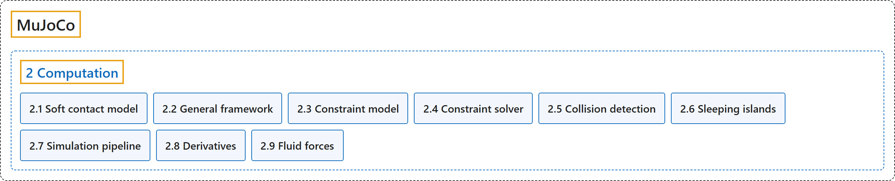

# 2. Computation

## Classification

## Glossary

| Term | Definition | 中文翻译 | Source |
|---|---|---|---|
| **2 Computation** 计算 | "This chapter describes **the mathematical and algorithmic foundations of MuJoCo**." | 本章介绍 **MuJoCo 的数学和算法基础**。 | [Google DeepMind, n.d.-a, "Introduction", para. 1](https://mujoco.readthedocs.io/en/stable/computation/index.html#introduction) |
| **[2.1 Soft contact model](soft-contact-model.md)** 软接触模型 | (No definition) | （无定义） | [Google DeepMind, n.d.-a, "Soft contact model"](https://mujoco.readthedocs.io/en/stable/computation/index.html#soft-contact-model) |
| **[2.2 General framework](general-framework.md)** 一般框架 | (No definition) | （无定义） | [Google DeepMind, n.d.-a, "General framework"](https://mujoco.readthedocs.io/en/stable/computation/index.html#general-framework) |
| **[2.3 Constraint model](constraint-model.md)** 约束模型 | (context) "MuJoCo has **a very flexible constraint model**, which is nevertheless handled in a uniform way by the solver described later." | （语境）MuJoCo 有**一个非常灵活的约束模型**，但它由后面介绍的求解器统一处理。 | [Google DeepMind, n.d.-a, "Constraint model", para. 1](https://mujoco.readthedocs.io/en/stable/computation/index.html#constraint-model) |
| **[2.4 Constraint solver](constraint-solver.md)** 约束求解器 | (context) "First, the constraint forces are defined as **the unique global solution to a convex optimization problem**." | （语境）首先，约束力被定义为**一个凸优化问题的唯一全局解**。 | [Google DeepMind, n.d.-a, "Constraint solver", para. 1](https://mujoco.readthedocs.io/en/stable/computation/index.html#constraint-solver) |
| **[2.5 Collision detection](collision-detection.md)** 碰撞检测 | (context) "Collision detection **operates on geoms, which are geometric entities rigidly attached to the underlying bodies**." | （语境）碰撞检测**作用于 geom，即刚性附着在底层刚体上的几何实体**。 | [Google DeepMind, n.d.-a, "Collision detection", para. 1](https://mujoco.readthedocs.io/en/stable/computation/index.html#collision-detection) |
| **[2.6 Sleeping islands](sleeping-islands.md)** 休眠岛 | (context) "Sleeping is **a performance optimization whereby movable elements of the simulation that are detected to be stationary are temporarily removed from the pipeline** (“put to sleep”)." | （语境）休眠是**一种性能优化：检测到静止不动的可动仿真元素会被暂时移出计算流水线**（“使其休眠”）。 | [Google DeepMind, n.d.-a, "Sleeping islands", para. 1](https://mujoco.readthedocs.io/en/stable/computation/index.html#sleeping-islands) |
| **[2.7 Simulation pipeline](simulation-pipeline.md)** 仿真流水线 | (context) "Here we summarize **the sequence of computations involved in forward and inverse dynamics respectively**." | （语境）这里分别概述**正向动力学和逆向动力学所涉及的计算顺序**。 | [Google DeepMind, n.d.-a, "Simulation pipeline", para. 1](https://mujoco.readthedocs.io/en/stable/computation/index.html#simulation-pipeline) |
| **[2.8 Derivatives](derivatives.md)** 导数 | (context) "MuJoCo’s entire computational pipeline including its constraint solver are **analytically differentiable in principle**." | （语境）MuJoCo 的整个计算流水线（包括约束求解器）**在原理上都是可解析求导的**。 | [Google DeepMind, n.d.-a, "Derivatives", para. 1](https://mujoco.readthedocs.io/en/stable/computation/index.html#derivatives) |
| **[2.9 Fluid forces](fluid-forces.md)** 流体力 | (context) "Nevertheless we provide **two phenomenological models which are sufficient for simulating behaviors such as flying and swimming**." | （语境）不过我们提供了**两种唯象模型，足以模拟飞行和游泳等行为**。 | [Google DeepMind, n.d.-b, "Fluid forces", para. 1](https://mujoco.readthedocs.io/en/stable/computation/fluid.html#fluid-forces) |

## References

Google DeepMind. (n.d.-a). *Computation*. MuJoCo Documentation (Version 3.17.0). Retrieved October 31, 2026, from <https://mujoco.readthedocs.io/en/stable/computation/index.html>

Google DeepMind. (n.d.-b). *Fluid forces*. MuJoCo Documentation (Version 3.17.0). Retrieved October 31, 2026, from <https://mujoco.readthedocs.io/en/stable/computation/fluid.html>
