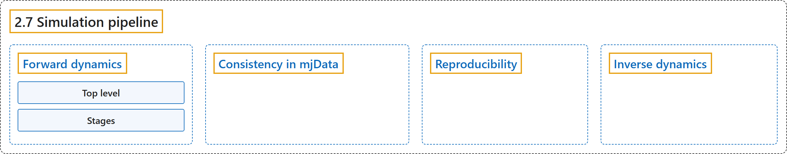

# 2.7 Simulation pipeline

## Classification

## Glossary

| Term | Definition | 中文翻译 | Source |
|---|---|---|---|
| **2.7 Simulation pipeline** 仿真流水线 | (context) "Here we summarize **the sequence of computations involved in forward and inverse dynamics respectively**." | （语境）这里分别概述**正向动力学和逆向动力学所涉及的计算顺序**。 | [Google DeepMind, n.d., "Simulation pipeline", para. 1](https://mujoco.readthedocs.io/en/stable/computation/index.html#simulation-pipeline) |
| **Forward dynamics** 正向动力学 | (context) "The source file engine_forward.c contains **the high-level forward dynamics pipeline**." | （语境）源文件 engine_forward.c 包含**高层的正向动力学流水线**。 | [Google DeepMind, n.d., "Forward dynamics", para. 1](https://mujoco.readthedocs.io/en/stable/computation/index.html#forward-dynamics) |
| **Top level** 顶层 | (context) "The top-level function mj_step **invokes the entire sequence of stages below** 1-26." | （语境）顶层函数 mj_step **调用下面的全部阶段序列**，即 1-26。 | [Google DeepMind, n.d., "Top level", item 1](https://mujoco.readthedocs.io/en/stable/computation/index.html#top-level) |
| **Stages** 阶段 | (context) "Below we describe **the pipeline stages and API functions corresponding to each stage**." | （语境）下面介绍**流水线的各个阶段以及与每个阶段对应的 API 函数**。 | [Google DeepMind, n.d., "Stages", para. 1](https://mujoco.readthedocs.io/en/stable/computation/index.html#stages) |
| **Position** 位置阶段 | "The stages below **compute quantities that depend on the generalized positions** mjData.qpos." | 下面这些阶段**计算依赖于广义位置的量**，即 mjData.qpos。 | [Google DeepMind, n.d., "Position", para. 1](https://mujoco.readthedocs.io/en/stable/computation/index.html#position) |
| **Velocity** 速度阶段 | "The stages below **compute quantities that depend on the generalized velocity** mjData.qvel." | 下面这些阶段**计算依赖于广义速度的量**，即 mjData.qvel。 | [Google DeepMind, n.d., "Velocity", para. 1](https://mujoco.readthedocs.io/en/stable/computation/index.html#velocity) |
| **Control callback** 控制回调 | "Invoke **the user-defined control callback** if defined" | 如果定义了**用户自定义的控制回调**，就调用它 | [Google DeepMind, n.d., "Control callback", item 1](https://mujoco.readthedocs.io/en/stable/computation/index.html#control-callback) |
| **Force/acceleration** 力/加速度阶段 | "The stages below **compute quantities that depend on user inputs**." | 下面这些阶段**计算依赖于用户输入的量**。 | [Google DeepMind, n.d., "Force/acceleration", para. 1](https://mujoco.readthedocs.io/en/stable/computation/index.html#force-acceleration) |
| **Consistency in mjData** mjData 的一致性 | "The MuJoCo computation pipeline is **entirely imperative, nothing happens automatically**." | MuJoCo 的计算流水线**完全是命令式的，没有任何事情会自动发生**。 | [Google DeepMind, n.d., "Consistency in mjData", para. 1](https://mujoco.readthedocs.io/en/stable/computation/index.html#consistency-in-mjdata) |
| **Reproducibility** 可复现性 | "MuJoCo’s simulation pipeline is **entirely deterministic and reproducible** – if a state in a trajectory is saved and reloaded and mj_step called again, the resulting next state will be identical." | MuJoCo 的仿真流水线**完全确定且可复现**：如果把轨迹中的某个状态保存后重新加载，再次调用 mj_step，得到的下一个状态将完全相同。 | [Google DeepMind, n.d., "Reproducibility", para. 1](https://mujoco.readthedocs.io/en/stable/computation/index.html#reproducibility) |
| **Inverse dynamics** 逆向动力学 | (context) "The top-level function mj_inverse **invokes the following sequence of computations**." | （语境）顶层函数 mj_inverse **调用下面的计算序列**。 | [Google DeepMind, n.d., "Inverse dynamics", para. 1](https://mujoco.readthedocs.io/en/stable/computation/index.html#inverse-dynamics) |

## References

Google DeepMind. (n.d.). *Computation*. MuJoCo Documentation (Version 3.17.0). Retrieved October 31, 2026, from <https://mujoco.readthedocs.io/en/stable/computation/index.html>
