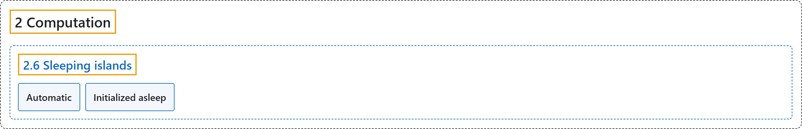

# 2.6 Sleeping islands

## Classification

## Glossary

| Term | Definition | 中文翻译 | Source |
|---|---|---|---|
| **2.6 Sleeping islands** 休眠岛 | (context) "Sleeping is **a performance optimization whereby movable elements of the simulation that are detected to be stationary are temporarily removed from the pipeline** (“put to sleep”)." | （语境）休眠是**一种性能优化：检测到静止不动的可动仿真元素会被暂时移出计算流水线**（“使其休眠”）。 | [Google DeepMind, n.d., "Sleeping islands", para. 1](https://mujoco.readthedocs.io/en/stable/computation/index.html#sleeping-islands) |
| **Automatic** 自动休眠 | "A tree whose maximum velocity in absolute value is less than the tolerance for mjMINAWAKE time steps is marked as “ready to sleep”. If all trees in an island are ready to sleep, **they are put to sleep during state advancement**." | 一棵树如果其最大速度的绝对值在 mjMINAWAKE 个时间步内都小于容差，就被标记为“准备休眠”。如果一个岛中的所有树都准备休眠，**它们会在状态推进时进入休眠**。 | [Google DeepMind, n.d., "Sleeping islands", item 1](https://mujoco.readthedocs.io/en/stable/computation/index.html#sleeping-islands) |
| **Initialized asleep** 初始化为休眠 | "By setting the body/sleep attribute of a tree root to “init”, it is **marked as “initialized-asleep” and put to sleep during mjData initialization**." | 把树根的 body/sleep 属性设为“init”，它就会**被标记为“初始化为休眠”，并在 mjData 初始化时进入休眠**。 | [Google DeepMind, n.d., "Sleeping islands", item 2](https://mujoco.readthedocs.io/en/stable/computation/index.html#sleeping-islands) |

## References

Google DeepMind. (n.d.). *Computation*. MuJoCo Documentation (Version 3.17.0). Retrieved October 31, 2026, from <https://mujoco.readthedocs.io/en/stable/computation/index.html>
