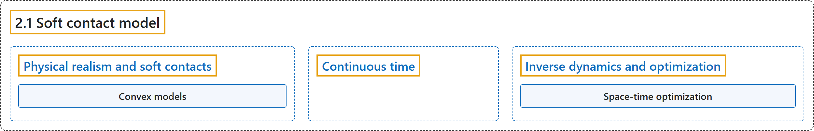

# 2.1 Soft contact model

## Classification

## Glossary

| Term | Definition | 中文翻译 | Source |
|---|---|---|---|
| **2.1 Soft contact model** 软接触模型 | (No definition) | （无定义） | [Google DeepMind, n.d., "Soft contact model"](https://mujoco.readthedocs.io/en/stable/computation/index.html#soft-contact-model) |
| **Physical realism and soft contacts** 物理真实性与软接触 | "So **the deviations from LCP actually increase physical realism in the presence of soft contacts**." | 因此，**在存在软接触时，对 LCP 的偏离实际上提高了物理真实性**。 | [Google DeepMind, n.d., "Physical realism and soft contacts", para. 2](https://mujoco.readthedocs.io/en/stable/computation/index.html#physical-realism-and-soft-contacts) |
| **Convex models** 凸模型 | "Many of the advantages of our contact model can be traced to the fact that **we drop the strict complementarity constraint at the heart of the LCP formulation**. We will call this family of models convex; see References for related work." | 我们接触模型的许多优点可以归因于**我们去掉了 LCP 表述核心的严格互补约束**。我们把这一类模型称为凸模型；相关工作见参考文献。 | [Google DeepMind, n.d., "Physical realism and soft contacts", para. 1](https://mujoco.readthedocs.io/en/stable/computation/index.html#physical-realism-and-soft-contacts) |
| **Continuous time** 连续时间 | "The present model is **defined in continuous-time, in terms of forces and accelerations**." | 本模型是**在连续时间中、用力和加速度定义的**。 | [Google DeepMind, n.d., "Continuous time", para. 2](https://mujoco.readthedocs.io/en/stable/computation/index.html#continuous-time) |
| **Inverse dynamics and optimization** 逆向动力学与优化 | "The objective of inverse dynamics is **to recover the applied force and contact force given the position, velocity and acceleration of the multi-joint system**." | 逆向动力学的目标是**在已知多关节系统的位置、速度和加速度时，求出施加力和接触力**。 | [Google DeepMind, n.d., "Inverse dynamics and optimization", para. 1](https://mujoco.readthedocs.io/en/stable/computation/index.html#inverse-dynamics-and-optimization) |
| **Space-time optimization** 时空优化 | "They make it possible to **treat the sequence of positions (or a parametric representation thereof) as the object being optimized**. Velocities and acceleration are then computed by differentiating the positions; inverse dynamics are used to compute the applied and contact forces; and finally an objective function is constructed which can depend on all of the above. This is interchangeably called space-time optimization, spectral method, direct collocation." | 它们使得可以**把位置序列（或其参数化表示）当作被优化的对象**。然后通过对位置求导得到速度和加速度；用逆向动力学计算施加力和接触力；最后构造一个可以依赖上述所有量的目标函数。这种做法也称为时空优化、谱方法、直接配点法。 | [Google DeepMind, n.d., "Inverse dynamics and optimization", para. 2](https://mujoco.readthedocs.io/en/stable/computation/index.html#inverse-dynamics-and-optimization) |

## References

Google DeepMind. (n.d.). *Computation*. MuJoCo Documentation (Version 3.17.0). Retrieved October 31, 2026, from <https://mujoco.readthedocs.io/en/stable/computation/index.html>
