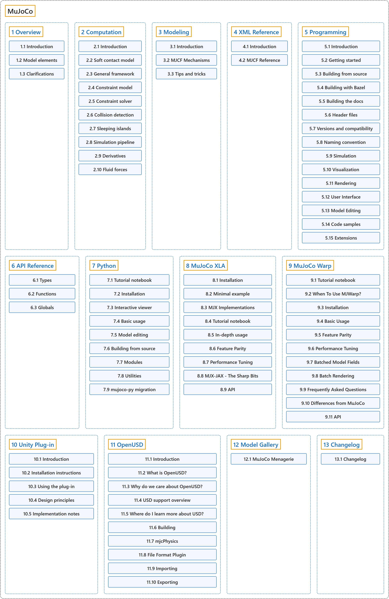

# MuJoCo

## Classification

## Glossary

| Term | Definition | 中文翻译 | Source |
|---|---|---|---|
| **MuJoCo** MuJoCo | "MuJoCo stands for **Multi-Joint dynamics with Contact**. It is **a general purpose physics engine** that aims to facilitate research and development in robotics, biomechanics, graphics and animation, machine learning, and other areas that demand fast and accurate simulation of articulated structures interacting with their environment." | MuJoCo 是 **Multi-Joint dynamics with Contact（多关节接触动力学）** 的缩写。它是**一个通用物理引擎**，旨在推动机器人、生物力学、图形与动画、机器学习等领域的研究和开发，这些领域需要快速而准确地模拟与环境交互的铰接结构。 | [Google DeepMind, n.d., "Introduction", para. 1](https://mujoco.readthedocs.io/en/stable/overview.html#introduction) |
| **[1 Overview](overview/index.md)** 概述 | (context) "MuJoCo is **a C/C++ library with a C API, intended for researchers and developers**." | （语境）MuJoCo 是**一个提供 C API 的 C/C++ 库，面向研究人员和开发者**。 | [Google DeepMind, n.d., "Introduction", para. 2](https://mujoco.readthedocs.io/en/stable/overview.html#introduction) |
| **[2 Computation](computation/index.md)** 计算 | "This chapter describes **the mathematical and algorithmic foundations of MuJoCo**." | 本章介绍 **MuJoCo 的数学和算法基础**。 | [Google DeepMind, n.d., "Introduction", para. 1](https://mujoco.readthedocs.io/en/stable/computation/index.html#introduction) |
| **[3 Modeling](modeling/index.md)** 建模 | "MuJoCo’s native model format is MJCF, an XML-based language designed to describe complex dynamical systems. This chapter is **the primary MJCF modeling guide**." | MuJoCo 的原生模型格式是 MJCF，一种基于 XML、用于描述复杂动力系统的语言。本章是 **MJCF 建模的主要指南**。 | [Google DeepMind, n.d., "Introduction", para. 1](https://mujoco.readthedocs.io/en/stable/modeling.html#introduction) |
| **[4 XML Reference](xml-reference/index.md)** XML 参考 | "This chapter is **the reference manual for the MJCF modeling language used in MuJoCo**." | 本章是 **MuJoCo 所用 MJCF 建模语言的参考手册**。 | [Google DeepMind, n.d., "Introduction", para. 1](https://mujoco.readthedocs.io/en/stable/XMLreference.html#introduction) |
| **[5 Programming](programming/index.md)** 编程 | "This chapter is **the MuJoCo programming guide**." | 本章是 **MuJoCo 编程指南**。 | [Google DeepMind, n.d., "Introduction", para. 1](https://mujoco.readthedocs.io/en/stable/programming/index.html#introduction) |
| **[6 API Reference](api-reference/index.md)** API 参考 | "This chapter is **the reference manual for the MuJoCo API**." | 本章是 **MuJoCo API 的参考手册**。 | [Google DeepMind, n.d., "API Reference", para. 1](https://mujoco.readthedocs.io/en/stable/APIreference/index.html#api-reference) |
| **[7 Python](python/index.md)** Python | "MuJoCo comes with **native Python bindings that are developed in C++ using pybind11**." | MuJoCo 自带**用 pybind11 在 C++ 中开发的原生 Python 绑定**。 | [Google DeepMind, n.d., "Python", para. 1](https://mujoco.readthedocs.io/en/stable/python.html#python) |
| **[8 MuJoCo XLA](mujoco-xla/index.md)** MuJoCo XLA | "MuJoCo XLA (MJX) provides **a JAX API for various implementations of MuJoCo**." | MuJoCo XLA（MJX）提供**一个面向 MuJoCo 多种实现的 JAX API**。 | [Google DeepMind, n.d., "MuJoCo XLA (MJX)", para. 1](https://mujoco.readthedocs.io/en/stable/mjx.html#mujoco-xla-mjx) |
| **[9 MuJoCo Warp](mujoco-warp/index.md)** MuJoCo Warp | "MuJoCo Warp (MJWarp) is **an implementation of MuJoCo written in Warp and optimized for NVIDIA hardware and parallel simulation**." | MuJoCo Warp（MJWarp）是**用 Warp 编写、针对 NVIDIA 硬件和并行仿真优化的 MuJoCo 实现**。 | [Google DeepMind, n.d., "MuJoCo Warp (MJWarp)", para. 1](https://mujoco.readthedocs.io/en/stable/mjwarp/index.html#mujoco-warp-mjwarp) |
| **[10 Unity Plug-in](unity-plug-in/index.md)** Unity 插件 | "The MuJoCo Unity plug-in **allows the Unity Editor and runtime to use the MuJoCo physics engine**." | MuJoCo 的 Unity 插件**让 Unity 编辑器和运行时能够使用 MuJoCo 物理引擎**。 | [Google DeepMind, n.d., "Introduction", para. 1](https://mujoco.readthedocs.io/en/stable/unity.html#introduction) |
| **[11 OpenUSD](openusd/index.md)** OpenUSD | "This chapter describes **MuJoCo’s support for OpenUSD**." | 本章介绍 **MuJoCo 对 OpenUSD 的支持**。 | [Google DeepMind, n.d., "Introduction", para. 1](https://mujoco.readthedocs.io/en/stable/OpenUSD/index.html#introduction) |
| **[12 Model Gallery](model-gallery/index.md)** 模型库 | (context) "The goal of MuJoCo Menagerie is to provide the community with **a curated collection of well-designed models that work well right out of the box**." | （语境）MuJoCo Menagerie 的目标是为社区提供**一套精选的、设计良好、开箱即用的模型**。 | [Google DeepMind, n.d., "MuJoCo Menagerie", para. 1](https://mujoco.readthedocs.io/en/stable/models.html#mujoco-menagerie) |
| **[13 Changelog](changelog/index.md)** 更新日志 | (No definition) | （无定义） | [Google DeepMind, n.d., "Changelog", documentation menu](https://mujoco.readthedocs.io/en/stable/changelog.html) |

## References

Google DeepMind. (n.d.). *MuJoCo documentation* (Version 3.17.0). Retrieved October 30, 2026, from <https://mujoco.readthedocs.io/en/stable/>
