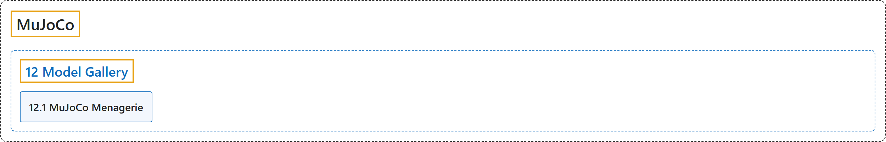

# 12. Model Gallery

## Classification

## Glossary

| Term | Definition | 中文翻译 | Source |
|---|---|---|---|
| **12 Model Gallery** 模型库 | (context) "The goal of MuJoCo Menagerie is to provide the community with **a curated collection of well-designed models that work well right out of the box**." | （语境）MuJoCo Menagerie 的目标是为社区提供**一套精选的、设计良好、开箱即用的模型**。 | [Google DeepMind, n.d., "MuJoCo Menagerie", para. 1](https://mujoco.readthedocs.io/en/stable/models.html#mujoco-menagerie) |
| **[12.1 MuJoCo Menagerie](mujoco-menagerie.md)** MuJoCo Menagerie | "The goal of MuJoCo Menagerie is to provide the community with **a curated collection of well-designed models that work well right out of the box**." | MuJoCo Menagerie 的目标是为社区提供**一套精选的、设计良好、开箱即用的模型**。 | [Google DeepMind, n.d., "MuJoCo Menagerie", para. 1](https://mujoco.readthedocs.io/en/stable/models.html#mujoco-menagerie) |

## References

Google DeepMind. (n.d.). *Model Gallery*. MuJoCo Documentation (Version 3.17.0). Retrieved October 31, 2026, from <https://mujoco.readthedocs.io/en/stable/models.html>
