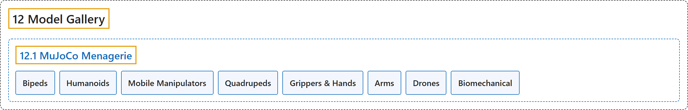

# 12.1 MuJoCo Menagerie

## Classification

## Glossary

| Term | Definition | 中文翻译 | Source |
|---|---|---|---|
| **12.1 MuJoCo Menagerie** MuJoCo Menagerie | "The goal of MuJoCo Menagerie is to provide the community with **a curated collection of well-designed models that work well right out of the box**." | MuJoCo Menagerie 的目标是为社区提供**一套精选的、设计良好、开箱即用的模型**。 | [Google DeepMind, n.d., "MuJoCo Menagerie", para. 1](https://mujoco.readthedocs.io/en/stable/models.html#mujoco-menagerie) |
| **Bipeds** 双足机器人 | (No definition) | （无定义） | [Google DeepMind, n.d., "Bipeds"](https://mujoco.readthedocs.io/en/stable/models.html#bipeds) |
| **Humanoids** 人形机器人 | (No definition) | （无定义） | [Google DeepMind, n.d., "Humanoids"](https://mujoco.readthedocs.io/en/stable/models.html#humanoids) |
| **Mobile Manipulators** 移动操作机器人 | (No definition) | （无定义） | [Google DeepMind, n.d., "Mobile Manipulators"](https://mujoco.readthedocs.io/en/stable/models.html#mobile-manipulators) |
| **Quadrupeds** 四足机器人 | (No definition) | （无定义） | [Google DeepMind, n.d., "Quadrupeds"](https://mujoco.readthedocs.io/en/stable/models.html#quadrupeds) |
| **Grippers & Hands** 夹爪与灵巧手 | (No definition) | （无定义） | [Google DeepMind, n.d., "Grippers & Hands"](https://mujoco.readthedocs.io/en/stable/models.html#grippers-hands) |
| **Arms** 机械臂 | (No definition) | （无定义） | [Google DeepMind, n.d., "Arms"](https://mujoco.readthedocs.io/en/stable/models.html#arms) |
| **Drones** 无人机 | (No definition) | （无定义） | [Google DeepMind, n.d., "Drones"](https://mujoco.readthedocs.io/en/stable/models.html#drones) |
| **Biomechanical** 生物力学模型 | (No definition) | （无定义） | [Google DeepMind, n.d., "Biomechanical"](https://mujoco.readthedocs.io/en/stable/models.html#biomechanical) |

## References

Google DeepMind. (n.d.). *Model Gallery*. MuJoCo Documentation (Version 3.17.0). Retrieved October 31, 2026, from <https://mujoco.readthedocs.io/en/stable/models.html>
