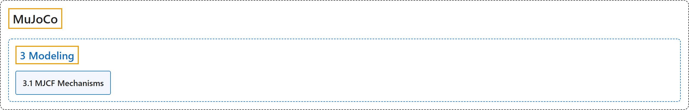

# 3. Modeling

## Classification

## Glossary

| Term | Definition | 中文翻译 | Source |
|---|---|---|---|
| **3 Modeling** 建模 | "MuJoCo’s native model format is MJCF, an XML-based language designed to describe complex dynamical systems. This chapter is **the primary MJCF modeling guide**." | MuJoCo 的原生模型格式是 MJCF，一种基于 XML、用于描述复杂动力系统的语言。本章是 **MJCF 建模的主要指南**。 | [Google DeepMind, n.d., "Introduction", para. 1](https://mujoco.readthedocs.io/en/stable/modeling.html#introduction) |
| **[3.1 MJCF Mechanisms](mjcf-mechanisms.md)** MJCF 机制 | (context) "MJCF uses **several mechanisms for model creation which span multiple model elements**." | （语境）MJCF 使用**若干跨越多个模型元素的模型创建机制**。 | [Google DeepMind, n.d., "MJCF Mechanisms", para. 1](https://mujoco.readthedocs.io/en/stable/modeling.html#mjcf-mechanisms) |

## References

Google DeepMind. (n.d.). *Modeling*. MuJoCo Documentation (Version 3.17.0). Retrieved October 31, 2026, from <https://mujoco.readthedocs.io/en/stable/modeling.html>
