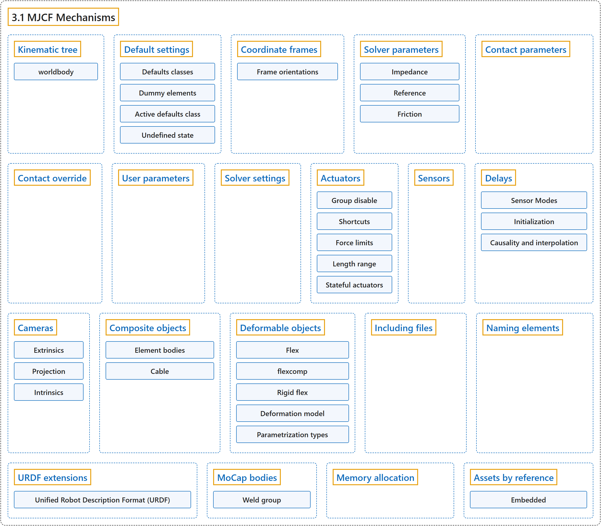

# 3.1 MJCF Mechanisms

## Classification

## Glossary

| Term | Definition | 中文翻译 | Source |
|---|---|---|---|
| **3.1 MJCF Mechanisms** MJCF 机制 | (context) "MJCF uses **several mechanisms for model creation which span multiple model elements**." | （语境）MJCF 使用**若干跨越多个模型元素的模型创建机制**。 | [Google DeepMind, n.d., "MJCF Mechanisms", para. 1](https://mujoco.readthedocs.io/en/stable/modeling.html#mjcf-mechanisms) |
| **Kinematic tree** 运动学树 | "The main part of the MJCF file is **an XML tree created by nested body elements**." | MJCF 文件的主体是**由嵌套的 body 元素构成的 XML 树**。 | [Google DeepMind, n.d., "Kinematic tree", para. 1](https://mujoco.readthedocs.io/en/stable/modeling.html#kinematic-tree) |
| **worldbody** 世界刚体 | "**The top-level body is special** and is called worldbody." | **顶层刚体很特殊**，称为 worldbody。 | [Google DeepMind, n.d., "Kinematic tree", para. 1](https://mujoco.readthedocs.io/en/stable/modeling.html#kinematic-tree) |
| **Default settings** 默认设置 | "MJCF has **an elaborate mechanism for setting default attribute values**." | MJCF 有**一套精细的机制来设置属性默认值**。 | [Google DeepMind, n.d., "Default settings", para. 1](https://mujoco.readthedocs.io/en/stable/modeling.html#default-settings) |
| **Defaults classes** 默认类 | "MuJoCo supports **unlimited number of defaults classes, created by possibly nested default elements in the XML**." | MuJoCo 支持**数量不限的默认类，它们由 XML 中可以嵌套的 default 元素创建**。 | [Google DeepMind, n.d., "Default settings", para. 4](https://mujoco.readthedocs.io/en/stable/modeling.html#default-settings) |
| **Dummy elements** 虚拟元素 | "The dummy elements contained in the defaults classes **are not part of the model; they are only used to initialize the attribute values of the actual model elements**." | 默认类中包含的虚拟元素**不是模型的一部分；它们只用来初始化实际模型元素的属性值**。 | [Google DeepMind, n.d., "Default settings", para. 5](https://mujoco.readthedocs.io/en/stable/modeling.html#default-settings) |
| **Active defaults class** 当前默认类 | "**There is always an active defaults class**, which can be determined in one of three ways." | **总有一个当前生效的默认类**，它可以用三种方式之一确定。 | [Google DeepMind, n.d., "Default settings", para. 5](https://mujoco.readthedocs.io/en/stable/modeling.html#default-settings) |
| **Undefined state** 未定义状态 | "Some attributes, such as body inertia, can be in a special undefined state. This **instructs the compiler to infer the corresponding value from other information**, in this case the inertias of the geoms attached to the body." | 有些属性（例如刚体惯量）可以处于一种特殊的未定义状态。它**指示编译器从其他信息推断相应的值**，在这个例子中是附着在刚体上的 geom 的惯量。 | [Google DeepMind, n.d., "Default settings", para. 6](https://mujoco.readthedocs.io/en/stable/modeling.html#default-settings) |
| **Coordinate frames** 坐标系 | "The positions and orientations of all elements defined in the kinematic tree are **expressed in local coordinates**, relative to the parent body for bodies, and relative to the body that contains the element for geoms, joints, sites, cameras and lights." | 运动学树中定义的所有元素的位置和朝向都**用局部坐标表示**：刚体相对于父刚体，geom、关节、site、相机和光源相对于包含它们的刚体。 | [Google DeepMind, n.d., "Coordinate frames", para. 1](https://mujoco.readthedocs.io/en/stable/modeling.html#coordinate-frames) |
| **Frame orientations** 坐标系朝向 | "Specifying 3D positions is straightforward, but **specifying 3D orientations can be challenging**. This is why MJCF provides **several alternative mechanisms**." | 指定三维位置很简单，但**指定三维朝向可能很困难**。这就是为什么 MJCF 提供了**几种可选的机制**。 | [Google DeepMind, n.d., "Frame orientations", para. 1](https://mujoco.readthedocs.io/en/stable/modeling.html#frame-orientations) |
| **Spatial frame** 空间坐标系 | "A spatial frame is **defined by its position and orientation**." | 空间坐标系**由它的位置和朝向定义**。 | [Google DeepMind, n.d., "Frame orientations", para. 1](https://mujoco.readthedocs.io/en/stable/modeling.html#frame-orientations) |
| **Solver parameters** 求解器参数 | "The constraint solver **finds forces that satisfy soft constraints, parameterized by three quantities**" | 约束求解器**求出满足软约束的力，软约束由三个量参数化** | [Google DeepMind, n.d., "Solver parameters", para. 1](https://mujoco.readthedocs.io/en/stable/modeling.html#solver-parameters) |
| **Impedance** 阻抗 | "corresponds to **a constraint’s ability to generate force**" | 对应于**约束产生力的能力** | [Google DeepMind, n.d., "Impedance", note](https://mujoco.readthedocs.io/en/stable/modeling.html#impedance) |
| **Reference** 参考加速度 | "determines the **motion that constraint is trying to achieve** in order to rectify violation" | 决定**约束为纠正违反而试图实现的运动** | [Google DeepMind, n.d., "Reference", note](https://mujoco.readthedocs.io/en/stable/modeling.html#reference) |
| **Time constant** 时间常数 | "By “time constant” we mean **the inverse of the natural frequency times the damping ratio**." | 所谓“时间常数”，我们指的是**固有频率与阻尼比乘积的倒数**。 | [Google DeepMind, n.d., "Reference", item 1](https://mujoco.readthedocs.io/en/stable/modeling.html#reference) |
| **Friction** 摩擦 | "Friction loss constraints (in joints and tendons) and friction dimensions of elliptic contact cones **have zero position violation**" | 摩擦损失约束（关节和肌腱中的）和椭圆接触锥的摩擦维度**位置违反为零** | [Google DeepMind, n.d., "Friction", para. 1](https://mujoco.readthedocs.io/en/stable/modeling.html#friction) |
| **Contact parameters** 接触参数 | (context) "In that case **we use the geom attributes solmix and priority to decide how to combine them**." | （语境）此时**我们用 geom 属性 solmix 和 priority 决定如何组合它们**。 | [Google DeepMind, n.d., "Contact parameters", para. 1](https://mujoco.readthedocs.io/en/stable/modeling.html#contact-parameters) |
| **Contact override** 接触覆盖 | "In order to facilitate this process, we provide **a mechanism to override some of the solver parameters, without making changes to the actual model**." | 为了方便这个过程，我们提供了**一种覆盖部分求解器参数的机制，而无需修改实际模型**。 | [Google DeepMind, n.d., "Contact override", para. 1](https://mujoco.readthedocs.io/en/stable/modeling.html#contact-override) |
| **User parameters** 用户参数 | "A number of MJCF elements have the optional attribute user, which defines **a custom element-specific parameter array**." | 许多 MJCF 元素有可选属性 user，它定义**一个元素专属的自定义参数数组**。 | [Google DeepMind, n.d., "User parameters", para. 1](https://mujoco.readthedocs.io/en/stable/modeling.html#user-parameters) |
| **Solver settings** 求解器设置 | "MuJoCo has **three algorithms for solving this optimization problem: Newton, CG, PGS**." | MuJoCo 有**三种求解这个优化问题的算法：Newton、CG、PGS**。 | [Google DeepMind, n.d., "Solver settings", para. 1](https://mujoco.readthedocs.io/en/stable/modeling.html#solver-settings) |
| **Actuators** 驱动器 | (context) "This section describes **various aspects of using actuators in MuJoCo**." | （语境）本节介绍**在 MuJoCo 中使用驱动器的各个方面**。 | [Google DeepMind, n.d., "Actuators", para. 1](https://mujoco.readthedocs.io/en/stable/modeling.html#actuators) |
| **Group disable** 分组禁用 | "The actuatorgroupdisable attribute, which can be changed at runtime by setting the mjOption.disableactuator integer bitfield, allows the user **to disable sets of actuators according to their group**." | actuatorgroupdisable 属性可以在运行时通过设置 mjOption.disableactuator 整数位域来改变，它让用户**按分组禁用若干组驱动器**。 | [Google DeepMind, n.d., "Group disable", para. 1](https://mujoco.readthedocs.io/en/stable/modeling.html#group-disable) |
| **Shortcuts** 快捷方式 | "In addition, MJCF provides **shortcuts for configuring common actuators**." | 此外，MJCF 提供了**用于配置常见驱动器的快捷方式**。 | [Google DeepMind, n.d., "Shortcuts", para. 1](https://mujoco.readthedocs.io/en/stable/modeling.html#shortcuts) |
| **Force limits** 力限制 | "Actuator forces are usually **limited between lower and upper bounds**." | 驱动器的力通常**被限制在下界和上界之间**。 | [Google DeepMind, n.d., "Force limits", para. 1](https://mujoco.readthedocs.io/en/stable/modeling.html#force-limits) |
| **Control clamping with ctrlrange** 用 ctrlrange 截断控制量 | "If this actuator attribute is set, **the input control value will be clamped**." | 如果设置了这个驱动器属性，**输入的控制值会被截断**。 | [Google DeepMind, n.d., "Force limits", item 1](https://mujoco.readthedocs.io/en/stable/modeling.html#force-limits) |
| **Force clamping at actuator output with forcerange** 用 forcerange 在驱动器输出端截断力 | "If this actuator attribute is set, **the actuator’s output force will be clamped**." | 如果设置了这个驱动器属性，**驱动器的输出力会被截断**。 | [Google DeepMind, n.d., "Force limits", item 2](https://mujoco.readthedocs.io/en/stable/modeling.html#force-limits) |
| **Force clamping at joint input with joint/actuatorfrcrange** 用 joint/actuatorfrcrange 在关节输入端截断力 | "This joint attribute **clamps input forces from all actuators acting on the joint, after passing through the transmission**." | 这个关节属性**在经过传动之后，截断所有作用在该关节上的驱动器输入力**。 | [Google DeepMind, n.d., "Force limits", item 3](https://mujoco.readthedocs.io/en/stable/modeling.html#force-limits) |
| **Force clamping at tendon input with tendon/actuatorfrcrange** 用 tendon/actuatorfrcrange 在肌腱输入端截断力 | "This tendon attribute **clamps input forces from all actuators acting on the tendon**." | 这个肌腱属性**截断所有作用在该肌腱上的驱动器输入力**。 | [Google DeepMind, n.d., "Force limits", item 4](https://mujoco.readthedocs.io/en/stable/modeling.html#force-limits) |
| **Length range** 长度范围 | "The field mjModel.actuator_lengthrange contains **the range of feasible actuator lengths** (or more precisely, lengths of the actuator’s transmission)." | 字段 mjModel.actuator_lengthrange 包含**驱动器可行长度的范围**（更准确地说，是驱动器传动的长度）。 | [Google DeepMind, n.d., "Length range", para. 1](https://mujoco.readthedocs.io/en/stable/modeling.html#length-range) |
| **Stateful actuators** 有状态驱动器 | "As described in the Actuation model section of the Computation chapter, MuJoCo supports **actuators with internal dynamics whose states are called “activations”**." | 如计算一章的驱动模型一节所述，MuJoCo 支持**具有内部动力学的驱动器，其状态称为“激活”**。 | [Google DeepMind, n.d., "Stateful actuators", para. 1](https://mujoco.readthedocs.io/en/stable/modeling.html#stateful-actuators) |
| **Activation limits** 激活限制 | "In the case of integrated-velocity actuators, **it is often desirable to clamp the activation state**, since otherwise the position target would keep integrating beyond the joint limits, leading to loss of controllabillity." | 对于积分速度驱动器，**通常希望截断激活状态**，否则位置目标会一直积分到超出关节限位，导致失去可控性。 | [Google DeepMind, n.d., "Activation limits", para. 2](https://mujoco.readthedocs.io/en/stable/modeling.html#activation-limits) |
| **Integrated-velocity actuator** 积分速度驱动器 | "Different from the pure velocity actuators, which implement direct feedback on transmission target’s velocity, integrated-velocity actuators **couple an integrator with a position-feedback actuator**." | 与对传动目标速度直接反馈的纯速度驱动器不同，积分速度驱动器**把一个积分器与一个位置反馈驱动器耦合起来**。 | [Google DeepMind, n.d., "Activation limits", para. 1](https://mujoco.readthedocs.io/en/stable/modeling.html#activation-limits) |
| **Muscles** 肌肉 | "We provide **a set of tools for modeling biological muscles**." | 我们提供了**一套建模生物肌肉的工具**。 | [Google DeepMind, n.d., "Muscles", para. 1](https://mujoco.readthedocs.io/en/stable/modeling.html#muscles) |
| **Muscle-tendon actuator** 肌肉-肌腱驱动器 | "In biomechanics, **a muscle and a tendon are attached in series and form a muscle-tendon actuator**." | 在生物力学中，**肌肉和肌腱串联连接，构成肌肉-肌腱驱动器**。 | [Google DeepMind, n.d., "Muscles", para. 4](https://mujoco.readthedocs.io/en/stable/modeling.html#muscles) |
| **Optimal resting length** 最优静息长度 | "Another important constant is **the optimal resting length of the muscle**" | 另一个重要常数是**肌肉的最优静息长度** | [Google DeepMind, n.d., "Muscles", para. 5](https://mujoco.readthedocs.io/en/stable/modeling.html#muscles) |
| **Force-Length-Velocity (FLV) function** 力-长度-速度（FLV）函数 | "The behavior is captured by **the Force-Length-Velocity**" | 这种行为由**力-长度-速度**函数刻画 | [Google DeepMind, n.d., "Muscles", para. 7](https://mujoco.readthedocs.io/en/stable/modeling.html#muscles) |
| **Muscle activation** 肌肉激活 | "Coming back to our muscle model, there is the muscle activation act. This is **the state of a first-order nonlinear filter whose input is the control signal**." | 回到我们的肌肉模型，还有肌肉激活 act。它是**一个以控制信号为输入的一阶非线性滤波器的状态**。 | [Google DeepMind, n.d., "Muscles", para. 13](https://mujoco.readthedocs.io/en/stable/modeling.html#muscles) |
| **Pennation angle** 羽状角 | "Pennation angle (**i.e., the angle between the muscle and the line of force**) is not modeled in MuJoCo and is assumed to be 0." | 羽状角（**即肌肉与力作用线之间的夹角**）在 MuJoCo 中不建模，假定为 0。 | [Google DeepMind, n.d., "Muscles", Relation to OpenSim, para. 5](https://mujoco.readthedocs.io/en/stable/modeling.html#muscles) |
| **Inverse wrap** 反向缠绕 | "We also allow “side sites” to be placed inside the sphere or cylinder, which causes an inverse wrap: **the tendon path is constrained to pass through the object instead of going around it**." | 我们还允许把“侧 site”放在球体或圆柱体内部，这会造成反向缠绕：**肌腱路径被约束为穿过物体，而不是绕过它**。 | [Google DeepMind, n.d., "Muscles", Relation to OpenSim, para. 6](https://mujoco.readthedocs.io/en/stable/modeling.html#muscles) |
| **Sensors** 传感器 | "Sensors **do not affect the simulation**. Instead their outputs are copied in the array mjData.sensordata and are available for user processing." | 传感器**不影响仿真**。它们的输出被复制到数组 mjData.sensordata 中，供用户处理。 | [Google DeepMind, n.d., "Sensors", para. 1](https://mujoco.readthedocs.io/en/stable/modeling.html#sensors) |
| **Delays** 延迟 | "Both actuators and sensors **support time delays via a ring buffer that stores timestamped samples**." | 驱动器和传感器都**通过一个存储带时间戳样本的环形缓冲区支持时间延迟**。 | [Google DeepMind, n.d., "Delays", para. 1](https://mujoco.readthedocs.io/en/stable/modeling.html#delays) |
| **Sensor Modes** 传感器模式 | "Sensors support both delay and interval/period attributes. **The combination determines behavior**:" | 传感器同时支持 delay 和 interval/period 属性。**二者的组合决定其行为**： | [Google DeepMind, n.d., "Delays", para. 5](https://mujoco.readthedocs.io/en/stable/modeling.html#delays) |
| **History-only** 仅历史 | "History-only: **computed every step, written to sensordata , pushed into history buffer**" | 仅历史：**每步计算，写入 sensordata，推入历史缓冲区** | [Google DeepMind, n.d., "Delays", table, row 1](https://mujoco.readthedocs.io/en/stable/modeling.html#delays) |
| **Delayed** 延迟 | "Delayed: **computed every step, sensordata contains delayed reading (read from buffer)**" | 延迟：**每步计算，sensordata 包含延迟读数（从缓冲区读取）** | [Google DeepMind, n.d., "Delays", table, row 2](https://mujoco.readthedocs.io/en/stable/modeling.html#delays) |
| **Periodic** 周期 | "Periodic: **computed on period, sensordata contains last computed value (no delay)**" | 周期：**按周期计算，sensordata 包含最近一次计算的值（无延迟）** | [Google DeepMind, n.d., "Delays", table, row 3](https://mujoco.readthedocs.io/en/stable/modeling.html#delays) |
| **Periodic + Delayed** 周期 + 延迟 | "Periodic + Delayed: **computed on period, sensordata contains delayed reading (read from buffer)**" | 周期 + 延迟：**按周期计算，sensordata 包含延迟读数（从缓冲区读取）** | [Google DeepMind, n.d., "Delays", table, row 4](https://mujoco.readthedocs.io/en/stable/modeling.html#delays) |
| **Initialization** 初始化 | (context) "**History buffers are initialized by mj_resetData** as follows:" | （语境）**历史缓冲区由 mj_resetData 初始化**，方式如下： | [Google DeepMind, n.d., "Delays", para. 6](https://mujoco.readthedocs.io/en/stable/modeling.html#delays) |
| **Causality and interpolation** 因果性与插值 | (context) "The most common positive delay value is delay = timestep * nsample, which implements **a simple history buffer, with no causality issues**." | （语境）最常见的正延迟值是 delay = timestep * nsample，它实现**一个简单的历史缓冲区，不存在因果性问题**。 | [Google DeepMind, n.d., "Delays", para. 8](https://mujoco.readthedocs.io/en/stable/modeling.html#delays) |
| **Cameras** 相机 | "Besides the default, user-controllable, free camera, **“fixed” cameras can be attached to the kinematic tree**." | 除了默认的、用户可控的自由相机之外，**还可以把“固定”相机附着到运动学树上**。 | [Google DeepMind, n.d., "Cameras", para. 1](https://mujoco.readthedocs.io/en/stable/modeling.html#cameras) |
| **Extrinsics** 外参 | "By default, **camera frames are attached to the containing body**." | 默认情况下，**相机坐标系附着在包含它的刚体上**。 | [Google DeepMind, n.d., "Cameras", item 1](https://mujoco.readthedocs.io/en/stable/modeling.html#cameras) |
| **Projection** 投影 | "Cameras use **perspective projection by default**. Setting projection to orthographic switches to **an orthographic projection**, where the fovy attribute is interpreted as the vertical extent in length units rather than degrees." | 相机**默认使用透视投影**。把 projection 设为 orthographic 会切换到**正交投影**，此时 fovy 属性被解释为以长度单位表示的垂直范围，而不是角度。 | [Google DeepMind, n.d., "Cameras", item 2](https://mujoco.readthedocs.io/en/stable/modeling.html#cameras) |
| **Intrinsics** 内参 | "Camera intrinsics are **specified using ipd (inter-pupilary distance, required for stereoscopic rendering and VR) and fovy (vertical field of view, in degrees)**." | 相机内参**用 ipd（瞳距，立体渲染和 VR 需要）和 fovy（垂直视场角，以度为单位）指定**。 | [Google DeepMind, n.d., "Cameras", item 3](https://mujoco.readthedocs.io/en/stable/modeling.html#cameras) |
| **Composite objects** 复合物体 | "Composite objects are **collections of existing elements originally designed to simulate particle systems, ropes, cloth, and soft bodies**." | 复合物体是**现有元素的集合，最初设计用来仿真粒子系统、绳索、布料和软体**。 | [Google DeepMind, n.d., "Composite objects", para. 1](https://mujoco.readthedocs.io/en/stable/modeling.html#composite-objects) |
| **Element bodies** 单元刚体 | "Composite objects are made up of regular MuJoCo bodies, **which we call “element bodies” in this context**." | 复合物体由常规的 MuJoCo 刚体组成，**在这里我们称之为“单元刚体”**。 | [Google DeepMind, n.d., "Composite objects", para. 2](https://mujoco.readthedocs.io/en/stable/modeling.html#composite-objects) |
| **Cable** 缆绳 | "The cable **simulates an inextensible elastic 1D object having twist and bending stiffness**." | 缆绳**仿真一个具有扭转刚度和弯曲刚度、不可伸长的一维弹性物体**。 | [Google DeepMind, n.d., "Composite objects", para. 5](https://mujoco.readthedocs.io/en/stable/modeling.html#composite-objects) |
| **Deformable objects** 可变形物体 | "In MuJoCo 3.0 we have introduced **true deformable objects involving new model elements**." | 在 MuJoCo 3.0 中，我们引入了**涉及新模型元素的真正可变形物体**。 | [Google DeepMind, n.d., "Deformable objects", para. 1](https://mujoco.readthedocs.io/en/stable/modeling.html#deformable-objects) |
| **Flex** 柔性体 | "A flex is **a collection of MuJoCo bodies that are connected with massless stretchable elements**." | flex 是**一组由无质量可拉伸单元连接起来的 MuJoCo 刚体**。 | [Google DeepMind, n.d., "Deformable objects", para. 2](https://mujoco.readthedocs.io/en/stable/modeling.html#deformable-objects) |
| **flexcomp** flexcomp 元素 | "To aid with modeling, we have further introduced the element flexcomp which **automates the creation of the low-level flex**, similar to how composite automates the creation of (collections of) MuJoCo objects needed to emulate a soft body." | 为了辅助建模，我们进一步引入了元素 flexcomp，它**自动创建低层的 flex**，类似于 composite 自动创建模拟软体所需的（一组）MuJoCo 对象。 | [Google DeepMind, n.d., "Deformable objects", para. 1](https://mujoco.readthedocs.io/en/stable/modeling.html#deformable-objects) |
| **Rigid flex** 刚性柔性体 | "It is also possible to create a rigid flex, **by assigning all vertices to the same body**." | 也可以创建刚性 flex，**方法是把所有顶点都分配给同一个刚体**。 | [Google DeepMind, n.d., "Deformable objects", para. 3](https://mujoco.readthedocs.io/en/stable/modeling.html#deformable-objects) |
| **Deformation model** 变形模型 | "Instead, the design philosophy is to use a single set of parameters and provide **two modeling choices**: a new (soft) equality constraint type that applies to all edges of a given flex, which permits large time steps, or a discretized continuum representation, where each element is in a constant stress state, which is equivalent to piecewise linear finite elements and achieves improved realism and accuracy." | 设计思路是使用同一组参数，并提供**两种建模选择**：一种新的（软）等式约束类型，作用于给定 flex 的所有边，允许较大的时间步；或一种离散化的连续体表示，其中每个单元处于常应力状态，等价于分段线性有限元，可以提高真实性和精度。 | [Google DeepMind, n.d., "Deformable objects", para. 4](https://mujoco.readthedocs.io/en/stable/modeling.html#deformable-objects) |
| **Edge-based model** 基于边的模型 | "The edge-based model could be seen as **a “lumped” stiffness model, where the correct coupling of deformation modes (e.g. shear and volumetric) is averaged in a single quantity**." | 基于边的模型可以看作**一种“集总”刚度模型，变形模式（例如剪切和体积）之间的正确耦合被平均为单个量**。 | [Google DeepMind, n.d., "Deformable objects", para. 4](https://mujoco.readthedocs.io/en/stable/modeling.html#deformable-objects) |
| **Continuum model** 连续体模型 | "The continuum model enables instead **to specify shear and volumetric stiffnesses separately** using the Poisson’s ratio of the material." | 连续体模型则可以利用材料的泊松比**分别指定剪切刚度和体积刚度**。 | [Google DeepMind, n.d., "Deformable objects", para. 4](https://mujoco.readthedocs.io/en/stable/modeling.html#deformable-objects) |
| **Parametrization types** 参数化类型 | "While the default behavior of flexcomp produces a “full” flex where every node corresponds to a MuJoCo body, it also supports **specialized parametrizations for volumetric objects**: trilinear and quadratic." | flexcomp 的默认行为生成“完全”flex，其中每个节点对应一个 MuJoCo 刚体，但它也支持**针对体积物体的专门参数化**：三线性和二次。 | [Google DeepMind, n.d., "Deformable objects", para. 5](https://mujoco.readthedocs.io/en/stable/modeling.html#deformable-objects) |
| **Full flex** 完全柔性体 | "While the default behavior of flexcomp produces **a “full” flex where every node corresponds to a MuJoCo body**, it also supports specialized parametrizations for volumetric objects: trilinear and quadratic." | flexcomp 的默认行为生成**每个节点都对应一个 MuJoCo 刚体的“完全”flex**，但它也支持针对体积物体的专门参数化：三线性和二次。 | [Google DeepMind, n.d., "Deformable objects", para. 5](https://mujoco.readthedocs.io/en/stable/modeling.html#deformable-objects) |
| **Trilinear** 三线性 | "Trilinear flexes **use 8-node hexahedral cells with linear interpolation along each axis**, while quadratic flexes use 27-node cells with quadratic interpolation, allowing for curved deformation modes." | 三线性 flex **使用 8 节点六面体单元，沿每个轴线性插值**，而二次 flex 使用 27 节点单元和二次插值，允许弯曲的变形模式。 | [Google DeepMind, n.d., "Deformable objects", para. 5](https://mujoco.readthedocs.io/en/stable/modeling.html#deformable-objects) |
| **Quadratic** 二次 | "Trilinear flexes use 8-node hexahedral cells with linear interpolation along each axis, while quadratic flexes **use 27-node cells with quadratic interpolation, allowing for curved deformation modes**." | 三线性 flex 使用 8 节点六面体单元，沿每个轴线性插值，而二次 flex **使用 27 节点单元和二次插值，允许弯曲的变形模式**。 | [Google DeepMind, n.d., "Deformable objects", para. 5](https://mujoco.readthedocs.io/en/stable/modeling.html#deformable-objects) |
| **Including files** 包含文件 | "MJCF files **can include other XML files using the include element**." | MJCF 文件**可以用 include 元素包含其他 XML 文件**。 | [Google DeepMind, n.d., "Including files", para. 1](https://mujoco.readthedocs.io/en/stable/modeling.html#including-files) |
| **Naming elements** 元素命名 | "Most model elements in MJCF **can have names**. They are defined with the attribute name of the corresponding XML element. When a given model element is named, **its name must be unique among all elements of the same type**." | MJCF 中的大多数模型元素**都可以有名称**。名称用相应 XML 元素的 name 属性定义。当某个模型元素有名称时，**它的名称必须在同类型的所有元素中唯一**。 | [Google DeepMind, n.d., "Naming elements", para. 1](https://mujoco.readthedocs.io/en/stable/modeling.html#naming-elements) |
| **URDF extensions** URDF 扩展 | "In addition to standard URDF files, MuJoCo can load files that have **a custom (from the viewpoint of URDF) mujoco element as a child of the top-level element robot**." | 除了标准 URDF 文件，MuJoCo 还能加载这样的文件：**它有一个（从 URDF 的角度看是自定义的）mujoco 元素，作为顶层元素 robot 的子元素**。 | [Google DeepMind, n.d., "URDF extensions", para. 1](https://mujoco.readthedocs.io/en/stable/modeling.html#urdf-extensions) |
| **Unified Robot Description Format (URDF)** 统一机器人描述格式（URDF） | "The Unified Robot Description Format (URDF) is **a popular XML file format in which many existing robots have been modeled**." | 统一机器人描述格式（URDF）是**一种流行的 XML 文件格式，许多现有机器人都用它建模**。 | [Google DeepMind, n.d., "URDF extensions", para. 1](https://mujoco.readthedocs.io/en/stable/modeling.html#urdf-extensions) |
| **MoCap bodies** 动作捕捉刚体 | "mocap bodies are **static children of the world (i.e., have no joints) and their mocap attribute is set to “true”**." | mocap 刚体是**世界的静态子刚体（即没有关节），并且其 mocap 属性设为“true”**。 | [Google DeepMind, n.d., "MoCap bodies", para. 1](https://mujoco.readthedocs.io/en/stable/modeling.html#mocap-bodies) |
| **Weld group** 焊接组 | "Mocap bodies and their dof-less descendants **form their own weld group, rooted at the mocap body**" | mocap 刚体及其无自由度的后代**构成自己的焊接组，以该 mocap 刚体为根** | [Google DeepMind, n.d., "MoCap bodies", para. 2](https://mujoco.readthedocs.io/en/stable/modeling.html#mocap-bodies) |
| **Memory allocation** 内存分配 | "MuJoCo **preallocates all the memory needed at runtime in mjData, and does not access the heap allocator after model creation**." | MuJoCo **在 mjData 中预先分配运行时所需的全部内存，模型创建之后不再访问堆分配器**。 | [Google DeepMind, n.d., "Memory allocation", para. 1](https://mujoco.readthedocs.io/en/stable/modeling.html#memory-allocation) |
| **Assets by reference** 按引用的资源 | "An asset in mjModel is embedded when its payload is in the model buffer, which is the default, or **by reference when the model holds a resolved path and the parameters a consumer needs to load it, and no payload**." | mjModel 中的资源，如果其载荷在模型缓冲区中，就是嵌入的，这是默认情况；**如果模型持有一个已解析的路径和使用方加载它所需的参数，而没有载荷，就是按引用的**。 | [Google DeepMind, n.d., "Assets by reference", para. 1](https://mujoco.readthedocs.io/en/stable/modeling.html#assets-by-reference) |
| **Embedded** 嵌入 | "An asset in mjModel is **embedded when its payload is in the model buffer**, which is the default, or by reference when the model holds a resolved path and the parameters a consumer needs to load it, and no payload." | mjModel 中的资源，**如果其载荷在模型缓冲区中，就是嵌入的**，这是默认情况；如果模型持有一个已解析的路径和使用方加载它所需的参数，而没有载荷，就是按引用的。 | [Google DeepMind, n.d., "Assets by reference", para. 1](https://mujoco.readthedocs.io/en/stable/modeling.html#assets-by-reference) |

## References

Google DeepMind. (n.d.). *Modeling*. MuJoCo Documentation (Version 3.17.0). Retrieved October 31, 2026, from <https://mujoco.readthedocs.io/en/stable/modeling.html>
